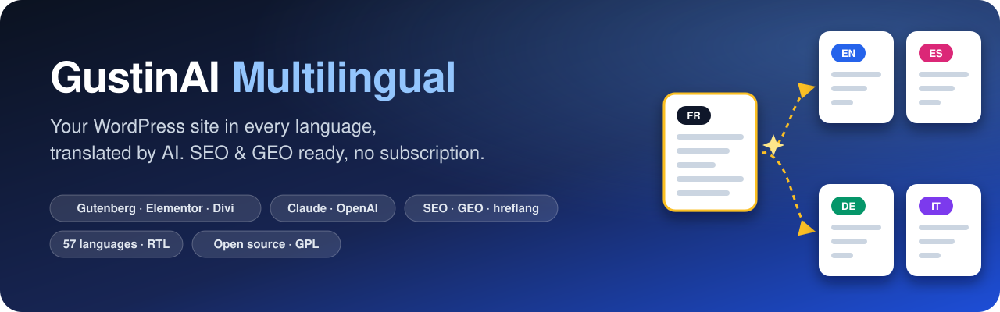
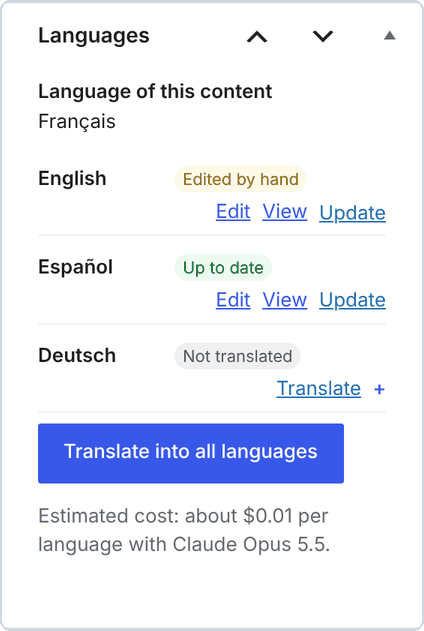
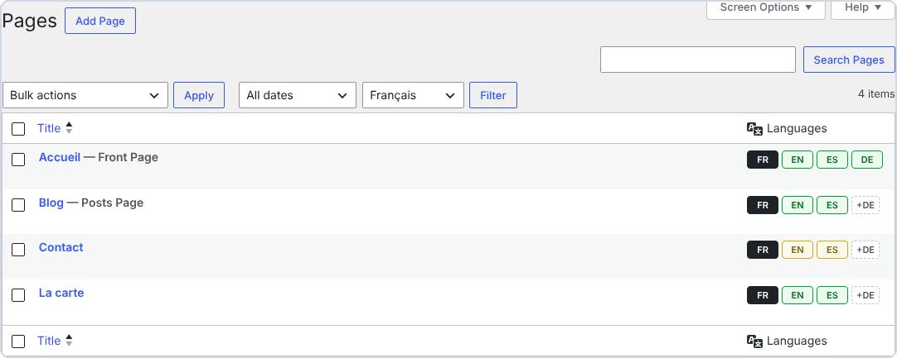
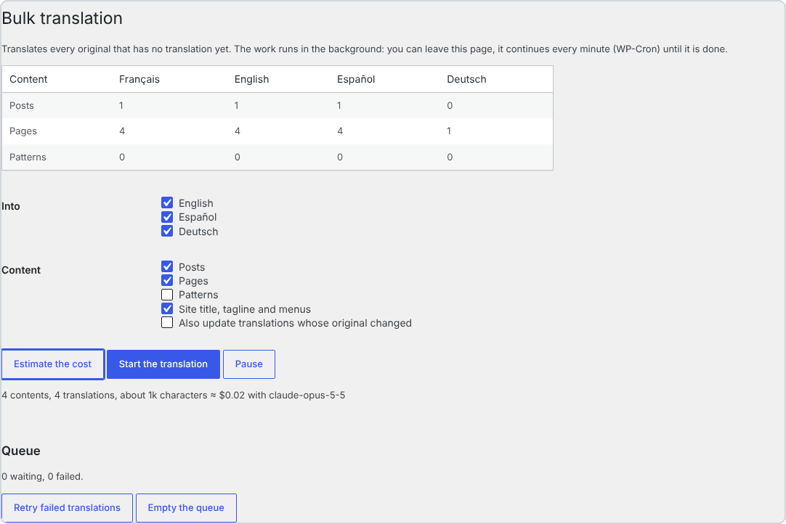
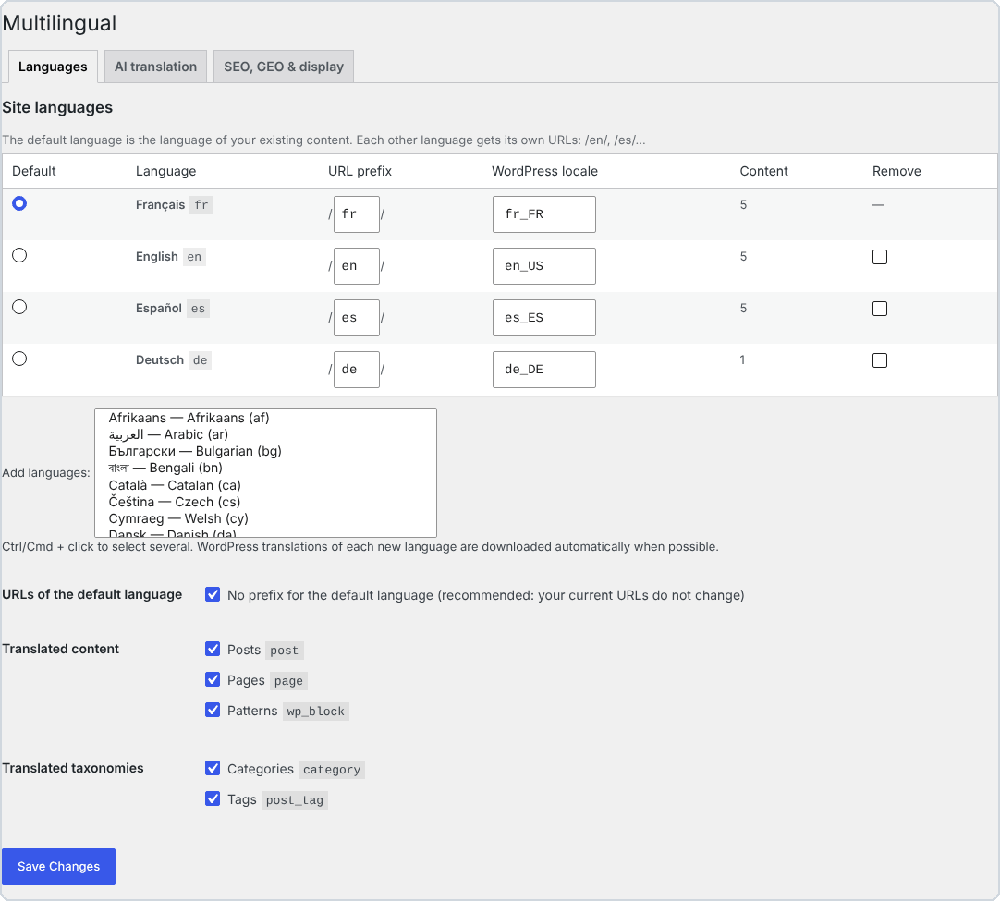
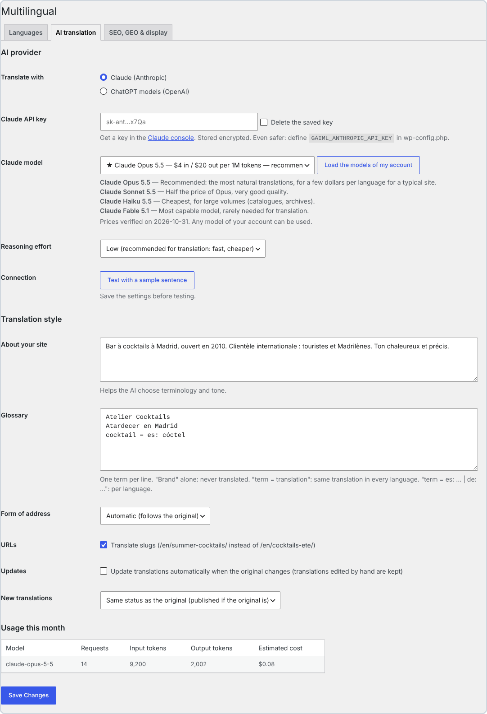
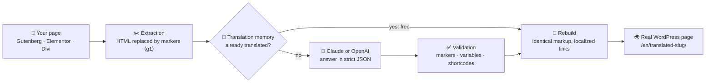
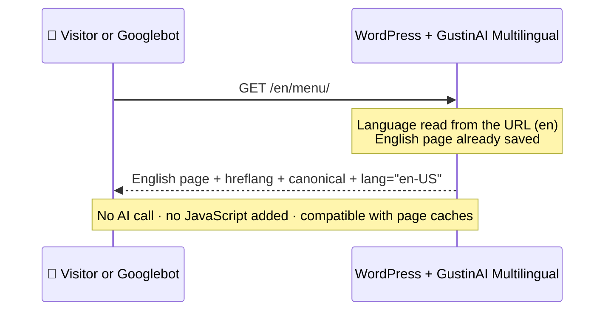

<p align="center">
  
</p>

<p align="center">
  🌐 <b>English</b> · <a href="docs/readme/README.fr.md">Français</a> · <a href="docs/readme/README.es.md">Español</a> · <a href="docs/readme/README.it.md">Italiano</a> · <a href="docs/readme/README.de.md">Deutsch</a> · <a href="docs/readme/README.pt.md">Português</a>
</p>

<p align="center">
  
  
  
  
  
  
  
</p>

> **Turn any WordPress site into a multilingual site translated by AI: real pages, translated URLs, SEO and GEO done right. No subscription and no word quota: you only pay for the AI you use, directly to Anthropic or OpenAI.**

<p align="center">
  <a href="https://github.com/Jacckisback/gustinai-multilingual/raw/main/dist/gustinai-multilingual-1.0.0.zip"><b>⬇️ Download the plugin (.zip)</b></a> ·
  <a href="#-quick-start-in-5-minutes">🚀 Quick start</a> ·
  <a href="#-what-does-it-really-cost">💸 Costs</a> ·
  <a href="#-comparison-with-paid-translation-plugins">📊 Comparison</a> ·
  <a href="#-how-it-works">🧠 How it works</a> ·
  <a href="#-faq">❓ FAQ</a>
</p>

---

## 📑 Contents

- [✨ Why GustinAI Multilingual?](#-why-gustinai-multilingual)
- [🌍 Why make your site multilingual?](#-why-make-your-site-multilingual)
- [📸 See it in action](#-see-it-in-action)
- [🚀 Quick start in 5 minutes](#-quick-start-in-5-minutes)
- [💸 What does it really cost?](#-what-does-it-really-cost)
- [📊 Comparison with paid translation plugins](#-comparison-with-paid-translation-plugins)
- [🧠 How it works](#-how-it-works)
- [🔎 Multilingual SEO, by the book](#-multilingual-seo-by-the-book)
- [🤖 GEO: being visible in AI answers](#-geo-being-visible-in-ai-answers)
- [🧩 Page builders](#-page-builders)
- [⚙️ Under the hood](#️-under-the-hood)
- [🔐 Security and privacy](#-security-and-privacy)
- [🛠️ For developers](#️-for-developers)
- [⚠️ Known limitations](#️-known-limitations)
- [✅ Quality and tests](#-quality-and-tests)
- [❓ FAQ](#-faq)
- [👋 About](#-about)

---

## ✨ Why GustinAI Multilingual?

| | |
|---|---|
| 💸 **No subscription, no word quota** | The plugin is free and open source (GPL). Translation is billed by the AI provider at cost, with your own key: about **$0.06 per page and per language** with Claude Opus 5.5, the most natural model, and less than **$0.002** with Claude Haiku 5.5 (see [costs](#-what-does-it-really-cost)). |
| 🏠 **Your translations belong to you** | Each translation is a real WordPress page stored in **your** database. No third-party server sits between your visitors and your content. |
| 🧱 **Your layout never breaks** | The AI never sees your HTML: only the texts are sent, the markup is replaced by numbered markers and then rebuilt exactly as it was. Gutenberg blocks, Elementor data and Divi modules stay intact. |
| 🔎 **SEO done by the book** | One URL per language, no automatic redirect, `hreflang` + `x-default` on every page, translated slugs and categories: exactly what Google recommends.[^g-multi][^g-hreflang] |
| 🤖 **Ready for AI search engines (GEO)** | One `llms.txt` per language[^llms], structured data linking each page to its translations[^schema], and a translation prompt written for SEO and GEO. |
| ⚡ **Zero AI during visits** | Translations are generated once, in the admin. Visitors get static pages: compatible with every cache and CDN, with no JavaScript added. |

---

## 🌍 Why make your site multilingual?

- 🛒 **People buy in their own language.** In a survey of 8,709 consumers in 29 countries, CSA Research found that **66%** would choose a similar product that has information in their language, and **75%** are more likely to buy the same brand again when customer care speaks their language.[^csa]
- 🧭 **Google needs one URL per language.** Google recommends a separate URL for each language version and `hreflang` tags so it can show the right version to each user.[^g-multi][^g-hreflang] A translation that only appears in the browser, or that depends on a cookie, cannot be indexed.
- 🌐 **WordPress is everywhere.** WordPress powers **39.5%** of all websites and **58.2%** of sites whose CMS is known.[^w3techs] GustinAI Multilingual adds languages to the site you already have, without rebuilding it.

> [!TIP]
> **In plain words:** a multilingual site is not a widget that translates on the fly. It is one page per language, at its own address (`/en/…`, `/es/…`), that Google can read and that a visitor can share. This is exactly what the plugin creates.

---

## 📸 See it in action

<p align="center">
  
  <br><sub>The same page in 4 languages. Each one has its own URL, its translated menu and a language switcher (simple HTML links, no flags). Demo site.</sub>
</p>

<table>
  <tr>
    <td width="38%" valign="top">
      
      <p><b>In the editor:</b> the status of each language (<i>Up to date</i>, <i>Edited by hand</i>, <i>Not translated</i>), one-click translation and the estimated cost.</p>
    </td>
    <td width="62%" valign="top">
      
      <p><b>In your page lists:</b> 🟩 up to date, 🟨 original changed since the translation, <code>+DE</code> = translate into German in one click.</p>
      
      <p><b>Bulk translation:</b> estimate the cost, then translate the whole site in the background.</p>
    </td>
  </tr>
</table>

<details>
<summary>🖼️ <b>More screenshots: languages and AI settings</b></summary>
<br>
<p align="center"><br><sub>Languages: 57 languages, editable URL prefix, default language without prefix (your current URLs don't change).</sub></p>
<p align="center"><br><sub>AI translation: Claude or OpenAI, recommended model with prices, site description, glossary, form of address, monthly usage.</sub></p>
</details>

---

## 🚀 Quick start in 5 minutes

**Requirements:** WordPress 6.5+, PHP 8.1+, “pretty” permalinks, and a Claude (Anthropic) or OpenAI API key.

1. **Install.** [Download the zip](https://github.com/Jacckisback/gustinai-multilingual/raw/main/dist/gustinai-multilingual-1.0.0.zip), then go to **Plugins → Add New → Upload Plugin** and activate it.
2. **Choose your languages.** Go to **Multilingual → Settings → Languages**. Your site's current language becomes the default language. WordPress translations for each new language are downloaded automatically.
3. **Get an API key.**
   - **Claude:** create a key on the [API keys page of the Claude Console](https://platform.claude.com/settings/keys).[^a-key]
   - **OpenAI:** create a key on the OpenAI platform.
4. **Configure the AI.** In **Multilingual → Settings → AI translation**:
   - paste the key and keep the recommended model;
   - describe your site in 2 or 3 sentences, and add your brand names to the glossary;
   - click **Test with a sample sentence**.
5. **Translate.**
   - Click **+EN** next to a page and check the result.
   - Then go to **Multilingual → Bulk translation**: **Estimate the cost**, then **Start the translation**.
6. **Add the language switcher.** Use the *Language switcher* block, the `[gaiml_switcher]` shortcode, or let the plugin add it to a menu automatically.

> [!IMPORTANT]
> **Claude keys and workspaces:** when you create the key, pick the **“Default”** workspace. The Claude API refuses requests made with a key that is not scoped to a workspace unless they carry an extra `anthropic-workspace-id` header, which the plugin does not send.[^a-key]

> [!TIP]
> **Even safer:** declare your keys in `wp-config.php` rather than in the database. They then never appear in the admin.
>
> ```php
> define( 'GAIML_ANTHROPIC_API_KEY', 'sk-ant-...' );
> define( 'GAIML_OPENAI_API_KEY', 'sk-...' );
> ```

> [!NOTE]
> Want to proofread before publishing? Set **New translations** to **Draft, to review before publishing**. Google rewards quality content “however it is produced”.[^g-ai] Proofreading your key pages is the best guarantee.

---

## 💸 What does it really cost?

The plugin is **free**. You only pay the AI provider for the texts you send, with your own key. Prices were checked on the official pages on 2 November 2026:

| Provider | Model | Price per million tokens (input / output) | ≈ Cost per 100 pages of ~800 words, per language* |
|---|---|---|---|
| Claude | **Claude Opus 5.5** ⭐ recommended | $4 / $20[^a-pricing] | **≈ $5.80** |
| Claude | Claude Sonnet 5.5 | $2 / $10[^a-pricing] | ≈ $2.90 |
| Claude | Claude Haiku 5.5 | $0.10 / $0.50[^a-pricing] | ≈ $0.15 |
| OpenAI | **GPT-6.1 Sol** ⭐ recommended | $2 / $10[^o-pricing] | ≈ $2.90 |
| OpenAI | GPT-6.1 Terra | $1 / $5[^o-pricing] | ≈ $1.45 |
| OpenAI | GPT-6 Luna | $0.10 / $0.50[^o-pricing] | ≈ $0.15 |

<sub>* Estimate calculated by the plugin from the public prices: about 1 token per 3.5 characters, plus the instructions and JSON wrapping of each request, with a low reasoning effort. The plugin shows its own estimate for your content before you translate anything.</sub>

> [!TIP]
> **What is a token?** It is the unit the AI providers bill: roughly ¾ of an English word. A page of 800 words is about 1,000 to 1,500 tokens.

**Three mechanisms keep the bill low:**

- 🧠 **Translation memory.** An identical sentence is only paid for once, and an edited page only sends the sentences that changed.
- 🗜️ **Prompt caching.** On Claude, the instructions shared by every request are cached. Cache reads cost 5% of the input price on Opus 5.5 and Sonnet 5.5.[^a-cache]
- 🎚️ **Low reasoning effort by default.** Translating does not need long reasoning, so it is faster and cheaper.

---

## 📊 Comparison with paid translation plugins

### Worked example: a site of 100 pages (~80,000 words) translated into 5 languages

That is **400,000 words to translate**, because WPML and Weglot count words once per target language.[^wpml-words][^weglot-words]

| Solution | What you pay in year 1 | And after that? |
|---|---|---|
| **GustinAI Multilingual** | **$0 plugin + ≈ $29 of AI, once** (Claude Opus 5.5)<br>≈ $14.50 with Sonnet 5.5 or GPT-6.1 Sol, **≈ $0.75** with Haiku 5.5 | **$0 of licence.** Only new or changed texts are sent to the AI. |
| Weglot | **€2,990 / year**: the *Advanced* plan (1,000,000 words, 10 languages), because *Pro* stops at 200,000 words[^weglot][^weglot-words] | Same amount every year. If you cancel, the translations disappear from your site.[^weglot-cancel] |
| WPML | **≈ €614**: the *CMS* plan at €99 (22,500 AI words included) + ≈ €515 of extra words at the public pay-as-you-go rates[^wpml][^wpml-words] | Yearly renewal for updates, plus words for new content. |
| TranslatePress | **≈ €195 to €349 / year**: *Personal* (€99, 50,000 AI words) + 100,000-word packs at €24, or *Developer* (€349, 500,000 words)[^tp] | Yearly licence. The AI word quota is topped up at renewal.[^tp] |
| GTranslate | **$350 / year**: the *Business* plan, the first one with translated URLs (unlimited words)[^gtranslate] | Yearly subscription. Translations are served by GTranslate's proxy.[^gtranslate] |
| Polylang Pro | **€99 / year** (1 site) + the DeepL API, billed separately with your own key[^polylang] | No one-click “translate everything” feature, according to the vendor.[^polylang] |

<sub>Public list prices excluding VAT, checked on the vendors' pages on 2 November 2026; they can change. Our calculations are shown in each cell. For TranslatePress, we assume that words are counted per target language, as WPML and Weglot do. Each competitor offers features that GustinAI Multilingual does not have, such as professional human translation, translation management, multisite and WooCommerce. Compare against your own needs.</sub>

### How each one works

| | GustinAI Multilingual | WPML | Polylang Pro | TranslatePress | Weglot | GTranslate (paid plans) |
|---|---|---|---|---|---|---|
| **Business model** | Free (GPL), AI paid at cost | Licence €39–€199 (1 year of updates) + AI words[^wpml] | Yearly licence from €99[^polylang] | Yearly licence €99–€349[^tp] | Monthly subscription €15–€699[^weglot] | Monthly subscription $12–$50[^gtranslate] |
| **Translation engine** | Claude or OpenAI, the model of your choice, with your key | WPML AI words, DeepL, Google, Microsoft[^wpml-words] | DeepL with your key[^polylang] | TranslatePress AI (quota), Google or DeepL with your key[^tp] | Included in the word quota[^weglot] | Included[^gtranslate] |
| **Where the translations live** | Your database, as real WordPress pages | Your database, one post per language[^wpml-tables] | Your database, content duplicated per language[^polylang] | Your server, kept after the licence expires[^tp] | Weglot's service[^weglot-cancel] | GTranslate's cloud proxy[^gtranslate] |
| **Translated URLs** | ✅ included | ✅ | ✅ | ✅ all paid plans[^tp] | from *Pro* (€79/month)[^weglot] | from *Business* ($35/month)[^gtranslate] |

<sub>WordPress, WPML, Polylang, TranslatePress, Weglot, GTranslate, Claude, OpenAI, ChatGPT, Elementor and Divi are trademarks of their respective owners. GustinAI Multilingual is an independent project, not affiliated with them.</sub>

---

## 🧠 How it works



**Example.** Here is what happens to a sentence from your page:

| Step | Content |
|---|---|
| 1. Your original HTML | `<p>Réservez <strong>aujourd’hui</strong> dans <a href="/contact/">notre bar</a>.</p>` |
| 2. What the AI receives | `Réservez <g1>aujourd’hui</g1> dans <g2>notre bar</g2>.` |
| 3. What the AI returns | `Book <g1>today</g1> at <g2>our bar</g2>.` |
| 4. What gets saved | `<p>Book <strong>today</strong> at <a href="/en/contact/">our bar</a>.</p>` |

- The AI only ever sees text and markers. It **cannot** break a tag or a block, or inject HTML.
- The link was localized automatically, from `/contact/` to `/en/contact/`, because that page has an English translation.

**When a visitor arrives:**



---

## 🔎 Multilingual SEO, by the book

Each recommendation from Google and the W3C, and what the plugin does about it:

| Recommendation | What GustinAI Multilingual does |
|---|---|
| Use **different URLs for each language**.[^g-multi] | Sub-directories `/en/`, `/es/`… The default language can keep its current URLs, without a prefix. |
| **Avoid automatically redirecting** users based on their language.[^g-multi] | The language comes **only from the URL**: no cookie, no detection. Googlebot sees every version. |
| Each language version must **list itself as well as all the other versions** (`hreflang`), plus `x-default`.[^g-hreflang] | `hreflang` tags are generated on every page, both ways, only towards translations that are actually published. |
| Translate the **main content**, not just the boilerplate around it.[^g-multi] | Everything is translated: content, page-builder data, SEO title and description, image `alt` texts, slugs, categories, tags and menus. |
| Declare the **language of the page** (accessibility).[^wcag] Add `dir="rtl"` for right-to-left languages.[^w3c-dir] | `<html lang="en-US">` on every page and `dir="rtl"` for Arabic, Hebrew, Persian and Urdu. |
| **Don't use flags** to indicate languages.[^w3c-flags] | The switcher shows names or codes (EN, Español…), as plain HTML links that search engines can crawl. |
| XML sitemaps (built into WordPress since 5.5).[^wp-sitemaps] | Every active language is listed in `/wp-sitemap.xml`. Yoast SEO and Rank Math pick up the right URLs. |

**Also included:**

- Translated slugs (`/en/summer-cocktails/`), or the same slug in every language if you prefer (`/contact/` and `/en/contact/`).
- Fields translated for Yoast SEO, Rank Math, SEOPress, The SEO Framework and AIOSEO.
- No duplicate content: an `/en/` URL never shows an untranslated page, and a wrong URL redirects to the translation in the requested language.

> [!TIP]
> **What is `hreflang`?** It is a tag in the page code that tells Google: “this page also exists in Spanish, here is its address”. Google then shows the right version to each user.

---

## 🤖 GEO: being visible in AI answers

**GEO** (*Generative Engine Optimization*) means optimizing your content for answer engines such as ChatGPT, Claude, Perplexity and Google's AI Overviews. A 2024 paper presented at the KDD conference showed that suitable optimizations **can boost visibility by up to 40%** in these answers.[^geo]

- 📄 **`llms.txt` in every language** (`/llms.txt`, `/en/llms.txt`…). This format, proposed in 2024, gives AI models a clean Markdown index of your site.[^llms]
- 🧬 **Structured data.** `inLanguage`, `workTranslation` and `translationOfWork`[^schema] tell AI models that two pages are translations of each other. They are added to the Yoast SEO or Rank Math graph, or emitted alone if you don't use an SEO plugin.
- ✍️ **A translation prompt written for SEO and GEO.** It asks for the vocabulary people actually search for in the target language and explicit headings, and forbids invented information.
- 🔗 **Internal links that stay in the language.** An English page links to English pages, so the AI models that read it stay in the right language.

---

## 🧩 Page builders

| Builder | What is translated |
|---|---|
| **Gutenberg** (block editor) | Texts, block attributes (buttons, search, navigation…) and synced patterns, whose blocks then point to the translated pattern. Translated blocks stay valid in the editor. |
| **Elementor** | Every text widget (heading, text editor, button, tabs, accordions, forms, carousels…), links and images. The CSS is regenerated, and Elementor templates (header, footer, popup) are replaced by their translation. |
| **Divi 4** (shortcodes) and **Divi 5** (blocks) | Module texts, titles, buttons and links. The *Code* module is never translated. |
| **Classic editor** | Texts, custom HTML and form shortcodes, which are left untouched. |

🛡️ **Never translated:** `<code>`, `<pre>`, `<script>`, `<style>`, `<svg>`, and any element marked `translate="no"` or `class="notranslate"`.

---

## ⚙️ Under the hood

What makes the plugin light, fast and reliable:

**🗃️ Data model**
- A single indexed table, `wp_gaiml_translations`, maps `(object type, ID)` to `(language, translation group)`. A `UNIQUE (group, language)` key guarantees one translation per language.
- Translations are ordinary WordPress posts and terms. Your themes, plugins, caches and backups handle them like any other content.

**🧭 Routing**
- The language is read from the URL before WordPress loads its translations, so WordPress, your theme and your plugins display their own texts in the visitor's language.
- `home_url()` gets the language prefix: archives, search, feeds and pagination all stay in the language without extra code.

**⚡ Performance**
- Language filtering is a single indexed `LEFT JOIN`, with no `meta_query`.
- The languages of pages, terms and menus are loaded in batches.
- Measured on our test site: **about 10 extra indexed queries per page, with no measurable time**. That site ran WordPress 7.1.4, PHP 8.3 and MariaDB 10.11.
- No JavaScript is added for visitors. The switcher CSS (1 KB) is printed inline only when the switcher is displayed.

**🤖 Translation engine**
- **Batches:** up to 6,000 characters and 120 texts per request. If an answer is cut off, the batch is halved automatically.
- **Guaranteed output format:** the answers follow a strict JSON schema, through structured outputs on Claude[^a-so] and on OpenAI[^o-so].
- **Validation:** each text must keep its markers and its variables (`%%title%%`, `%s`, `{{name}}`…). An invalid text stays in the original language: **never broken HTML**.
- **Adaptive:** if a model rejects a parameter (reasoning effort, JSON format), the plugin drops it and remembers it for that model, so any model of your account works.

**🔁 Background queue**
- Jobs are claimed atomically, with a 15-minute lock and up to 6 attempts with increasing delays.
- The queue runs in the background with WP-Cron, or from the command line with WP-CLI. You can close the page.

**✍️ Respect for your edits**
- Each translation stores the fingerprint of the original it was made from and of the text the AI generated.
- So the plugin knows when the original changed (*Original changed*) and when someone edited the translation (*Edited by hand*).
- A translation edited by hand is **never** overwritten automatically.

---

## 🔐 Security and privacy

- 🔑 **Encrypted API keys.** Keys saved in the database are encrypted with libsodium (XSalsa20-Poly1305) and never shown again. Even better: declare them as constants in `wp-config.php`.
- 👮 **Permissions.**
  - Every action checks a nonce and the user's rights.
  - A contributor can only translate what they can edit and publish.
  - They cannot overwrite a translation they are not allowed to modify.
- 🧱 **AI output neutralized.**
  - Only the expected markers are restored. Everything else is escaped, square brackets included, so the AI cannot inject a tag or a shortcode.
  - HTML attributes are read one by one and replaced by position.
- 🗄️ **Robust SQL.** Queries are prepared, and the queue uses atomic locks that withstand concurrent requests.
- 🕵️ **Privacy.**
  - Only your content texts are sent, never your visitors' data.
  - Calls go only to `api.anthropic.com` or `api.openai.com`, and OpenAI requests are sent with `store: false`.
  - By default, neither Anthropic nor OpenAI use API data to train their models.[^a-data][^o-data]

---

## 🛠️ For developers

**WP-CLI**

```bash
wp gaiml translate 12 34 --lang=en,es   # translate content items and wait for the result
wp gaiml translate 7 --type=term        # translate a category
wp gaiml bulk --lang=en                 # everything missing, pages first (--queue-only: let WP-Cron do it)
wp gaiml queue status|run|retry|clear
wp gaiml status                         # languages, content, usage this month
```

**PHP functions**

- `gaiml_current_language()`, `gaiml_default_language()` and `gaiml_languages()`.
- `gaiml_get_translation( $id, $lang, 'post'|'term' )` and `gaiml_post_language( $id )`.
- `gaiml_home_url( $lang )` and `gaiml_language_switcher( $args )`.

**REST API and queries**

- The REST API exposes the fields `gaiml_lang` and `gaiml_translations`, and accepts the `?lang=en` parameter on every route.
- `WP_Query` accepts `'gaiml_lang' => 'en'`, `'all'` or `'active'`.
- `get_posts()` is only filtered with `'suppress_filters' => false`, as with WPML.

**Hooks**

- **Filters:** `gaiml_post_types`, `gaiml_taxonomies`, `gaiml_translatable_meta` (custom fields to translate), `gaiml_meta_skip`, `gaiml_strings`, `gaiml_system_prompt`, `gaiml_known_models`, `gaiml_provider`, `gaiml_hreflang`, `gaiml_alternates`, `gaiml_llms_txt`, `gaiml_switcher_css` and `gaiml_exclude_post`.
- **Actions:** `gaiml_post_translated`, `gaiml_translations_changed` and `gaiml_loaded`.

Internal architecture (in French): [docs/ARCHITECTURE.md](docs/ARCHITECTURE.md).

---

## ⚠️ Known limitations

Version 1.0 has a few limits:

- **URL structure:** sub-directories only. Sub-domains and one domain per language are not supported.
- **WooCommerce:** don't select *Products*, because stock and prices are not synchronized between languages.
- **Block themes:**
  - Customized template parts such as headers and footers are not translated, except for the navigation, site title and tagline.
  - The Divi Theme Builder is not supported.
- **Custom fields (ACF):** declare them with the `gaiml_translatable_meta` filter.
- **Divi 5:** support is based on Divi 5's public block format and still needs to be validated on a real site.

---

## ✅ Quality and tests

| Test suite | Checks | What it covers |
|---|---|---|
| `php tests/unit.php` | 52 | Text extraction: Gutenberg, Divi 4 and 5, Elementor, injection attempts |
| `wp eval-file tests/e2e/providers.php` | 28 | Claude and OpenAI connectors, with simulated API answers |
| `wp eval-file tests/e2e/engine.php` | 7 | Robustness: truncated answers, broken markup |
| `wp eval-file tests/e2e/review.php` | 24 | Non-regression: trash, concurrency, slugs, sitemaps, locks |

**Also tested:**

- In the browser: the admin pages, 0 invalid Gutenberg blocks after translation, and Elementor with no JavaScript errors.
- A clean install from the zip.
- Static security analysis with PHPCS (WordPress.Security, PreparedSQL, PHPCompatibility 8.1).

**Test environment:**

- WordPress 7.1.4, PHP 8.3 and MariaDB 10.11.
- Elementor 4.3.5.
- The Twenty Twenty-Five (block) and Twenty Twenty-One (classic) themes.

Build the zip yourself: `bin/build.sh`.

---

## ❓ FAQ

<details>
<summary><b>Will Google penalize pages translated by AI?</b></summary>

Google says it rewards quality content “however it is produced”, and that “appropriate use of AI or automation is not against our guidelines”.[^g-ai] To aim for quality:

- describe your site and fill in the glossary;
- choose a good model;
- proofread your key pages (you can publish new translations as drafts).

Your manual edits are protected.
</details>

<details>
<summary><b>What happens to my translations if I uninstall the plugin?</b></summary>

They stay in your database as normal WordPress pages and posts: you keep all your content. Without the plugin, however, WordPress no longer knows which language each page is in.

The plugin's tables and settings are only deleted if you tick the corresponding option before uninstalling.
</details>

<details>
<summary><b>Can I edit a translation by hand?</b></summary>

Yes, like any WordPress page, with your usual builder. The plugin detects the edit (*Edited by hand* status) and never overwrites it automatically.
</details>

<details>
<summary><b>Do my visitors trigger AI calls?</b></summary>

Never. Translations are created in the admin, then served as normal pages. A visit costs nothing in AI.
</details>

<details>
<summary><b>Which model should I choose?</b></summary>

- **Claude Opus 5.5** gives the most natural translations, for a few dollars per language on a typical site.
- **Claude Sonnet 5.5** or **GPT-6.1 Sol** cost half as much, with very good quality.
- **Claude Haiku 5.5** or **GPT-6 Luna** suit very large volumes, such as catalogs and archives.

Any model of your account can be used.
</details>

<details>
<summary><b>Is my content used to train AI models?</b></summary>

Not by default. Anthropic does not use inputs and outputs from its commercial products, including the API, to train its models,[^a-data] and OpenAI does not use data sent to its API unless you opt in.[^o-data]
</details>

<details>
<summary><b>How many languages are available?</b></summary>

57 languages, including regional variants (fr-CA, pt-BR, es-MX, de-CH…) and 4 right-to-left languages (Arabic, Hebrew, Persian, Urdu). You can change each language's URL prefix.
</details>

---

## 👋 About

GustinAI Multilingual is developed by **Thierry Gustin**, founder of **[GustinAI](https://gustinai.com)**, which provides AI training for companies in France and Spain.

- 💼 **Need help launching a multilingual site, or training your team to use AI effectively?** → [gustinai.com](https://gustinai.com)
- ⭐ **This plugin saves you a subscription?** Give the repository a star: it helps other people find it.
- 🐛 **Found a bug or have an idea?** Open an [issue](https://github.com/Jacckisback/gustinai-multilingual/issues).

## 📄 License

[GPL-2.0-or-later](LICENSE): free to use, modify and redistribute.

---

## 📚 Sources

All the figures and recommendations quoted above are sourced below. The pages were checked on 2 November 2026.

[^csa]: CSA Research, *Does Language Matter? The Impact of Language on the Customer Journey* (Can't Read, Won't Buy – B2C), 10 June 2020: 8,709 consumers in 29 countries. <https://csa-research.com/Blogs-Events/Blog/customer-online-buying-experience>
[^w3techs]: W3Techs, *Usage statistics and market share of WordPress* (2 November 2026). <https://w3techs.com/technologies/details/cm-wordpress>
[^g-multi]: Google Search Central, *Managing multi-regional and multilingual sites*. <https://developers.google.com/search/docs/specialty/international/managing-multi-regional-sites>
[^g-hreflang]: Google Search Central, *Tell Google about localized versions of your page*. <https://developers.google.com/search/docs/specialty/international/localized-versions>
[^g-ai]: Google Search Central Blog, *Google Search's guidance about AI-generated content*, February 2023. <https://developers.google.com/search/blog/2023/02/google-search-and-ai-content>
[^llms]: Jeremy Howard, *The /llms.txt file*, proposal of 3 September 2024. <https://llmstxt.org/>
[^geo]: P. Aggarwal et al., *GEO: Generative Engine Optimization*, KDD 2024 (arXiv:2311.09735). <https://arxiv.org/abs/2311.09735>
[^schema]: Schema.org, properties `workTranslation` / `translationOfWork` and `inLanguage`. <https://schema.org/workTranslation>, <https://schema.org/inLanguage>
[^wcag]: W3C, WCAG 2.2, *Understanding Success Criterion 3.1.1: Language of Page*. <https://www.w3.org/WAI/WCAG22/Understanding/language-of-page.html>
[^w3c-dir]: W3C Internationalization, *Structural markup and right-to-left text in HTML*. <https://www.w3.org/International/questions/qa-html-dir>
[^w3c-flags]: W3C Internationalization, *Indicating the language of a link destination* (“Don't use flags to indicate languages!”). <https://www.w3.org/International/questions/qa-link-lang>
[^wp-sitemaps]: Make WordPress Core, *New XML Sitemaps Functionality in WordPress 5.5*, 22 July 2020. <https://make.wordpress.org/core/2020/07/22/new-xml-sitemaps-functionality-in-wordpress-5-5/>
[^a-pricing]: Anthropic, *Pricing* (Claude API). <https://platform.claude.com/docs/en/about-claude/pricing>
[^o-pricing]: OpenAI, *API Pricing*. <https://developers.openai.com/api/docs/pricing>
[^a-cache]: Anthropic, *Prompt caching*. <https://platform.claude.com/docs/en/build-with-claude/prompt-caching>
[^a-so]: Anthropic, *Structured outputs*. <https://platform.claude.com/docs/en/build-with-claude/structured-outputs>
[^o-so]: OpenAI, *Structured Outputs*. <https://developers.openai.com/api/docs/guides/structured-outputs>
[^a-data]: Anthropic Privacy Center, *Is my data used for model training?* <https://privacy.claude.com/en/articles/7996868-is-my-data-used-for-model-training>
[^o-data]: OpenAI, *Data controls in the OpenAI platform*. <https://developers.openai.com/api/docs/guides/your-data>
[^a-key]: Anthropic, *Get your Claude API key* and *Authentication: Select a workspace*. <https://platform.claude.com/docs/en/get-api-key>, <https://platform.claude.com/docs/en/manage-claude/authentication>
[^wpml]: WPML, *Pricing*: Multilingual Blog €39, Multilingual CMS €99 (22,500 AI words), Multilingual Agency €199 (45,000 AI words). <https://app.wpml.org/purchase>
[^wpml-words]: WPML, *Pricing for Automatic Translation*: words counted “once per language you translate into”; pay-as-you-go from €3.00 down to €0.40 per 1,000 words. <https://wpml.org/documentation/automatic-translation/automatic-translation-pricing/>
[^wpml-tables]: WPML, *WPML's Database Tables* (`icl_translations` table: a post and its translation are two separate entries). <https://wpml.org/documentation/support/wpml-tables/>
[^polylang]: Polylang, *Polylang Pro*: from €99/year for 1 site, DeepL integration with your own API key, “does not provide a one-click ‘translate everything’ feature”. <https://polylang.pro/pricing/polylang-pro/>
[^tp]: TranslatePress, *Pricing*: Personal €99/year (50K AI words), Business €199 (200K), Developer €349 (500K), 100K extra words for €24, translations kept on your server after the licence expires. <https://translatepress.com/pricing/>
[^weglot]: Weglot, *Pricing*: Starter €15/month (10,000 words, 1 language) to Extended €699/month; Pro €79/month (200,000 words, 5 languages, translated URLs); Advanced €299/month or €2,990/year (1,000,000 words, 10 languages). <https://www.weglot.com/pricing>
[^weglot-words]: Weglot Help Center, *What is the number of translated words and how is it calculated?* (“3 x 8,000 = 24,000 translated words”). <https://support.weglot.com/article/59-total-number-translated-words>
[^weglot-cancel]: Weglot Help Center, *How can I pause/cancel my subscription*: after cancelling, “your translations won't appear” and “your translated pages will be progressively removed from search engines”. <https://support.weglot.com/article/247-how-to-cancel-my-subscription>
[^gtranslate]: GTranslate, home page and plans: Custom $12, Startup $25, Business $35 (URL translation), Enterprise $50 per month; paid plans “work as a translation proxy”, with translations hosted on GTranslate's cloud network. <https://gtranslate.io/>
