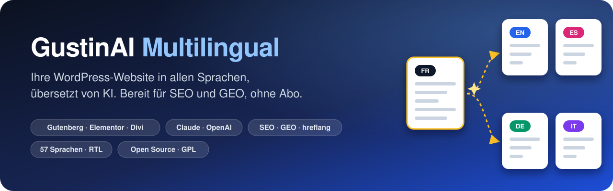
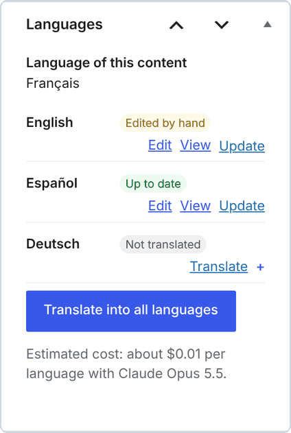
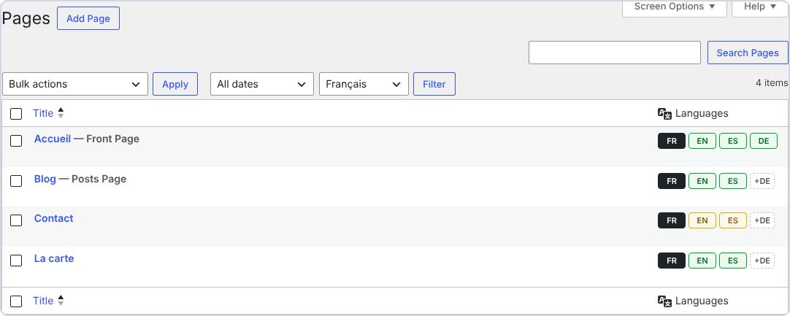
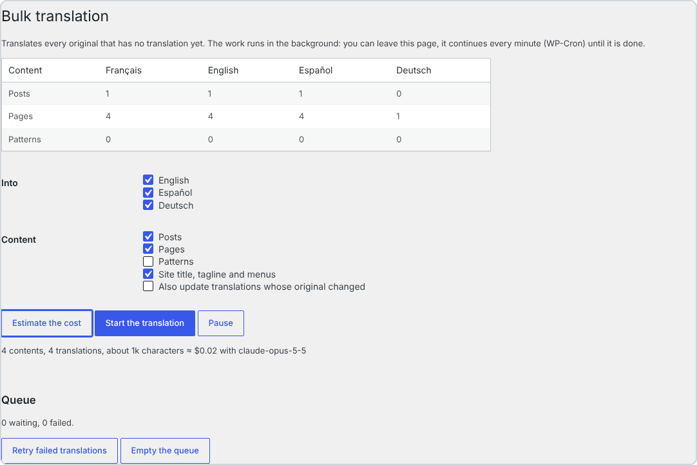
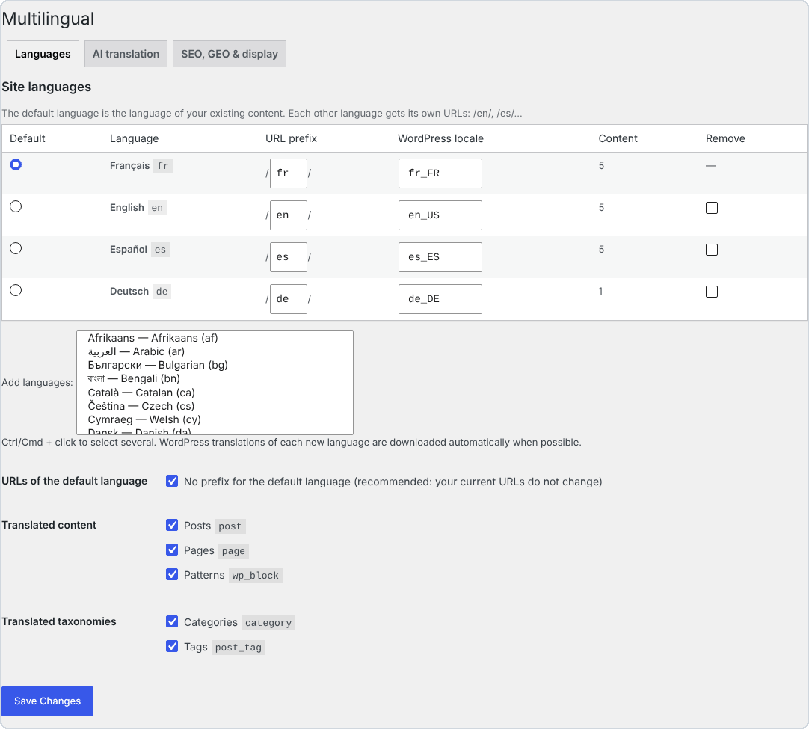
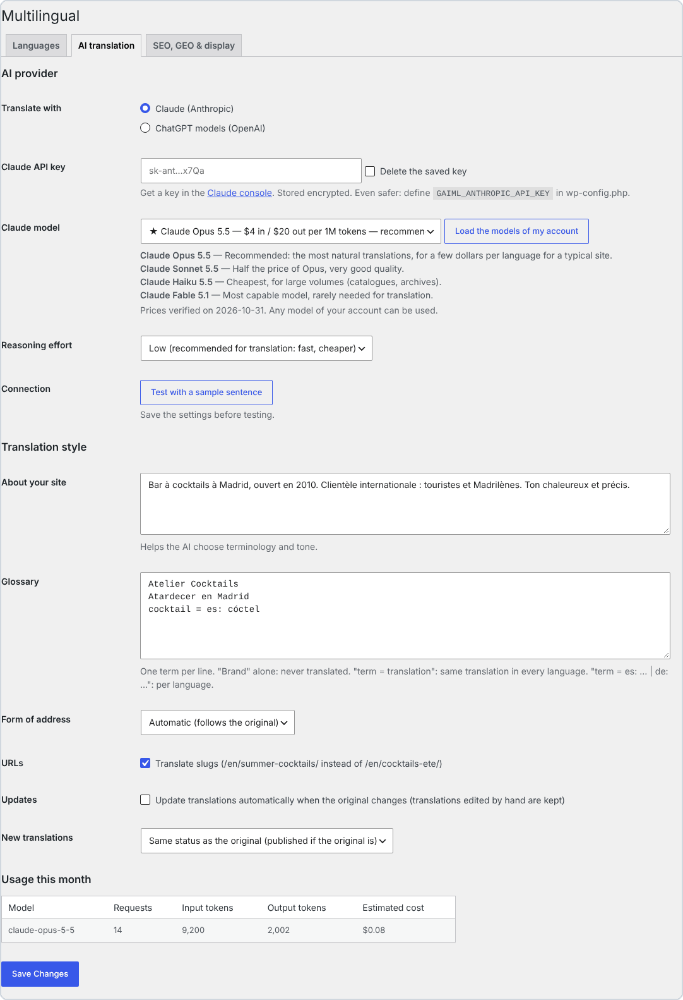
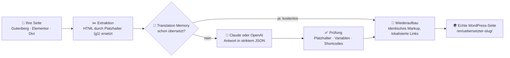
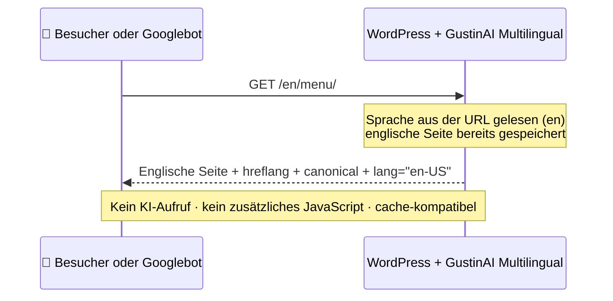

<p align="center">
  
</p>

<p align="center">
  🌐 <a href="../../README.md">English</a> · <a href="README.fr.md">Français</a> · <a href="README.es.md">Español</a> · <a href="README.it.md">Italiano</a> · <b>Deutsch</b> · <a href="README.pt.md">Português</a>
</p>

<p align="center">
  
  
  
  
  
  
  
</p>

> **Machen Sie aus jeder WordPress-Website eine mehrsprachige Website, übersetzt von KI: echte Seiten, übersetzte URLs, sauberes SEO und GEO. Kein Abo und kein Wortkontingent: Sie bezahlen nur die KI, die Sie nutzen, direkt an Anthropic oder OpenAI.**

<p align="center">
  <a href="https://github.com/Jacckisback/gustinai-multilingual/raw/main/dist/gustinai-multilingual-1.0.0.zip"><b>⬇️ Plugin herunterladen (.zip)</b></a> ·
  <a href="#-in-5-minuten-startklar">🚀 Schnellstart</a> ·
  <a href="#-was-kostet-es-wirklich">💸 Kosten</a> ·
  <a href="#-vergleich-mit-kostenpflichtigen-übersetzungs-plugins">📊 Vergleich</a> ·
  <a href="#-so-funktioniert-es">🧠 Funktionsweise</a> ·
  <a href="#-faq">❓ FAQ</a>
</p>

---

## 📑 Inhalt

- [✨ Warum GustinAI Multilingual?](#-warum-gustinai-multilingual)
- [🌍 Warum eine mehrsprachige Website?](#-warum-eine-mehrsprachige-website)
- [📸 In Bildern](#-in-bildern)
- [🚀 In 5 Minuten startklar](#-in-5-minuten-startklar)
- [💸 Was kostet es wirklich?](#-was-kostet-es-wirklich)
- [📊 Vergleich mit kostenpflichtigen Übersetzungs-Plugins](#-vergleich-mit-kostenpflichtigen-übersetzungs-plugins)
- [🧠 So funktioniert es](#-so-funktioniert-es)
- [🔎 Mehrsprachiges SEO nach allen Regeln](#-mehrsprachiges-seo-nach-allen-regeln)
- [🤖 GEO: in KI-Antworten sichtbar sein](#-geo-in-ki-antworten-sichtbar-sein)
- [🧩 Page-Builder](#-page-builder)
- [⚙️ Unter der Haube](#️-unter-der-haube)
- [🔐 Sicherheit und Datenschutz](#-sicherheit-und-datenschutz)
- [🛠️ Für Entwickler](#️-für-entwickler)
- [⚠️ Bekannte Einschränkungen](#️-bekannte-einschränkungen)
- [✅ Qualität und Tests](#-qualität-und-tests)
- [❓ FAQ](#-faq)
- [👋 Über uns](#-über-uns)

---

## ✨ Warum GustinAI Multilingual?

| | |
|---|---|
| 💸 **Kein Abo, kein Wortkontingent** | Das Plugin ist kostenlos und Open Source (GPL). Die Übersetzung rechnet der KI-Anbieter zum Selbstkostenpreis ab, mit Ihrem eigenen Schlüssel: etwa **0,06 $ pro Seite und Sprache** mit Claude Opus 5.5, dem natürlichsten Modell, und weniger als **0,002 $** mit Claude Haiku 5.5 (siehe [Kosten](#-was-kostet-es-wirklich)). |
| 🏠 **Ihre Übersetzungen gehören Ihnen** | Jede Übersetzung ist eine echte WordPress-Seite in **Ihrer** Datenbank. Kein fremder Server steht zwischen Ihren Besuchern und Ihren Inhalten. |
| 🧱 **Ihr Layout bleibt immer intakt** | Die KI sieht Ihr HTML nie: Sie erhält nur die Texte. Das Markup wird durch nummerierte Platzhalter ersetzt und danach exakt wiederhergestellt. Gutenberg-Blöcke, Elementor-Daten und Divi-Module bleiben unverändert. |
| 🔎 **SEO nach allen Regeln** | Eine URL pro Sprache, keine automatische Weiterleitung, `hreflang` + `x-default` auf jeder Seite, übersetzte Slugs und Kategorien: genau das, was Google empfiehlt.[^g-multi][^g-hreflang] |
| 🤖 **Bereit für KI-Suchmaschinen (GEO)** | Eine `llms.txt` pro Sprache[^llms], strukturierte Daten, die jede Seite mit ihren Übersetzungen verknüpfen[^schema], und ein Übersetzungs-Prompt, der für SEO und GEO geschrieben ist. |
| ⚡ **Keine KI während der Besuche** | Übersetzungen entstehen einmal, im Backend. Besucher erhalten statische Seiten: kompatibel mit jedem Cache und CDN, ohne zusätzliches JavaScript. |

---

## 🌍 Warum eine mehrsprachige Website?

- 🛒 **Gekauft wird in der eigenen Sprache.** In einer Umfrage unter 8.709 Verbrauchern aus 29 Ländern stellte CSA Research fest: **66 %** würden ein vergleichbares Produkt wählen, wenn die Informationen in ihrer Sprache vorliegen, und **75 %** kaufen eher wieder bei derselben Marke, wenn der Kundenservice ihre Sprache spricht.[^csa]
- 🧭 **Google braucht eine URL pro Sprache.** Google empfiehlt für jede Sprachversion eine eigene URL sowie `hreflang`-Tags, damit jeder Nutzer die passende Version sieht.[^g-multi][^g-hreflang] Eine Übersetzung, die nur im Browser existiert oder von einem Cookie abhängt, kann nicht indexiert werden.
- 🌐 **WordPress ist überall.** WordPress betreibt **39,5 %** aller Websites und **58,2 %** der Websites mit bekanntem CMS.[^w3techs] GustinAI Multilingual ergänzt Ihre bestehende Website um weitere Sprachen, ohne sie neu aufzubauen.

> [!TIP]
> **Einfach gesagt:** Eine mehrsprachige Website ist kein Widget, das spontan übersetzt. Es ist eine Seite pro Sprache, unter einer eigenen Adresse (`/en/…`, `/es/…`), die Google lesen und ein Besucher teilen kann. Genau das erzeugt das Plugin.

---

## 📸 In Bildern

<p align="center">
  
  <br><sub>Dieselbe Seite in 4 Sprachen. Jede hat ihre eigene URL, ihr übersetztes Menü und einen Sprachumschalter (einfache HTML-Links, keine Flaggen). Demo-Website.</sub>
</p>

> [!NOTE]
> Die Admin-Oberfläche des Plugins ist auf Englisch, Französisch und Spanisch verfügbar. Die folgenden Screenshots zeigen die englische Version.

<table>
  <tr>
    <td width="38%" valign="top">
      
      <p><b>Im Editor:</b> der Status jeder Sprache (<i>Up to date</i>, <i>Edited by hand</i>, <i>Not translated</i>), Übersetzung per Klick und die geschätzten Kosten.</p>
    </td>
    <td width="62%" valign="top">
      
      <p><b>In Ihren Seitenlisten:</b> 🟩 aktuell, 🟨 Original seit der Übersetzung geändert, <code>+DE</code> = per Klick ins Deutsche übersetzen.</p>
      
      <p><b>Massenübersetzung:</b> Kosten schätzen, dann die ganze Website im Hintergrund übersetzen.</p>
    </td>
  </tr>
</table>

<details>
<summary>🖼️ <b>Weitere Screenshots: Sprach- und KI-Einstellungen</b></summary>
<br>
<p align="center"><br><sub>Sprachen: 57 Sprachen, anpassbares URL-Präfix, Standardsprache ohne Präfix (Ihre bisherigen URLs ändern sich nicht).</sub></p>
<p align="center"><br><sub>KI-Übersetzung: Claude oder OpenAI, empfohlenes Modell mit Preisen, Beschreibung der Website, Glossar, Anrede (Sie oder du), Verbrauch des Monats.</sub></p>
</details>

---

## 🚀 In 5 Minuten startklar

**Voraussetzungen:** WordPress 6.5+, PHP 8.1+, „schöne“ Permalinks und ein API-Schlüssel von Claude (Anthropic) oder OpenAI.

1. **Installieren.** [Laden Sie das ZIP herunter](https://github.com/Jacckisback/gustinai-multilingual/raw/main/dist/gustinai-multilingual-1.0.0.zip), gehen Sie zu **Plugins → Neues Plugin hinzufügen → Plugin hochladen** und aktivieren Sie es.
2. **Sprachen wählen.** Gehen Sie zu **Multilingual → Settings → Languages**. Die aktuelle Sprache Ihrer Website wird zur Standardsprache. Die WordPress-Übersetzungen jeder neuen Sprache werden automatisch heruntergeladen.
3. **API-Schlüssel besorgen.**
   - **Claude:** Erstellen Sie einen Schlüssel auf der [Seite „API keys“ der Claude Console](https://platform.claude.com/settings/keys).[^a-key]
   - **OpenAI:** Erstellen Sie einen Schlüssel auf der OpenAI-Plattform.
4. **KI einrichten.** Unter **Multilingual → Settings → AI translation**:
   - fügen Sie den Schlüssel ein und behalten Sie das empfohlene Modell bei;
   - beschreiben Sie Ihre Website in 2 oder 3 Sätzen und tragen Sie Ihre Markennamen ins Glossar ein;
   - klicken Sie auf **Test with a sample sentence**.
5. **Übersetzen.**
   - Klicken Sie neben einer Seite auf **+EN** und prüfen Sie das Ergebnis.
   - Gehen Sie dann zu **Multilingual → Bulk translation**: **Estimate the cost**, danach **Start the translation**.
6. **Sprachumschalter hinzufügen.** Nutzen Sie den Block *Language switcher*, den Shortcode `[gaiml_switcher]`, oder lassen Sie das Plugin ihn automatisch einem Menü hinzufügen.

> [!IMPORTANT]
> **Claude-Schlüssel und Workspaces:** Wählen Sie beim Erstellen des Schlüssels den Workspace **„Default“**. Die Claude-API lehnt Anfragen mit einem Schlüssel ohne Workspace ab, es sei denn, sie enthalten den zusätzlichen Header `anthropic-workspace-id`, den das Plugin nicht sendet.[^a-key]

> [!TIP]
> **Noch sicherer:** Hinterlegen Sie Ihre Schlüssel in der `wp-config.php` statt in der Datenbank. Dann tauchen sie nie im Backend auf.
>
> ```php
> define( 'GAIML_ANTHROPIC_API_KEY', 'sk-ant-...' );
> define( 'GAIML_OPENAI_API_KEY', 'sk-...' );
> ```

> [!NOTE]
> Sie möchten vor der Veröffentlichung Korrektur lesen? Stellen Sie **New translations** auf **Draft, to review before publishing**. Google belohnt hochwertige Inhalte „unabhängig davon, wie sie erstellt wurden“.[^g-ai] Ihre wichtigsten Seiten gegenzulesen bleibt die beste Absicherung.

---

## 💸 Was kostet es wirklich?

Das Plugin ist **kostenlos**. Sie bezahlen dem KI-Anbieter nur die Texte, die Sie senden, mit Ihrem eigenen Schlüssel. Preise am 2. November 2026 auf den offiziellen Seiten geprüft:

| Anbieter | Modell | Preis pro Million Token (Eingabe / Ausgabe) | ≈ Kosten für 100 Seiten mit je ca. 800 Wörtern, pro Sprache* |
|---|---|---|---|
| Claude | **Claude Opus 5.5** ⭐ empfohlen | 4 $ / 20 $[^a-pricing] | **≈ 5,80 $** |
| Claude | Claude Sonnet 5.5 | 2 $ / 10 $[^a-pricing] | ≈ 2,90 $ |
| Claude | Claude Haiku 5.5 | 0,10 $ / 0,50 $[^a-pricing] | ≈ 0,15 $ |
| OpenAI | **GPT-6.1 Sol** ⭐ empfohlen | 2 $ / 10 $[^o-pricing] | ≈ 2,90 $ |
| OpenAI | GPT-6.1 Terra | 1 $ / 5 $[^o-pricing] | ≈ 1,45 $ |
| OpenAI | GPT-6 Luna | 0,10 $ / 0,50 $[^o-pricing] | ≈ 0,15 $ |

<sub>* Schätzung des Plugins auf Basis der öffentlichen Preise: etwa 1 Token pro 3,5 Zeichen, zuzüglich der Anweisungen und der JSON-Hülle jeder Anfrage, mit niedrigem Denkaufwand. Das Plugin zeigt Ihnen vor jeder Übersetzung seine eigene Schätzung für Ihre Inhalte.</sub>

> [!TIP]
> **Was ist ein Token?** Die Abrechnungseinheit der KI-Anbieter: ungefähr ¾ eines englischen Wortes, im Deutschen etwas weniger. Eine Seite mit 800 Wörtern entspricht etwa 1.000 bis 1.500 Token.

**Drei Mechanismen halten die Rechnung niedrig:**

- 🧠 **Translation Memory.** Ein identischer Satz wird nur einmal bezahlt, und eine geänderte Seite sendet nur die geänderten Sätze.
- 🗜️ **Prompt-Caching.** Bei Claude werden die Anweisungen, die alle Anfragen teilen, zwischengespeichert. Ein Lesezugriff auf den Cache kostet bei Opus 5.5 und Sonnet 5.5 nur 5 % des Eingabepreises.[^a-cache]
- 🎚️ **Standardmäßig niedriger Denkaufwand.** Übersetzen erfordert kein langes Nachdenken: Das ist schneller und günstiger.

---

## 📊 Vergleich mit kostenpflichtigen Übersetzungs-Plugins

### Rechenbeispiel: 100 Seiten (~80.000 Wörter) in 5 Sprachen

Das ergibt **400.000 zu übersetzende Wörter**, weil WPML und Weglot die Wörter einmal pro Zielsprache zählen.[^wpml-words][^weglot-words]

| Lösung | Was Sie im ersten Jahr bezahlen | Und danach? |
|---|---|---|
| **GustinAI Multilingual** | **0 $ für das Plugin + ≈ 29 $ für die KI, einmalig** (Claude Opus 5.5)<br>≈ 14,50 $ mit Sonnet 5.5 oder GPT-6.1 Sol, **≈ 0,75 $** mit Haiku 5.5 | **0 $ Lizenzkosten.** Nur neue oder geänderte Texte gehen an die KI. |
| Weglot | **2.990 € pro Jahr**: der Tarif *Advanced* (1.000.000 Wörter, 10 Sprachen), weil *Pro* bei 200.000 Wörtern endet[^weglot][^weglot-words] | Jedes Jahr derselbe Betrag. Nach einer Kündigung verschwinden die Übersetzungen von Ihrer Website.[^weglot-cancel] |
| WPML | **≈ 614 €**: der Tarif *CMS* für 99 € (22.500 KI-Wörter inklusive) + ≈ 515 € für zusätzliche Wörter zum öffentlichen Staffelpreis[^wpml][^wpml-words] | Jährliche Verlängerung für Updates, plus Wörter für neue Inhalte. |
| TranslatePress | **≈ 195 € bis 349 € pro Jahr**: *Personal* (99 €, 50.000 KI-Wörter) + Pakete mit 100.000 Wörtern für 24 €, oder *Developer* (349 €, 500.000 Wörter)[^tp] | Jahreslizenz. Das KI-Wortkontingent wird bei Verlängerung aufgefüllt.[^tp] |
| GTranslate | **350 $ pro Jahr**: der Tarif *Business*, der erste mit übersetzten URLs (unbegrenzte Wörter)[^gtranslate] | Jahresabo. Die Übersetzungen liefert der Proxy von GTranslate aus.[^gtranslate] |
| Polylang Pro | **99 € pro Jahr** (1 Website) + die DeepL-API, separat abgerechnet mit Ihrem eigenen Schlüssel[^polylang] | Laut Hersteller keine Funktion „alles mit einem Klick übersetzen“.[^polylang] |

<sub>Öffentliche Listenpreise ohne MwSt., am 2. November 2026 auf den Seiten der Anbieter erhoben; sie können sich ändern. Unsere Berechnungen stehen in jeder Zelle. Bei TranslatePress gehen wir davon aus, dass Wörter pro Zielsprache gezählt werden, wie bei WPML und Weglot. Jeder Wettbewerber bietet Funktionen, die GustinAI Multilingual nicht hat, etwa professionelle Humanübersetzung, Übersetzungsmanagement, Multisite und WooCommerce. Vergleichen Sie anhand Ihrer eigenen Anforderungen.</sub>

### So funktionieren die Lösungen

| | GustinAI Multilingual | WPML | Polylang Pro | TranslatePress | Weglot | GTranslate (Bezahltarife) |
|---|---|---|---|---|---|---|
| **Geschäftsmodell** | Kostenlos (GPL), KI zum Selbstkostenpreis | Lizenz 39–199 € (1 Jahr Updates) + KI-Wörter[^wpml] | Jahreslizenz ab 99 €[^polylang] | Jahreslizenz 99–349 €[^tp] | Monatsabo 15–699 €[^weglot] | Monatsabo 12–50 $[^gtranslate] |
| **Übersetzungs-Engine** | Claude oder OpenAI, das Modell Ihrer Wahl, mit Ihrem Schlüssel | WPML-KI-Wörter, DeepL, Google, Microsoft[^wpml-words] | DeepL mit Ihrem Schlüssel[^polylang] | TranslatePress AI (Kontingent), Google oder DeepL mit Ihrem Schlüssel[^tp] | Im Wortkontingent enthalten[^weglot] | Enthalten[^gtranslate] |
| **Wo die Übersetzungen liegen** | In Ihrer Datenbank, als echte WordPress-Seiten | In Ihrer Datenbank, ein Beitrag pro Sprache[^wpml-tables] | In Ihrer Datenbank, Inhalt pro Sprache dupliziert[^polylang] | Auf Ihrem Server, bleiben nach Lizenzablauf erhalten[^tp] | Beim Dienst von Weglot[^weglot-cancel] | Im Cloud-Proxy von GTranslate[^gtranslate] |
| **Übersetzte URLs** | ✅ inklusive | ✅ | ✅ | ✅ alle Bezahltarife[^tp] | ab *Pro* (79 €/Monat)[^weglot] | ab *Business* (35 $/Monat)[^gtranslate] |

<sub>WordPress, WPML, Polylang, TranslatePress, Weglot, GTranslate, Claude, OpenAI, ChatGPT, Elementor und Divi sind Marken ihrer jeweiligen Inhaber. GustinAI Multilingual ist ein unabhängiges Projekt und mit ihnen nicht verbunden.</sub>

---

## 🧠 So funktioniert es



**Beispiel.** So wird ein Satz Ihrer Seite verarbeitet:

| Schritt | Inhalt |
|---|---|
| 1. Ihr ursprüngliches HTML | `<p>Reservieren Sie <strong>heute</strong> in <a href="/kontakt/">unserer Bar</a>.</p>` |
| 2. Was die KI erhält | `Reservieren Sie <g1>heute</g1> in <g2>unserer Bar</g2>.` |
| 3. Was die KI zurückgibt | `Book <g1>today</g1> at <g2>our bar</g2>.` |
| 4. Was gespeichert wird | `<p>Book <strong>today</strong> at <a href="/en/contact/">our bar</a>.</p>` |

- Die KI sieht nur Text und Platzhalter. Sie **kann** weder ein Tag oder einen Block beschädigen noch HTML einschleusen.
- Der Link wurde automatisch lokalisiert, von `/kontakt/` zu `/en/contact/`, weil diese Seite eine englische Übersetzung hat.

**Wenn ein Besucher kommt:**



---

## 🔎 Mehrsprachiges SEO nach allen Regeln

Jede Empfehlung von Google und dem W3C, und was das Plugin daraus macht:

| Empfehlung | Was GustinAI Multilingual macht |
|---|---|
| **Für jede Sprache eine eigene URL** verwenden.[^g-multi] | Unterverzeichnisse `/en/`, `/es/`… Die Standardsprache kann ihre bisherigen URLs ohne Präfix behalten. |
| **Keine automatischen Weiterleitungen** anhand der Sprache des Nutzers.[^g-multi] | Die Sprache kommt **nur aus der URL**: kein Cookie, keine Erkennung. Googlebot sieht alle Versionen. |
| Jede Sprachversion muss **sich selbst und alle anderen Versionen auflisten** (`hreflang`), dazu `x-default`.[^g-hreflang] | Die `hreflang`-Tags werden auf jeder Seite in beide Richtungen erzeugt, und nur für tatsächlich veröffentlichte Übersetzungen. |
| Den **Hauptinhalt** übersetzen, nicht nur das Drumherum.[^g-multi] | Alles wird übersetzt: Inhalte, Page-Builder-Daten, SEO-Titel und -Beschreibung, Alternativtexte von Bildern, Slugs, Kategorien, Schlagwörter und Menüs. |
| Die **Sprache der Seite** angeben (Barrierefreiheit).[^wcag] `dir="rtl"` für Sprachen setzen, die von rechts nach links geschrieben werden.[^w3c-dir] | `<html lang="de-DE">` auf jeder Seite und `dir="rtl"` für Arabisch, Hebräisch, Persisch und Urdu. |
| **Keine Flaggen** für Sprachen verwenden.[^w3c-flags] | Der Umschalter zeigt Namen oder Codes (EN, Deutsch…), als einfache HTML-Links, die Suchmaschinen crawlen können. |
| XML-Sitemaps (seit WordPress 5.5 integriert).[^wp-sitemaps] | Alle aktiven Sprachen stehen in `/wp-sitemap.xml`. Yoast SEO und Rank Math übernehmen die richtigen URLs. |

**Außerdem enthalten:**

- Übersetzte Slugs (`/en/summer-cocktails/`), oder auf Wunsch derselbe Slug in allen Sprachen (`/contact/` und `/en/contact/`).
- Übersetzte Felder für Yoast SEO, Rank Math, SEOPress, The SEO Framework und AIOSEO.
- Kein Duplicate Content: Eine `/en/`-URL zeigt nie eine unübersetzte Seite, und eine falsche URL leitet auf die Übersetzung in der angefragten Sprache weiter.

> [!TIP]
> **Was ist `hreflang`?** Ein Tag im Code der Seite, der Google sagt: „Diese Seite gibt es auch auf Englisch, hier ist ihre Adresse.“ So zeigt Google jedem Nutzer die richtige Version.

---

## 🤖 GEO: in KI-Antworten sichtbar sein

**GEO** (*Generative Engine Optimization*) bedeutet, Inhalte für Antwortmaschinen wie ChatGPT, Claude, Perplexity oder die AI Overviews von Google zu optimieren. Eine auf der Konferenz KDD 2024 vorgestellte Studie zeigt, dass geeignete Optimierungen **die Sichtbarkeit in diesen Antworten um bis zu 40 % steigern können**.[^geo]

- 📄 **Eine `llms.txt` in jeder Sprache** (`/llms.txt`, `/en/llms.txt`…). Dieses 2024 vorgeschlagene Format liefert KI-Modellen einen sauberen Markdown-Index Ihrer Website.[^llms]
- 🧬 **Strukturierte Daten.** `inLanguage`, `workTranslation` und `translationOfWork`[^schema] zeigen KI-Modellen, dass zwei Seiten Übersetzungen voneinander sind. Sie werden in den Graph von Yoast SEO oder Rank Math eingefügt, oder eigenständig ausgegeben, wenn Sie kein SEO-Plugin nutzen.
- ✍️ **Ein Übersetzungs-Prompt für SEO und GEO.** Er verlangt das Vokabular, nach dem in der Zielsprache tatsächlich gesucht wird, und klare Überschriften, und verbietet erfundene Informationen.
- 🔗 **Interne Links bleiben in der Sprache.** Eine englische Seite verlinkt auf englische Seiten, sodass KI-Modelle, die sie lesen, in der richtigen Sprache bleiben.

---

## 🧩 Page-Builder

| Builder | Was übersetzt wird |
|---|---|
| **Gutenberg** (Block-Editor) | Texte, Block-Attribute (Buttons, Suche, Navigation…) und synchronisierte Vorlagen, deren Blöcke danach auf die übersetzte Vorlage zeigen. Übersetzte Blöcke bleiben im Editor gültig. |
| **Elementor** | Alle Text-Widgets (Überschrift, Texteditor, Button, Tabs, Akkordeons, Formulare, Karussells…), Links und Bilder. Das CSS wird neu erzeugt, und Elementor-Vorlagen (Header, Footer, Popup) werden durch ihre Übersetzung ersetzt. |
| **Divi 4** (Shortcodes) und **Divi 5** (Blöcke) | Modultexte, Titel, Buttons und Links. Das Modul *Code* wird nie übersetzt. |
| **Klassischer Editor** | Texte, eigenes HTML und Formular-Shortcodes, die unverändert bleiben. |

🛡️ **Nie übersetzt:** `<code>`, `<pre>`, `<script>`, `<style>`, `<svg>` sowie alle Elemente mit `translate="no"` oder `class="notranslate"`.

---

## ⚙️ Unter der Haube

Was das Plugin schlank, schnell und zuverlässig macht:

**🗃️ Datenmodell**
- Eine einzige indizierte Tabelle, `wp_gaiml_translations`, ordnet `(Objekttyp, ID)` einer `(Sprache, Übersetzungsgruppe)` zu. Ein Schlüssel `UNIQUE (Gruppe, Sprache)` garantiert eine einzige Übersetzung pro Sprache.
- Übersetzungen sind gewöhnliche WordPress-Beiträge und -Begriffe. Ihre Themes, Plugins, Caches und Backups behandeln sie wie alle anderen Inhalte.

**🧭 Routing**
- Die Sprache wird aus der URL gelesen, bevor WordPress seine Übersetzungen lädt. So zeigen WordPress, Ihr Theme und Ihre Plugins ihre eigenen Texte in der Sprache des Besuchers.
- `home_url()` erhält das Sprachpräfix: Archive, Suche, Feeds und Paginierung bleiben ohne zusätzlichen Code in der Sprache.

**⚡ Performance**
- Die Sprachfilterung ist ein einziger indizierter `LEFT JOIN`, ohne `meta_query`.
- Die Sprachen von Seiten, Begriffen und Menüs werden gebündelt geladen.
- Gemessen auf unserer Testwebsite: **etwa 10 zusätzliche indizierte Abfragen pro Seite, ohne messbaren Zeitaufwand**. Die Website lief mit WordPress 7.1.4, PHP 8.3 und MariaDB 10.11.
- Für Besucher wird kein JavaScript hinzugefügt. Das CSS des Umschalters (1 KB) wird nur inline ausgegeben, wenn der Umschalter angezeigt wird.

**🤖 Übersetzungs-Engine**
- **Batches:** bis zu 6.000 Zeichen und 120 Texte pro Anfrage. Wird eine Antwort abgeschnitten, halbiert sich der Batch automatisch.
- **Garantiertes Ausgabeformat:** Die Antworten folgen einem strikten JSON-Schema, dank der strukturierten Ausgaben von Claude[^a-so] und OpenAI[^o-so].
- **Prüfung:** Jeder Text muss seine Platzhalter und Variablen (`%%title%%`, `%s`, `{{name}}`…) behalten. Ein ungültiger Text bleibt in der Originalsprache: **niemals kaputtes HTML**.
- **Anpassungsfähig:** Lehnt ein Modell einen Parameter ab (Denkaufwand, JSON-Format), entfernt das Plugin ihn und merkt sich das für dieses Modell. So funktioniert jedes Modell Ihres Kontos.

**🔁 Warteschlange im Hintergrund**
- Aufträge werden atomar reserviert, mit einer Sperre von 15 Minuten und bis zu 6 Versuchen mit wachsenden Abständen.
- Die Warteschlange läuft im Hintergrund per WP-Cron oder über die Kommandozeile mit WP-CLI. Sie können die Seite schließen.

**✍️ Respekt vor Ihren Änderungen**
- Jede Übersetzung speichert den Fingerabdruck des Originals, aus dem sie entstanden ist, und den des von der KI erzeugten Textes.
- So erkennt das Plugin, wenn sich das Original geändert hat (*Original changed*) und wenn jemand die Übersetzung bearbeitet hat (*Edited by hand*).
- Eine von Hand bearbeitete Übersetzung wird **nie** automatisch überschrieben.

---

## 🔐 Sicherheit und Datenschutz

- 🔑 **Verschlüsselte API-Schlüssel.** In der Datenbank gespeicherte Schlüssel werden mit libsodium (XSalsa20-Poly1305) verschlüsselt und nie wieder angezeigt. Noch besser: Hinterlegen Sie sie als Konstanten in der `wp-config.php`.
- 👮 **Berechtigungen.**
  - Jede Aktion prüft eine Nonce und die Rechte des Nutzers.
  - Ein Mitarbeiter kann nur übersetzen, was er bearbeiten und veröffentlichen darf.
  - Er kann keine Übersetzung überschreiben, die er nicht ändern darf.
- 🧱 **KI-Ausgabe neutralisiert.**
  - Nur die erwarteten Platzhalter werden wiederhergestellt. Alles andere wird maskiert, eckige Klammern eingeschlossen: Die KI kann weder Tags noch Shortcodes einschleusen.
  - HTML-Attribute werden einzeln gelesen und anhand ihrer Position ersetzt.
- 🗄️ **Robustes SQL.** Die Abfragen sind vorbereitet, und die Warteschlange nutzt atomare Sperren, die gleichzeitigen Anfragen standhalten.
- 🕵️ **Datenschutz.**
  - Es werden nur die Texte Ihrer Inhalte gesendet, niemals Daten Ihrer Besucher.
  - Die Aufrufe gehen nur an `api.anthropic.com` oder `api.openai.com`, und OpenAI-Anfragen werden mit `store: false` gesendet.
  - Standardmäßig verwenden weder Anthropic noch OpenAI API-Daten zum Training ihrer Modelle.[^a-data][^o-data]

---

## 🛠️ Für Entwickler

**WP-CLI**

```bash
wp gaiml translate 12 34 --lang=en,es   # übersetzt Inhalte und wartet auf das Ergebnis
wp gaiml translate 7 --type=term        # übersetzt eine Kategorie
wp gaiml bulk --lang=en                 # alles Fehlende, Seiten zuerst (--queue-only: WP-Cron übernimmt)
wp gaiml queue status|run|retry|clear
wp gaiml status                         # Sprachen, Inhalte, Verbrauch des Monats
```

**PHP-Funktionen**

- `gaiml_current_language()`, `gaiml_default_language()` und `gaiml_languages()`.
- `gaiml_get_translation( $id, $lang, 'post'|'term' )` und `gaiml_post_language( $id )`.
- `gaiml_home_url( $lang )` und `gaiml_language_switcher( $args )`.

**REST-API und Abfragen**

- Die REST-API liefert die Felder `gaiml_lang` und `gaiml_translations` und akzeptiert den Parameter `?lang=en` auf allen Routen.
- `WP_Query` akzeptiert `'gaiml_lang' => 'en'`, `'all'` oder `'active'`.
- `get_posts()` wird nur mit `'suppress_filters' => false` gefiltert, wie bei WPML.

**Hooks**

- **Filter:** `gaiml_post_types`, `gaiml_taxonomies`, `gaiml_translatable_meta` (zu übersetzende benutzerdefinierte Felder), `gaiml_meta_skip`, `gaiml_strings`, `gaiml_system_prompt`, `gaiml_known_models`, `gaiml_provider`, `gaiml_hreflang`, `gaiml_alternates`, `gaiml_llms_txt`, `gaiml_switcher_css` und `gaiml_exclude_post`.
- **Actions:** `gaiml_post_translated`, `gaiml_translations_changed` und `gaiml_loaded`.

Interne Architektur (auf Französisch): [docs/ARCHITECTURE.md](../ARCHITECTURE.md).

---

## ⚠️ Bekannte Einschränkungen

Version 1.0 hat einige Grenzen:

- **URL-Struktur:** nur Unterverzeichnisse. Subdomains und eine Domain pro Sprache werden nicht unterstützt.
- **WooCommerce:** Wählen Sie *Produkte* nicht aus, denn Lagerbestand und Preise werden zwischen den Sprachen nicht synchronisiert.
- **Block-Themes:**
  - Angepasste Template-Teile wie Header und Footer werden nicht übersetzt, abgesehen von Navigation, Titel und Untertitel.
  - Der Divi Theme Builder wird nicht unterstützt.
- **Benutzerdefinierte Felder (ACF):** Melden Sie sie über den Filter `gaiml_translatable_meta` an.
- **Divi 5:** Die Unterstützung basiert auf dem öffentlichen Blockformat von Divi 5 und muss noch auf einer echten Website bestätigt werden.

---

## ✅ Qualität und Tests

| Testreihe | Prüfungen | Was sie abdeckt |
|---|---|---|
| `php tests/unit.php` | 52 | Textextraktion: Gutenberg, Divi 4 und 5, Elementor, Einschleusungsversuche |
| `wp eval-file tests/e2e/providers.php` | 28 | Claude- und OpenAI-Konnektoren, mit simulierten API-Antworten |
| `wp eval-file tests/e2e/engine.php` | 7 | Robustheit: abgeschnittene Antworten, kaputtes Markup |
| `wp eval-file tests/e2e/review.php` | 24 | Regressionstests: Papierkorb, Nebenläufigkeit, Slugs, Sitemaps, Sperren |

**Ebenfalls getestet:**

- Im Browser: die Admin-Seiten, 0 ungültige Gutenberg-Blöcke nach der Übersetzung und Elementor ohne JavaScript-Fehler.
- Eine saubere Installation aus dem ZIP.
- Die statische Sicherheitsanalyse mit PHPCS (WordPress.Security, PreparedSQL, PHPCompatibility 8.1).

**Testumgebung:**

- WordPress 7.1.4, PHP 8.3 und MariaDB 10.11.
- Elementor 4.3.5.
- Die Themes Twenty Twenty-Five (Block) und Twenty Twenty-One (klassisch).

Das ZIP selbst erstellen: `bin/build.sh`.

---

## ❓ FAQ

<details>
<summary><b>Bestraft Google von KI übersetzte Seiten?</b></summary>

Google erklärt, hochwertige Inhalte „unabhängig davon, wie sie erstellt wurden“ zu belohnen, und dass „ein angemessener Einsatz von KI oder Automatisierung nicht gegen die Richtlinien verstößt“.[^g-ai] So setzen Sie auf Qualität:

- beschreiben Sie Ihre Website und füllen Sie das Glossar aus;
- wählen Sie ein gutes Modell;
- lesen Sie Ihre wichtigsten Seiten gegen (Sie können neue Übersetzungen als Entwurf veröffentlichen).

Ihre Änderungen sind geschützt.
</details>

<details>
<summary><b>Was passiert mit meinen Übersetzungen, wenn ich das Plugin deinstalliere?</b></summary>

Sie bleiben als normale WordPress-Seiten und -Beiträge in Ihrer Datenbank: Sie behalten alle Inhalte. Ohne das Plugin weiß WordPress allerdings nicht mehr, in welcher Sprache jede Seite ist.

Die Tabellen und Einstellungen des Plugins werden nur gelöscht, wenn Sie vor der Deinstallation die entsprechende Option aktivieren.
</details>

<details>
<summary><b>Kann ich eine Übersetzung von Hand bearbeiten?</b></summary>

Ja, wie jede WordPress-Seite, mit Ihrem gewohnten Builder. Das Plugin erkennt die Änderung (Status *Edited by hand*) und überschreibt sie nie automatisch.
</details>

<details>
<summary><b>Lösen meine Besucher KI-Aufrufe aus?</b></summary>

Nie. Die Übersetzungen entstehen im Backend und werden danach als normale Seiten ausgeliefert. Ein Besuch kostet keine KI.
</details>

<details>
<summary><b>Welches Modell sollte ich wählen?</b></summary>

- **Claude Opus 5.5** liefert die natürlichsten Übersetzungen, für wenige Dollar pro Sprache bei einer typischen Website.
- **Claude Sonnet 5.5** oder **GPT-6.1 Sol** kosten die Hälfte, bei sehr guter Qualität.
- **Claude Haiku 5.5** oder **GPT-6 Luna** eignen sich für sehr große Mengen, etwa Kataloge und Archive.

Sie können jedes Modell Ihres Kontos verwenden.
</details>

<details>
<summary><b>Werden meine Inhalte zum Training von KI-Modellen verwendet?</b></summary>

Standardmäßig nicht. Anthropic verwendet die Ein- und Ausgaben seiner kommerziellen Produkte, die API eingeschlossen, nicht zum Training seiner Modelle,[^a-data] und OpenAI verwendet an seine API gesendete Daten nur, wenn Sie ausdrücklich zustimmen.[^o-data]
</details>

<details>
<summary><b>Wie viele Sprachen sind verfügbar?</b></summary>

57 Sprachen, darunter regionale Varianten (fr-CA, pt-BR, es-MX, de-CH…) und 4 Sprachen, die von rechts nach links geschrieben werden (Arabisch, Hebräisch, Persisch und Urdu). Sie können das URL-Präfix jeder Sprache ändern.
</details>

---

## 👋 Über uns

GustinAI Multilingual wird von **Thierry Gustin** entwickelt, dem Gründer von **[GustinAI](https://gustinai.com)**, das KI-Schulungen für Unternehmen in Frankreich und Spanien anbietet.

- 💼 **Sie brauchen Hilfe beim Start einer mehrsprachigen Website oder möchten Ihr Team im Umgang mit KI schulen?** → [gustinai.com](https://gustinai.com)
- ⭐ **Dieses Plugin spart Ihnen ein Abo?** Geben Sie dem Repository einen Stern: So finden es auch andere.
- 🐛 **Ein Fehler oder eine Idee?** Eröffnen Sie ein [Issue](https://github.com/Jacckisback/gustinai-multilingual/issues).

## 📄 Lizenz

[GPL-2.0-or-later](../../LICENSE): frei nutzbar, veränderbar und weiterverteilbar.

---

## 📚 Quellen

Alle oben genannten Zahlen und Empfehlungen sind unten belegt. Die Seiten wurden am 2. November 2026 abgerufen.

[^csa]: CSA Research, *Does Language Matter? The Impact of Language on the Customer Journey* (Can’t Read, Won’t Buy – B2C), 10. Juni 2020: 8.709 Verbraucher aus 29 Ländern. <https://csa-research.com/Blogs-Events/Blog/customer-online-buying-experience>
[^w3techs]: W3Techs, *Usage statistics and market share of WordPress* (2. November 2026). <https://w3techs.com/technologies/details/cm-wordpress>
[^g-multi]: Google Search Central, *Mehrsprachige und multiregionale Websites verwalten*. <https://developers.google.com/search/docs/specialty/international/managing-multi-regional-sites>
[^g-hreflang]: Google Search Central, *Lokalisierte Versionen deiner Seite an Google melden*. <https://developers.google.com/search/docs/specialty/international/localized-versions>
[^g-ai]: Google Search Central Blog, *Google Search’s guidance about AI-generated content*, Februar 2023. <https://developers.google.com/search/blog/2023/02/google-search-and-ai-content>
[^llms]: Jeremy Howard, *The /llms.txt file*, Vorschlag vom 3. September 2024. <https://llmstxt.org/>
[^geo]: P. Aggarwal et al., *GEO: Generative Engine Optimization*, KDD 2024 (arXiv:2311.09735). <https://arxiv.org/abs/2311.09735>
[^schema]: Schema.org, Eigenschaften `workTranslation` / `translationOfWork` und `inLanguage`. <https://schema.org/workTranslation>, <https://schema.org/inLanguage>
[^wcag]: W3C, WCAG 2.2, *Understanding Success Criterion 3.1.1: Language of Page*. <https://www.w3.org/WAI/WCAG22/Understanding/language-of-page.html>
[^w3c-dir]: W3C Internationalisierung, *Structural markup and right-to-left text in HTML*. <https://www.w3.org/International/questions/qa-html-dir>
[^w3c-flags]: W3C Internationalisierung, *Indicating the language of a link destination* („Don’t use flags to indicate languages!“). <https://www.w3.org/International/questions/qa-link-lang>
[^wp-sitemaps]: Make WordPress Core, *New XML Sitemaps Functionality in WordPress 5.5*, 22. Juli 2020. <https://make.wordpress.org/core/2020/07/22/new-xml-sitemaps-functionality-in-wordpress-5-5/>
[^a-pricing]: Anthropic, *Pricing* (Claude-API). <https://platform.claude.com/docs/en/about-claude/pricing>
[^o-pricing]: OpenAI, *API Pricing*. <https://developers.openai.com/api/docs/pricing>
[^a-cache]: Anthropic, *Prompt caching*. <https://platform.claude.com/docs/en/build-with-claude/prompt-caching>
[^a-so]: Anthropic, *Structured outputs*. <https://platform.claude.com/docs/en/build-with-claude/structured-outputs>
[^o-so]: OpenAI, *Structured Outputs*. <https://developers.openai.com/api/docs/guides/structured-outputs>
[^a-data]: Anthropic Privacy Center, *Is my data used for model training?* <https://privacy.claude.com/en/articles/7996868-is-my-data-used-for-model-training>
[^o-data]: OpenAI, *Data controls in the OpenAI platform*. <https://developers.openai.com/api/docs/guides/your-data>
[^a-key]: Anthropic, *Get your Claude API key* und *Authentication: Select a workspace*. <https://platform.claude.com/docs/en/get-api-key>, <https://platform.claude.com/docs/en/manage-claude/authentication>
[^wpml]: WPML, *Pricing*: Multilingual Blog 39 €, Multilingual CMS 99 € (22.500 KI-Wörter), Multilingual Agency 199 € (45.000 KI-Wörter). <https://app.wpml.org/purchase>
[^wpml-words]: WPML, *Pricing for Automatic Translation*: Wörter werden „einmal pro Zielsprache“ gezählt; nutzungsabhängig von 3,00 € bis 0,40 € pro 1.000 Wörter. <https://wpml.org/documentation/automatic-translation/automatic-translation-pricing/>
[^wpml-tables]: WPML, *WPML’s Database Tables* (Tabelle `icl_translations`: ein Beitrag und seine Übersetzung sind zwei getrennte Einträge). <https://wpml.org/documentation/support/wpml-tables/>
[^polylang]: Polylang, *Polylang Pro*: ab 99 € pro Jahr für 1 Website, DeepL-Integration mit Ihrem eigenen API-Schlüssel, keine Funktion „alles mit einem Klick übersetzen“. <https://polylang.pro/pricing/polylang-pro/>
[^tp]: TranslatePress, *Pricing*: Personal 99 € pro Jahr (50.000 KI-Wörter), Business 199 € (200.000), Developer 349 € (500.000), 100.000 zusätzliche Wörter für 24 €, Übersetzungen bleiben nach Lizenzablauf auf Ihrem Server. <https://translatepress.com/pricing/>
[^weglot]: Weglot, *Pricing*: von Starter 15 €/Monat (10.000 Wörter, 1 Sprache) bis Extended 699 €/Monat; Pro 79 €/Monat (200.000 Wörter, 5 Sprachen, übersetzte URLs); Advanced 299 €/Monat oder 2.990 €/Jahr (1.000.000 Wörter, 10 Sprachen). <https://www.weglot.com/pricing>
[^weglot-words]: Weglot-Hilfecenter, *What is the number of translated words and how is it calculated?* („3 x 8,000 = 24,000 translated words“). <https://support.weglot.com/article/59-total-number-translated-words>
[^weglot-cancel]: Weglot-Hilfecenter, *How can I pause/cancel my subscription*: Nach der Kündigung erscheinen die Übersetzungen nicht mehr, und die übersetzten Seiten werden nach und nach aus den Suchmaschinen entfernt. <https://support.weglot.com/article/247-how-to-cancel-my-subscription>
[^gtranslate]: GTranslate, Startseite und Tarife: Custom 12 $, Startup 25 $, Business 35 $ (übersetzte URLs), Enterprise 50 $ pro Monat; die Bezahltarife arbeiten als Übersetzungs-Proxy, die Übersetzungen liegen im Cloud-Netzwerk von GTranslate. <https://gtranslate.io/>
