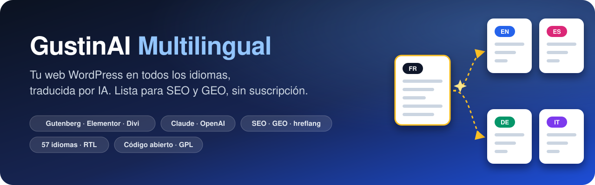
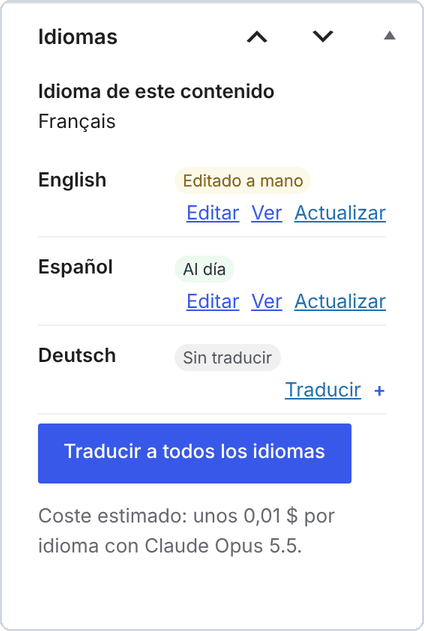
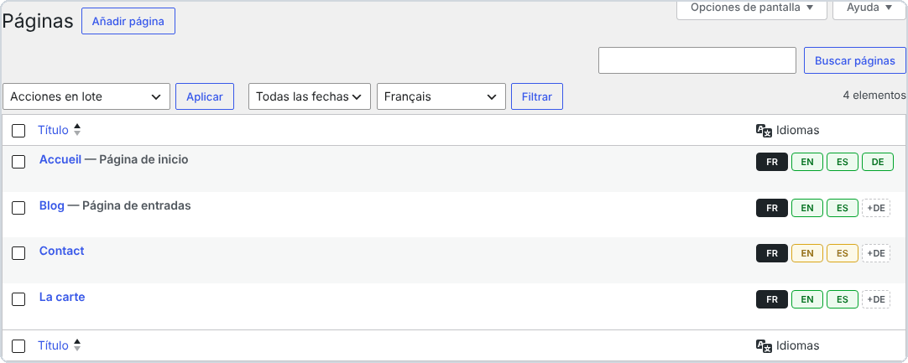
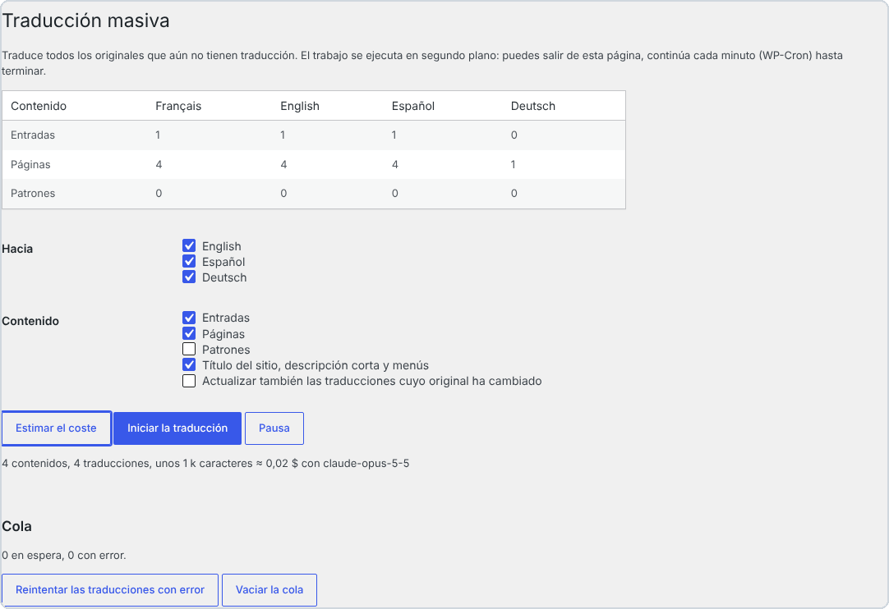
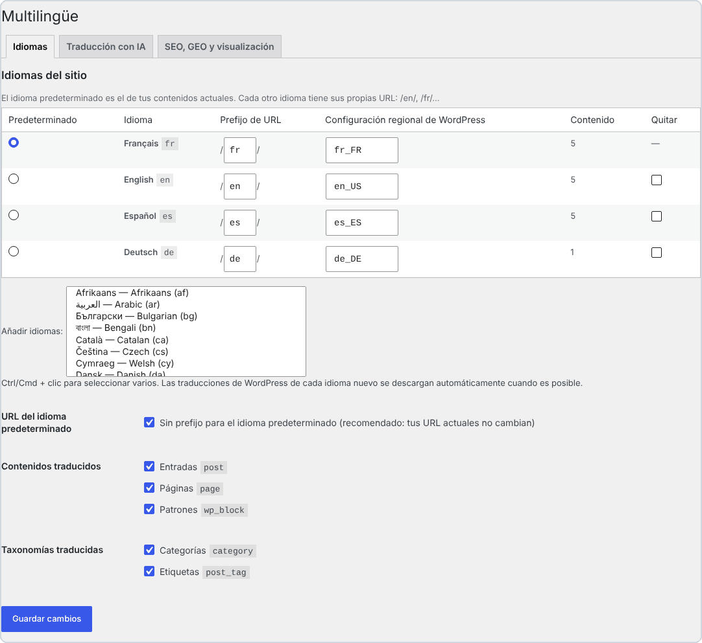
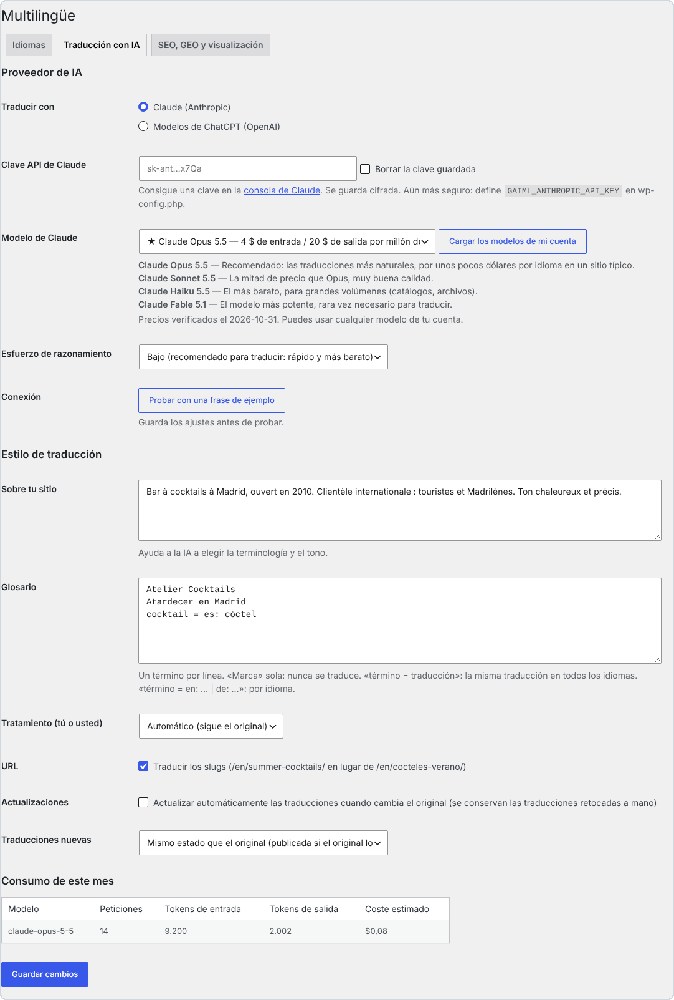
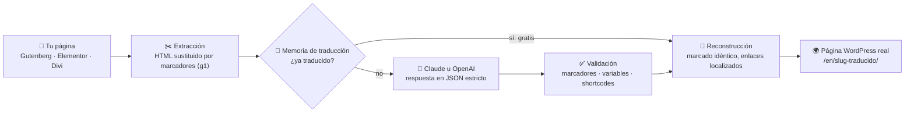
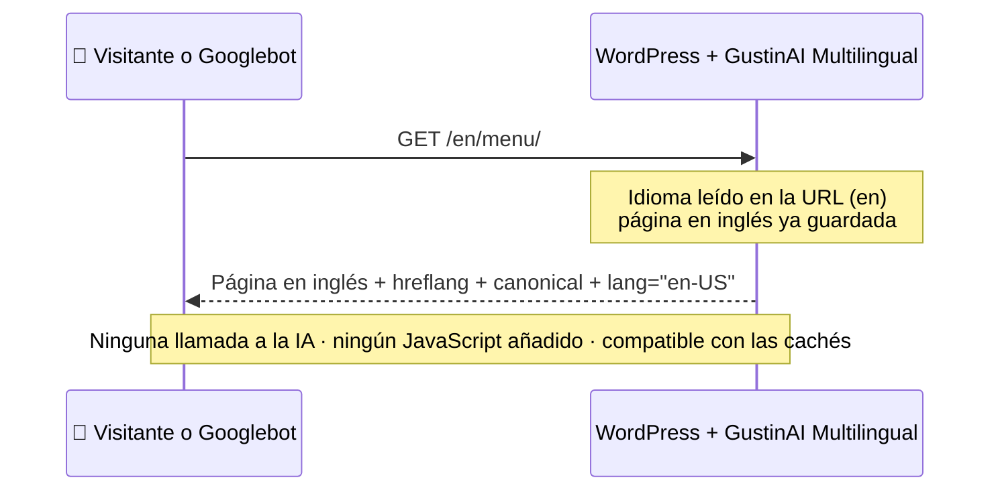

<p align="center">
  
</p>

<p align="center">
  🌐 <a href="../../README.md">English</a> · <a href="README.fr.md">Français</a> · <b>Español</b> · <a href="README.it.md">Italiano</a> · <a href="README.de.md">Deutsch</a> · <a href="README.pt.md">Português</a>
</p>

<p align="center">
  
  
  
  
  
  
  
</p>

> **Convierte cualquier web WordPress en una web multilingüe traducida por IA: páginas reales, URL traducidas, SEO y GEO impecables. Sin suscripción y sin cuota de palabras: solo pagas la IA que consumes, directamente a Anthropic o a OpenAI.**

<p align="center">
  <a href="https://github.com/Jacckisback/gustinai-multilingual/raw/main/dist/gustinai-multilingual-1.0.0.zip"><b>⬇️ Descargar el plugin (.zip)</b></a> ·
  <a href="#-empieza-en-5-minutos">🚀 Empezar</a> ·
  <a href="#-cuánto-cuesta-de-verdad">💸 Costes</a> ·
  <a href="#-comparativa-con-los-plugins-de-traducción-de-pago">📊 Comparativa</a> ·
  <a href="#-cómo-funciona">🧠 Funcionamiento</a> ·
  <a href="#-preguntas-frecuentes">❓ FAQ</a>
</p>

---

## 📑 Índice

- [✨ ¿Por qué GustinAI Multilingual?](#-por-qué-gustinai-multilingual)
- [🌍 ¿Por qué hacer tu web multilingüe?](#-por-qué-hacer-tu-web-multilingüe)
- [📸 En imágenes](#-en-imágenes)
- [🚀 Empieza en 5 minutos](#-empieza-en-5-minutos)
- [💸 ¿Cuánto cuesta de verdad?](#-cuánto-cuesta-de-verdad)
- [📊 Comparativa con los plugins de traducción de pago](#-comparativa-con-los-plugins-de-traducción-de-pago)
- [🧠 Cómo funciona](#-cómo-funciona)
- [🔎 SEO multilingüe según las reglas](#-seo-multilingüe-según-las-reglas)
- [🤖 GEO: ser visible en las respuestas de las IA](#-geo-ser-visible-en-las-respuestas-de-las-ia)
- [🧩 Maquetadores visuales](#-maquetadores-visuales)
- [⚙️ Bajo el capó](#️-bajo-el-capó)
- [🔐 Seguridad y privacidad](#-seguridad-y-privacidad)
- [🛠️ Para desarrolladores](#️-para-desarrolladores)
- [⚠️ Limitaciones conocidas](#️-limitaciones-conocidas)
- [✅ Calidad y pruebas](#-calidad-y-pruebas)
- [❓ Preguntas frecuentes](#-preguntas-frecuentes)
- [👋 Sobre el autor](#-sobre-el-autor)

---

## ✨ ¿Por qué GustinAI Multilingual?

| | |
|---|---|
| 💸 **Sin suscripción ni cuota de palabras** | El plugin es gratuito y de código abierto (GPL). La traducción la factura el proveedor de IA a precio de coste, con tu propia clave: unos **0,06 $ por página e idioma** con Claude Opus 5.5, el modelo más natural, y menos de **0,002 $** con Claude Haiku 5.5 (consulta [los costes](#-cuánto-cuesta-de-verdad)). |
| 🏠 **Tus traducciones son tuyas** | Cada traducción es una página WordPress real, guardada en **tu** base de datos. Ningún servidor externo se interpone entre tus visitantes y tu contenido. |
| 🧱 **Tu maquetación nunca se rompe** | La IA nunca ve tu HTML: solo recibe los textos. El marcado se sustituye por marcadores numerados y después se reconstruye tal cual. Los bloques de Gutenberg, los datos de Elementor y los módulos de Divi quedan intactos. |
| 🔎 **SEO según las reglas** | Una URL por idioma, ninguna redirección automática, `hreflang` + `x-default` en cada página, slugs y categorías traducidos: exactamente lo que recomienda Google.[^g-multi][^g-hreflang] |
| 🤖 **Preparado para los buscadores con IA (GEO)** | Un `llms.txt` por idioma[^llms], datos estructurados que enlazan cada página con sus traducciones[^schema] y un prompt de traducción pensado para el SEO y el GEO. |
| ⚡ **Cero IA durante las visitas** | Las traducciones se generan una sola vez, en el escritorio. Tus visitantes reciben páginas estáticas: compatibles con cualquier caché y CDN, sin JavaScript añadido. |

---

## 🌍 ¿Por qué hacer tu web multilingüe?

- 🛒 **La gente compra en su idioma.** En una encuesta a 8.709 consumidores de 29 países, CSA Research constató que el **66 %** elegiría un producto similar si tiene información en su idioma, y que el **75 %** es más propenso a volver a comprar la misma marca si la atención al cliente habla su idioma.[^csa]
- 🧭 **Google necesita una URL por idioma.** Google recomienda una URL distinta para cada versión lingüística y etiquetas `hreflang` para mostrar la versión adecuada a cada usuario.[^g-multi][^g-hreflang] Una traducción que solo existe en el navegador, o que depende de una cookie, no se puede indexar.
- 🌐 **WordPress está en todas partes.** WordPress mueve el **39,5 %** de todas las webs y el **58,2 %** de las webs cuyo CMS se conoce.[^w3techs] GustinAI Multilingual añade idiomas a la web que ya tienes, sin rehacerla.

> [!TIP]
> **En pocas palabras:** una web multilingüe no es un widget que traduce sobre la marcha. Es una página por idioma, con su propia dirección (`/en/…`, `/es/…`), que Google puede leer y que un visitante puede compartir. Eso es exactamente lo que crea el plugin.

---

## 📸 En imágenes

<p align="center">
  
  <br><sub>La misma página en 4 idiomas. Cada una tiene su propia URL, su menú traducido y un selector de idioma (enlaces HTML sencillos, sin banderas). Web de demostración.</sub>
</p>

<table>
  <tr>
    <td width="38%" valign="top">
      
      <p><b>En el editor:</b> el estado de cada idioma (<i>Al día</i>, <i>Editado a mano</i>, <i>Sin traducir</i>), la traducción en un clic y el coste estimado.</p>
    </td>
    <td width="62%" valign="top">
      
      <p><b>En tus listados de páginas:</b> 🟩 al día, 🟨 original modificado desde la traducción, <code>+DE</code> = traducir al alemán en un clic.</p>
      
      <p><b>Traducción masiva:</b> estima el coste y traduce toda la web en segundo plano.</p>
    </td>
  </tr>
</table>

<details>
<summary>🖼️ <b>Más capturas: ajustes de idiomas y de IA</b></summary>
<br>
<p align="center"><br><sub>Idiomas: 57 idiomas, prefijo de URL editable, idioma por defecto sin prefijo (tus URL actuales no cambian).</sub></p>
<p align="center"><br><sub>Traducción con IA: Claude u OpenAI, modelo recomendado con sus precios, descripción del sitio, glosario, tú o usted, consumo del mes.</sub></p>
</details>

---

## 🚀 Empieza en 5 minutos

**Requisitos:** WordPress 6.5+, PHP 8.1+, enlaces permanentes «bonitos» y una clave API de Claude (Anthropic) o de OpenAI.

1. **Instala.** [Descarga el zip](https://github.com/Jacckisback/gustinai-multilingual/raw/main/dist/gustinai-multilingual-1.0.0.zip), ve a **Plugins → Añadir nuevo plugin → Subir plugin** y actívalo.
2. **Elige tus idiomas.** Ve a **Multilingüe → Ajustes → Idiomas**. El idioma actual de tu web se convierte en el idioma por defecto. Las traducciones de WordPress de cada nuevo idioma se descargan automáticamente.
3. **Consigue una clave API.**
   - **Claude:** crea una clave en la [página de claves API de la consola de Claude](https://platform.claude.com/settings/keys).[^a-key]
   - **OpenAI:** crea una clave en la plataforma de OpenAI.
4. **Configura la IA.** En **Multilingüe → Ajustes → Traducción con IA**:
   - pega la clave y deja el modelo recomendado;
   - describe tu web en 2 o 3 frases y añade tus marcas al glosario;
   - haz clic en **Probar con una frase de ejemplo**.
5. **Traduce.**
   - Haz clic en **+EN** junto a una página y revisa el resultado.
   - Después ve a **Multilingüe → Traducción masiva**: **Estimar el coste** y luego **Iniciar la traducción**.
6. **Añade el selector de idioma.** Usa el bloque *Selector de idioma*, el shortcode `[gaiml_switcher]`, o deja que el plugin lo añada automáticamente a un menú.

> [!IMPORTANT]
> **Claves de Claude y workspaces:** al crear la clave, elige el workspace **«Default»**. La API de Claude rechaza las peticiones hechas con una clave que no está asociada a un workspace, salvo que lleven una cabecera `anthropic-workspace-id` adicional, que el plugin no envía.[^a-key]

> [!TIP]
> **Todavía más seguro:** declara tus claves en `wp-config.php` en lugar de en la base de datos. Así nunca aparecen en el escritorio.
>
> ```php
> define( 'GAIML_ANTHROPIC_API_KEY', 'sk-ant-...' );
> define( 'GAIML_OPENAI_API_KEY', 'sk-...' );
> ```

> [!NOTE]
> ¿Quieres revisar antes de publicar? En **Traducciones nuevas**, elige **Borrador, para revisar antes de publicar**. Google premia el contenido de calidad «se produzca como se produzca».[^g-ai] Revisar tus páginas clave sigue siendo la mejor garantía.

---

## 💸 ¿Cuánto cuesta de verdad?

El plugin es **gratuito**. Solo pagas al proveedor de IA los textos que envías, con tu propia clave. Precios comprobados en las páginas oficiales el 2 de noviembre de 2026:

| Proveedor | Modelo | Precio por millón de tokens (entrada / salida) | ≈ Coste por 100 páginas de unas 800 palabras, por idioma* |
|---|---|---|---|
| Claude | **Claude Opus 5.5** ⭐ recomendado | 4 $ / 20 $[^a-pricing] | **≈ 5,80 $** |
| Claude | Claude Sonnet 5.5 | 2 $ / 10 $[^a-pricing] | ≈ 2,90 $ |
| Claude | Claude Haiku 5.5 | 0,10 $ / 0,50 $[^a-pricing] | ≈ 0,15 $ |
| OpenAI | **GPT-6.1 Sol** ⭐ recomendado | 2 $ / 10 $[^o-pricing] | ≈ 2,90 $ |
| OpenAI | GPT-6.1 Terra | 1 $ / 5 $[^o-pricing] | ≈ 1,45 $ |
| OpenAI | GPT-6 Luna | 0,10 $ / 0,50 $[^o-pricing] | ≈ 0,15 $ |

<sub>* Estimación calculada por el plugin a partir de los precios públicos: aproximadamente 1 token por cada 3,5 caracteres, más las instrucciones y el envoltorio JSON de cada petición, con un esfuerzo de razonamiento bajo. El plugin muestra su propia estimación para tu contenido antes de traducir nada.</sub>

> [!TIP]
> **¿Qué es un token?** Es la unidad que facturan los proveedores de IA: más o menos ¾ de una palabra en inglés, algo menos en español. Una página de 800 palabras son unos 1.000 a 1.500 tokens.

**Tres mecanismos mantienen la factura baja:**

- 🧠 **Memoria de traducción.** Una frase idéntica solo se paga una vez, y una página editada solo vuelve a enviar las frases que han cambiado.
- 🗜️ **Caché del prompt.** En Claude, las instrucciones comunes a todas las peticiones se guardan en caché. Leer de la caché cuesta el 5 % del precio de entrada en Opus 5.5 y Sonnet 5.5.[^a-cache]
- 🎚️ **Esfuerzo de razonamiento bajo por defecto.** Traducir no requiere un razonamiento largo: es más rápido y más barato.

---

## 📊 Comparativa con los plugins de traducción de pago

### Ejemplo práctico: una web de 100 páginas (~80.000 palabras) traducida a 5 idiomas

Son **400.000 palabras que traducir**, porque WPML y Weglot cuentan las palabras una vez por cada idioma de destino.[^wpml-words][^weglot-words]

| Solución | Lo que pagas el primer año | ¿Y después? |
|---|---|---|
| **GustinAI Multilingual** | **0 $ de plugin + ≈ 29 $ de IA, una sola vez** (Claude Opus 5.5)<br>≈ 14,50 $ con Sonnet 5.5 o GPT-6.1 Sol, **≈ 0,75 $** con Haiku 5.5 | **0 $ de licencia.** Solo se envían a la IA los textos nuevos o modificados. |
| Weglot | **2.990 € al año**: el plan *Advanced* (1.000.000 de palabras, 10 idiomas), porque *Pro* se queda en 200.000 palabras[^weglot][^weglot-words] | La misma cantidad cada año. Si cancelas, las traducciones desaparecen de tu web.[^weglot-cancel] |
| WPML | **≈ 614 €**: el plan *CMS* a 99 € (22.500 palabras de IA incluidas) + ≈ 515 € de palabras adicionales a la tarifa pública por tramos[^wpml][^wpml-words] | Renovación anual para las actualizaciones, más palabras para el contenido nuevo. |
| TranslatePress | **≈ 195 € a 349 € al año**: *Personal* (99 €, 50.000 palabras de IA) + paquetes de 100.000 palabras a 24 €, o *Developer* (349 €, 500.000 palabras)[^tp] | Licencia anual. La cuota de palabras de IA se recarga al renovar.[^tp] |
| GTranslate | **350 $ al año**: el plan *Business*, el primero con URL traducidas (palabras ilimitadas)[^gtranslate] | Suscripción anual. Las traducciones las sirve el proxy de GTranslate.[^gtranslate] |
| Polylang Pro | **99 € al año** (1 web) + la API de DeepL, facturada aparte con tu propia clave[^polylang] | Sin función de «traducir todo en un clic», según el fabricante.[^polylang] |

<sub>Precios públicos sin IVA, consultados en las webs de los fabricantes el 2 de noviembre de 2026; pueden cambiar. Nuestros cálculos se detallan en cada celda. En TranslatePress suponemos que las palabras se cuentan por idioma de destino, como en WPML y Weglot. Cada competidor ofrece funciones que GustinAI Multilingual no tiene, como traducción humana profesional, gestión de proyectos de traducción, multisitio y WooCommerce. Compara según tus necesidades.</sub>

### Cómo funciona cada solución

| | GustinAI Multilingual | WPML | Polylang Pro | TranslatePress | Weglot | GTranslate (planes de pago) |
|---|---|---|---|---|---|---|
| **Modelo de negocio** | Gratuito (GPL), IA a precio de coste | Licencia 39–199 € (1 año de actualizaciones) + palabras de IA[^wpml] | Licencia anual desde 99 €[^polylang] | Licencia anual 99–349 €[^tp] | Suscripción mensual 15–699 €[^weglot] | Suscripción mensual 12–50 $[^gtranslate] |
| **Motor de traducción** | Claude u OpenAI, el modelo que elijas, con tu clave | Palabras de IA de WPML, DeepL, Google, Microsoft[^wpml-words] | DeepL con tu clave[^polylang] | TranslatePress AI (cuota), Google o DeepL con tu clave[^tp] | Incluido en la cuota de palabras[^weglot] | Incluido[^gtranslate] |
| **Dónde viven las traducciones** | Tu base de datos, como páginas WordPress reales | Tu base de datos, una entrada por idioma[^wpml-tables] | Tu base de datos, contenido duplicado por idioma[^polylang] | Tu servidor, se conservan al caducar la licencia[^tp] | El servicio de Weglot[^weglot-cancel] | El proxy en la nube de GTranslate[^gtranslate] |
| **URL traducidas** | ✅ incluidas | ✅ | ✅ | ✅ todos los planes de pago[^tp] | desde *Pro* (79 €/mes)[^weglot] | desde *Business* (35 $/mes)[^gtranslate] |

<sub>WordPress, WPML, Polylang, TranslatePress, Weglot, GTranslate, Claude, OpenAI, ChatGPT, Elementor y Divi son marcas de sus respectivos propietarios. GustinAI Multilingual es un proyecto independiente, sin relación con ellos.</sub>

---

## 🧠 Cómo funciona



**Ejemplo.** Esto es lo que le ocurre a una frase de tu página:

| Paso | Contenido |
|---|---|
| 1. Tu HTML original | `<p>Reserva <strong>hoy</strong> en <a href="/contacto/">nuestro bar</a>.</p>` |
| 2. Lo que recibe la IA | `Reserva <g1>hoy</g1> en <g2>nuestro bar</g2>.` |
| 3. Lo que devuelve la IA | `Book <g1>today</g1> at <g2>our bar</g2>.` |
| 4. Lo que se guarda | `<p>Book <strong>today</strong> at <a href="/en/contact/">our bar</a>.</p>` |

- La IA solo ve texto y marcadores. **No puede** romper una etiqueta o un bloque, ni inyectar HTML.
- El enlace se ha localizado automáticamente, de `/contacto/` a `/en/contact/`, porque esa página tiene una traducción al inglés.

**Cuando llega un visitante:**



---

## 🔎 SEO multilingüe según las reglas

Cada recomendación de Google y del W3C, y lo que hace el plugin:

| Recomendación | Lo que hace GustinAI Multilingual |
|---|---|
| Usar **una URL distinta para cada idioma**.[^g-multi] | Subdirectorios `/en/`, `/es/`… El idioma por defecto puede conservar sus URL actuales, sin prefijo. |
| **Evitar redirigir automáticamente** según el idioma del usuario.[^g-multi] | El idioma sale **solo de la URL**: ni cookie ni detección. Googlebot ve todas las versiones. |
| Cada versión debe **enumerarse a sí misma y a todas las demás** (`hreflang`), además de `x-default`.[^g-hreflang] | Las etiquetas `hreflang` se generan en cada página, en ambos sentidos, solo hacia traducciones realmente publicadas. |
| Traducir el **contenido principal**, no solo los elementos de alrededor.[^g-multi] | Se traduce todo: contenido, datos de los maquetadores, título y descripción SEO, textos alternativos de las imágenes, slugs, categorías, etiquetas y menús. |
| Declarar el **idioma de la página** (accesibilidad).[^wcag] Añadir `dir="rtl"` para los idiomas que se escriben de derecha a izquierda.[^w3c-dir] | `<html lang="es-ES">` en cada página y `dir="rtl"` para el árabe, el hebreo, el persa y el urdu. |
| **No usar banderas** para indicar idiomas.[^w3c-flags] | El selector muestra nombres o códigos (EN, Español…), como enlaces HTML sencillos que los buscadores pueden rastrear. |
| Mapas del sitio XML (integrados en WordPress desde la 5.5).[^wp-sitemaps] | Todos los idiomas activos aparecen en `/wp-sitemap.xml`. Yoast SEO y Rank Math obtienen las URL correctas. |

**También incluido:**

- Slugs traducidos (`/en/summer-cocktails/`), o el mismo slug en todos los idiomas si lo prefieres (`/contact/` y `/en/contact/`).
- Campos traducidos para Yoast SEO, Rank Math, SEOPress, The SEO Framework y AIOSEO.
- Sin contenido duplicado: una URL `/en/` nunca muestra una página sin traducir, y una URL errónea redirige a la traducción en el idioma solicitado.

> [!TIP]
> **¿Qué es `hreflang`?** Una etiqueta en el código de la página que le dice a Google: «esta página también existe en inglés, esta es su dirección». Así Google muestra la versión adecuada a cada usuario.

---

## 🤖 GEO: ser visible en las respuestas de las IA

El **GEO** (*Generative Engine Optimization*) consiste en optimizar tus contenidos para los motores de respuesta como ChatGPT, Claude, Perplexity o las AI Overviews de Google. Un estudio presentado en la conferencia KDD 2024 demostró que las optimizaciones adecuadas **pueden aumentar la visibilidad hasta un 40 %** en esas respuestas.[^geo]

- 📄 **Un `llms.txt` en cada idioma** (`/llms.txt`, `/en/llms.txt`…). Este formato, propuesto en 2024, ofrece a las IA un índice limpio de tu web en Markdown.[^llms]
- 🧬 **Datos estructurados.** `inLanguage`, `workTranslation` y `translationOfWork`[^schema] indican a las IA que dos páginas son traducción la una de la otra. Se añaden al grafo de Yoast SEO o de Rank Math, o se emiten solos si no usas un plugin de SEO.
- ✍️ **Un prompt de traducción pensado para el SEO y el GEO.** Pide el vocabulario que la gente busca de verdad en el idioma de destino y títulos explícitos, y prohíbe inventar información.
- 🔗 **Enlaces internos que se quedan en el idioma.** Una página en inglés enlaza a páginas en inglés, así que las IA que la leen se quedan en el idioma correcto.

---

## 🧩 Maquetadores visuales

| Maquetador | Lo que se traduce |
|---|---|
| **Gutenberg** (editor de bloques) | Los textos, los atributos de los bloques (botones, búsqueda, navegación…) y los patrones sincronizados, cuyos bloques apuntan después al patrón traducido. Los bloques traducidos siguen siendo válidos en el editor. |
| **Elementor** | Todos los widgets de texto (título, editor de texto, botón, pestañas, acordeones, formularios, carruseles…), los enlaces y las imágenes. El CSS se regenera, y las plantillas de Elementor (cabecera, pie de página, popup) se sustituyen por su traducción. |
| **Divi 4** (shortcodes) y **Divi 5** (bloques) | Los textos de los módulos, los títulos, los botones y los enlaces. El módulo *Código* nunca se traduce. |
| **Editor clásico** | Los textos, el HTML personalizado y los shortcodes de formularios, que quedan intactos. |

🛡️ **Nunca se traducen:** `<code>`, `<pre>`, `<script>`, `<style>`, `<svg>`, ni ningún elemento marcado con `translate="no"` o `class="notranslate"`.

---

## ⚙️ Bajo el capó

Lo que hace que el plugin sea ligero, rápido y fiable:

**🗃️ Modelo de datos**
- Una única tabla indexada, `wp_gaiml_translations`, asocia `(tipo de objeto, ID)` con `(idioma, grupo de traducciones)`. Una clave `UNIQUE (grupo, idioma)` garantiza una sola traducción por idioma.
- Las traducciones son entradas y términos de WordPress normales. Tus temas, plugins, cachés y copias de seguridad los tratan como cualquier otro contenido.

**🧭 Enrutamiento**
- El idioma se lee en la URL antes de que WordPress cargue sus traducciones. Así, WordPress, tu tema y tus plugins muestran sus propios textos en el idioma del visitante.
- `home_url()` recibe el prefijo del idioma: archivos, búsqueda, feeds y paginación se quedan en el idioma sin código adicional.

**⚡ Rendimiento**
- El filtrado por idioma es un único `LEFT JOIN` indexado, sin `meta_query`.
- Los idiomas de páginas, términos y menús se cargan por lotes.
- Medido en nuestra web de pruebas: **unas 10 consultas indexadas más por página, sin tiempo medible**. Esa web funcionaba con WordPress 7.1.4, PHP 8.3 y MariaDB 10.11.
- No se añade ningún JavaScript para los visitantes. El CSS del selector (1 KB) solo se imprime en línea cuando el selector se muestra.

**🤖 Motor de traducción**
- **Lotes:** hasta 6.000 caracteres y 120 textos por petición. Si una respuesta llega cortada, el lote se divide por la mitad automáticamente.
- **Formato de salida garantizado:** las respuestas siguen un esquema JSON estricto, gracias a las salidas estructuradas de Claude[^a-so] y de OpenAI[^o-so].
- **Validación:** cada texto debe conservar sus marcadores y sus variables (`%%title%%`, `%s`, `{{name}}`…). Un texto no válido se queda en el idioma original: **nunca HTML roto**.
- **Adaptativo:** si un modelo rechaza un parámetro (esfuerzo de razonamiento, formato JSON), el plugin lo retira y lo recuerda para ese modelo. Así funciona cualquier modelo de tu cuenta.

**🔁 Cola en segundo plano**
- Las tareas se reservan de forma atómica, con un bloqueo de 15 minutos y hasta 6 intentos con esperas crecientes.
- La cola avanza en segundo plano con WP-Cron, o desde la línea de comandos con WP-CLI. Puedes cerrar la página.

**✍️ Respeto por tus retoques**
- Cada traducción guarda la huella del original del que salió y la del texto que generó la IA.
- Así el plugin sabe cuándo ha cambiado el original (*Original modificado*) y cuándo alguien ha retocado la traducción (*Editado a mano*).
- Una traducción retocada a mano **nunca** se sobrescribe automáticamente.

---

## 🔐 Seguridad y privacidad

- 🔑 **Claves API cifradas.** Las claves guardadas en la base de datos se cifran con libsodium (XSalsa20-Poly1305) y no se vuelven a mostrar. Mejor aún: decláralas como constantes en `wp-config.php`.
- 👮 **Permisos.**
  - Cada acción comprueba un nonce y los permisos del usuario.
  - Un colaborador solo puede traducir lo que puede editar y publicar.
  - No puede sobrescribir una traducción que no tiene permiso para modificar.
- 🧱 **Salida de la IA neutralizada.**
  - Solo se restauran los marcadores esperados. Todo lo demás se escapa, corchetes incluidos: la IA no puede inyectar ni etiquetas ni shortcodes.
  - Los atributos HTML se leen uno a uno y se sustituyen por posición.
- 🗄️ **SQL robusto.** Las consultas son preparadas, y la cola usa bloqueos atómicos que resisten las peticiones simultáneas.
- 🕵️ **Privacidad.**
  - Solo se envían los textos de tu contenido, nunca los datos de tus visitantes.
  - Las llamadas solo van a `api.anthropic.com` o `api.openai.com`, y las peticiones a OpenAI se envían con `store: false`.
  - Por defecto, ni Anthropic ni OpenAI usan los datos de la API para entrenar sus modelos.[^a-data][^o-data]

---

## 🛠️ Para desarrolladores

**WP-CLI**

```bash
wp gaiml translate 12 34 --lang=en,es   # traduce contenidos y espera el resultado
wp gaiml translate 7 --type=term        # traduce una categoría
wp gaiml bulk --lang=en                 # todo lo que falta, páginas primero (--queue-only: deja que WP-Cron lo procese)
wp gaiml queue status|run|retry|clear
wp gaiml status                         # idiomas, contenidos, consumo del mes
```

**Funciones PHP**

- `gaiml_current_language()`, `gaiml_default_language()` y `gaiml_languages()`.
- `gaiml_get_translation( $id, $lang, 'post'|'term' )` y `gaiml_post_language( $id )`.
- `gaiml_home_url( $lang )` y `gaiml_language_switcher( $args )`.

**API REST y consultas**

- La API REST expone los campos `gaiml_lang` y `gaiml_translations`, y acepta el parámetro `?lang=en` en todas las rutas.
- `WP_Query` acepta `'gaiml_lang' => 'en'`, `'all'` o `'active'`.
- `get_posts()` solo se filtra con `'suppress_filters' => false`, igual que con WPML.

**Hooks**

- **Filtros:** `gaiml_post_types`, `gaiml_taxonomies`, `gaiml_translatable_meta` (campos personalizados que traducir), `gaiml_meta_skip`, `gaiml_strings`, `gaiml_system_prompt`, `gaiml_known_models`, `gaiml_provider`, `gaiml_hreflang`, `gaiml_alternates`, `gaiml_llms_txt`, `gaiml_switcher_css` y `gaiml_exclude_post`.
- **Acciones:** `gaiml_post_translated`, `gaiml_translations_changed` y `gaiml_loaded`.

Arquitectura interna (en francés): [docs/ARCHITECTURE.md](../ARCHITECTURE.md).

---

## ⚠️ Limitaciones conocidas

La versión 1.0 tiene algunos límites:

- **Estructura de URL:** solo subdirectorios. No se admiten subdominios ni un dominio por idioma.
- **WooCommerce:** no marques *Productos*, porque el stock y los precios no se sincronizan entre idiomas.
- **Temas de bloques:**
  - Las partes de plantilla personalizadas, como la cabecera y el pie de página, no se traducen, salvo la navegación, el título y la descripción corta.
  - Divi Theme Builder no está soportado.
- **Campos personalizados (ACF):** decláralos con el filtro `gaiml_translatable_meta`.
- **Divi 5:** el soporte se basa en el formato de bloques público de Divi 5 y aún debe validarse en una web real.

---

## ✅ Calidad y pruebas

| Batería de pruebas | Comprobaciones | Qué cubre |
|---|---|---|
| `php tests/unit.php` | 52 | Extracción de textos: Gutenberg, Divi 4 y 5, Elementor, intentos de inyección |
| `wp eval-file tests/e2e/providers.php` | 28 | Conectores de Claude y OpenAI, con respuestas de API simuladas |
| `wp eval-file tests/e2e/engine.php` | 7 | Robustez: respuestas cortadas, marcado roto |
| `wp eval-file tests/e2e/review.php` | 24 | No regresión: papelera, concurrencia, slugs, mapas del sitio, bloqueos |

**También probado:**

- En el navegador: el escritorio, 0 bloques de Gutenberg no válidos tras la traducción y Elementor sin errores de JavaScript.
- Una instalación limpia desde el zip.
- El análisis estático de seguridad con PHPCS (WordPress.Security, PreparedSQL, PHPCompatibility 8.1).

**Entorno de pruebas:**

- WordPress 7.1.4, PHP 8.3 y MariaDB 10.11.
- Elementor 4.3.5.
- Los temas Twenty Twenty-Five (de bloques) y Twenty Twenty-One (clásico).

Para generar el zip tú mismo: `bin/build.sh`.

---

## ❓ Preguntas frecuentes

<details>
<summary><b>¿Penalizará Google las páginas traducidas con IA?</b></summary>

Google afirma que premia el contenido de calidad «se produzca como se produzca» y que «el uso adecuado de la IA o de la automatización no infringe sus directrices».[^g-ai] Para apostar por la calidad:

- describe tu web y completa el glosario;
- elige un buen modelo;
- revisa tus páginas clave (puedes publicar las traducciones nuevas como borrador).

Tus retoques están protegidos.
</details>

<details>
<summary><b>¿Qué pasa con mis traducciones si desinstalo el plugin?</b></summary>

Se quedan en tu base de datos como páginas y entradas de WordPress normales: conservas todo tu contenido. Eso sí, sin el plugin WordPress deja de saber en qué idioma está cada página.

Las tablas y los ajustes del plugin solo se borran si marcas la opción correspondiente antes de desinstalarlo.
</details>

<details>
<summary><b>¿Puedo retocar una traducción a mano?</b></summary>

Sí, como cualquier página de WordPress, con tu maquetador habitual. El plugin detecta el retoque (estado *Editado a mano*) y nunca lo sobrescribe automáticamente.
</details>

<details>
<summary><b>¿Mis visitantes generan llamadas a la IA?</b></summary>

Nunca. Las traducciones se crean en el escritorio y después se sirven como páginas normales. Una visita no cuesta nada en IA.
</details>

<details>
<summary><b>¿Qué modelo elijo?</b></summary>

- **Claude Opus 5.5** ofrece las traducciones más naturales, por unos pocos dólares por idioma en una web típica.
- **Claude Sonnet 5.5** o **GPT-6.1 Sol** cuestan la mitad, con una calidad muy buena.
- **Claude Haiku 5.5** o **GPT-6 Luna** son ideales para volúmenes muy grandes, como catálogos y archivos.

Puedes usar cualquier modelo de tu cuenta.
</details>

<details>
<summary><b>¿Se usa mi contenido para entrenar a las IA?</b></summary>

No por defecto. Anthropic no usa las entradas ni las salidas de sus productos comerciales, API incluida, para entrenar sus modelos,[^a-data] y OpenAI no usa los datos enviados a su API salvo que lo aceptes expresamente.[^o-data]
</details>

<details>
<summary><b>¿Cuántos idiomas hay disponibles?</b></summary>

57 idiomas, con variantes regionales (fr-CA, pt-BR, es-MX, de-CH…) y 4 idiomas que se escriben de derecha a izquierda (árabe, hebreo, persa y urdu). Puedes cambiar el prefijo de URL de cada idioma.
</details>

---

## 👋 Sobre el autor

GustinAI Multilingual lo desarrolla **Thierry Gustin**, fundador de **[GustinAI](https://gustinai.com)**, que ofrece formación en IA para empresas en Francia y España.

- 💼 **¿Necesitas ayuda para lanzar una web multilingüe, o para formar a tu equipo en IA?** → [gustinai.com](https://gustinai.com)
- ⭐ **¿Este plugin te ahorra una suscripción?** Dale una estrella al repositorio: ayuda a que otras personas lo encuentren.
- 🐛 **¿Un error o una idea?** Abre una [issue](https://github.com/Jacckisback/gustinai-multilingual/issues).

## 📄 Licencia

[GPL-2.0-or-later](../../LICENSE): libre para usar, modificar y redistribuir.

---

## 📚 Fuentes

Todas las cifras y recomendaciones citadas arriba están documentadas a continuación. Las páginas se consultaron el 2 de noviembre de 2026.

[^csa]: CSA Research, *Does Language Matter? The Impact of Language on the Customer Journey* (Can’t Read, Won’t Buy – B2C), 10 de junio de 2020: 8.709 consumidores de 29 países. <https://csa-research.com/Blogs-Events/Blog/customer-online-buying-experience>
[^w3techs]: W3Techs, *Usage statistics and market share of WordPress* (2 de noviembre de 2026). <https://w3techs.com/technologies/details/cm-wordpress>
[^g-multi]: Google Search Central, *Gestionar sitios multirregionales y multilingües*. <https://developers.google.com/search/docs/specialty/international/managing-multi-regional-sites>
[^g-hreflang]: Google Search Central, *Informar a Google sobre las versiones localizadas de tu página*. <https://developers.google.com/search/docs/specialty/international/localized-versions>
[^g-ai]: Google Search Central Blog, *Google Search’s guidance about AI-generated content*, febrero de 2023. <https://developers.google.com/search/blog/2023/02/google-search-and-ai-content>
[^llms]: Jeremy Howard, *The /llms.txt file*, propuesta del 3 de septiembre de 2024. <https://llmstxt.org/>
[^geo]: P. Aggarwal et al., *GEO: Generative Engine Optimization*, KDD 2024 (arXiv:2311.09735). <https://arxiv.org/abs/2311.09735>
[^schema]: Schema.org, propiedades `workTranslation` / `translationOfWork` e `inLanguage`. <https://schema.org/workTranslation>, <https://schema.org/inLanguage>
[^wcag]: W3C, WCAG 2.2, *Understanding Success Criterion 3.1.1: Language of Page*. <https://www.w3.org/WAI/WCAG22/Understanding/language-of-page.html>
[^w3c-dir]: W3C Internacionalización, *Structural markup and right-to-left text in HTML*. <https://www.w3.org/International/questions/qa-html-dir>
[^w3c-flags]: W3C Internacionalización, *Indicating the language of a link destination* («Don’t use flags to indicate languages!»). <https://www.w3.org/International/questions/qa-link-lang>
[^wp-sitemaps]: Make WordPress Core, *New XML Sitemaps Functionality in WordPress 5.5*, 22 de julio de 2020. <https://make.wordpress.org/core/2020/07/22/new-xml-sitemaps-functionality-in-wordpress-5-5/>
[^a-pricing]: Anthropic, *Pricing* (API de Claude). <https://platform.claude.com/docs/en/about-claude/pricing>
[^o-pricing]: OpenAI, *API Pricing*. <https://developers.openai.com/api/docs/pricing>
[^a-cache]: Anthropic, *Prompt caching*. <https://platform.claude.com/docs/en/build-with-claude/prompt-caching>
[^a-so]: Anthropic, *Structured outputs*. <https://platform.claude.com/docs/en/build-with-claude/structured-outputs>
[^o-so]: OpenAI, *Structured Outputs*. <https://developers.openai.com/api/docs/guides/structured-outputs>
[^a-data]: Anthropic Privacy Center, *Is my data used for model training?* <https://privacy.claude.com/en/articles/7996868-is-my-data-used-for-model-training>
[^o-data]: OpenAI, *Data controls in the OpenAI platform*. <https://developers.openai.com/api/docs/guides/your-data>
[^a-key]: Anthropic, *Get your Claude API key* y *Authentication: Select a workspace*. <https://platform.claude.com/docs/en/get-api-key>, <https://platform.claude.com/docs/en/manage-claude/authentication>
[^wpml]: WPML, *Pricing*: Multilingual Blog 39 €, Multilingual CMS 99 € (22.500 palabras de IA), Multilingual Agency 199 € (45.000 palabras de IA). <https://app.wpml.org/purchase>
[^wpml-words]: WPML, *Pricing for Automatic Translation*: palabras contadas «una vez por cada idioma de destino»; pago por uso de 3,00 € a 0,40 € por cada 1.000 palabras. <https://wpml.org/documentation/automatic-translation/automatic-translation-pricing/>
[^wpml-tables]: WPML, *WPML’s Database Tables* (tabla `icl_translations`: una entrada y su traducción son dos registros distintos). <https://wpml.org/documentation/support/wpml-tables/>
[^polylang]: Polylang, *Polylang Pro*: desde 99 € al año para 1 web, integración con DeepL usando tu propia clave API, sin función de «traducir todo en un clic». <https://polylang.pro/pricing/polylang-pro/>
[^tp]: TranslatePress, *Pricing*: Personal 99 € al año (50.000 palabras de IA), Business 199 € (200.000), Developer 349 € (500.000), 100.000 palabras adicionales por 24 €, traducciones conservadas en tu servidor al caducar la licencia. <https://translatepress.com/pricing/>
[^weglot]: Weglot, *Pricing*: de Starter 15 €/mes (10.000 palabras, 1 idioma) a Extended 699 €/mes; Pro 79 €/mes (200.000 palabras, 5 idiomas, URL traducidas); Advanced 299 €/mes o 2.990 €/año (1.000.000 de palabras, 10 idiomas). <https://www.weglot.com/pricing>
[^weglot-words]: Centro de ayuda de Weglot, *What is the number of translated words and how is it calculated?* («3 x 8,000 = 24,000 translated words»). <https://support.weglot.com/article/59-total-number-translated-words>
[^weglot-cancel]: Centro de ayuda de Weglot, *How can I pause/cancel my subscription*: tras cancelar, las traducciones dejan de aparecer y las páginas traducidas se retiran progresivamente de los buscadores. <https://support.weglot.com/article/247-how-to-cancel-my-subscription>
[^gtranslate]: GTranslate, página de inicio y planes: Custom 12 $, Startup 25 $, Business 35 $ (URL traducidas), Enterprise 50 $ al mes; los planes de pago funcionan como un proxy de traducción, con las traducciones alojadas en la red en la nube de GTranslate. <https://gtranslate.io/>
