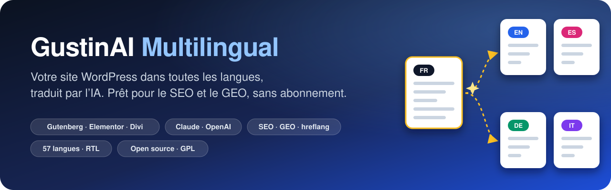
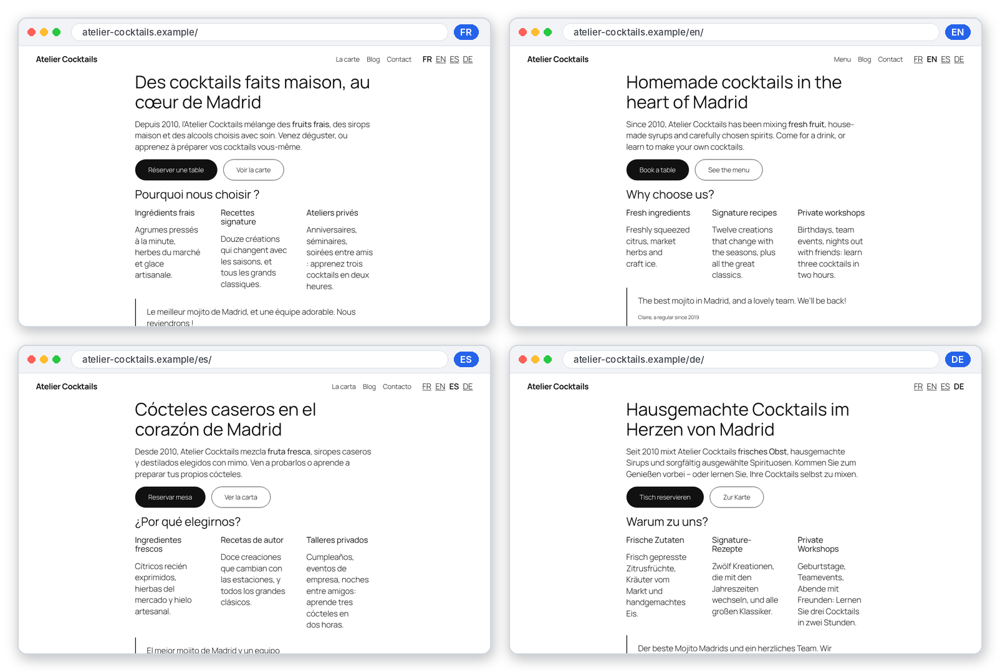
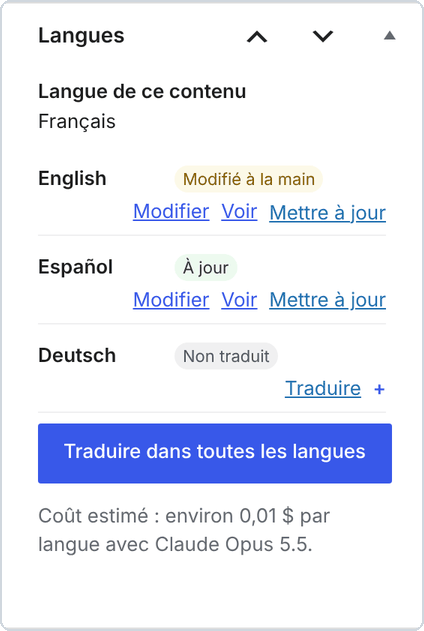
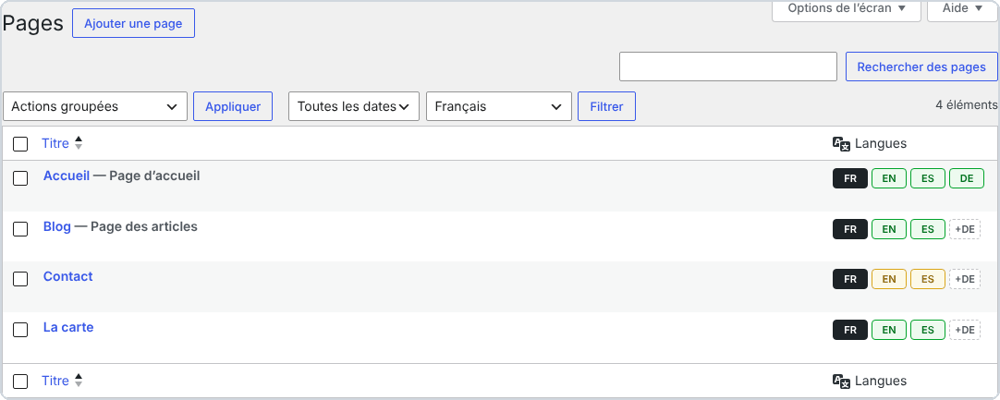
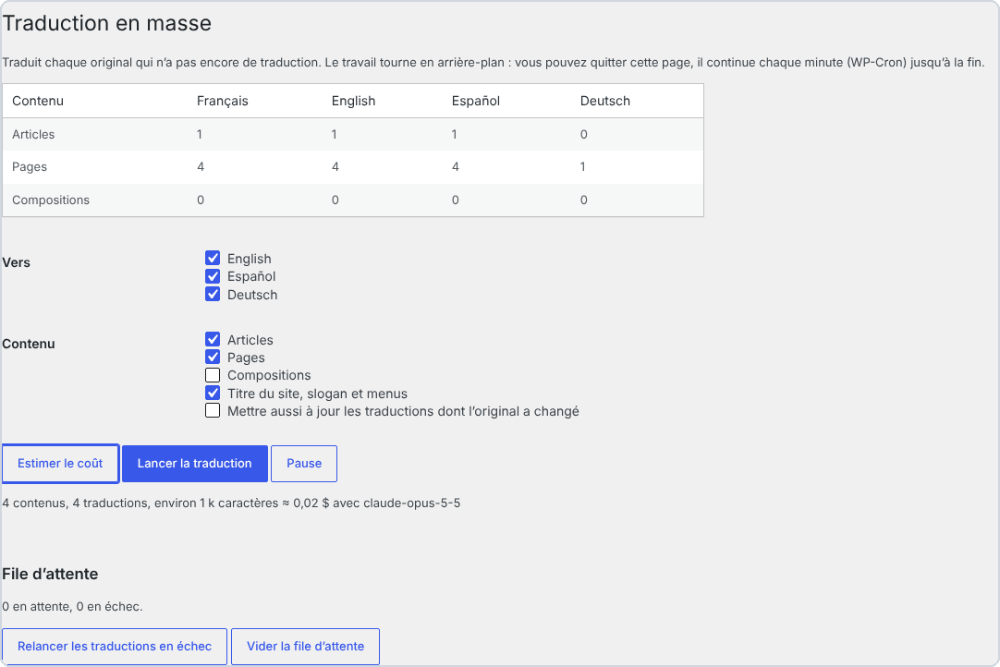
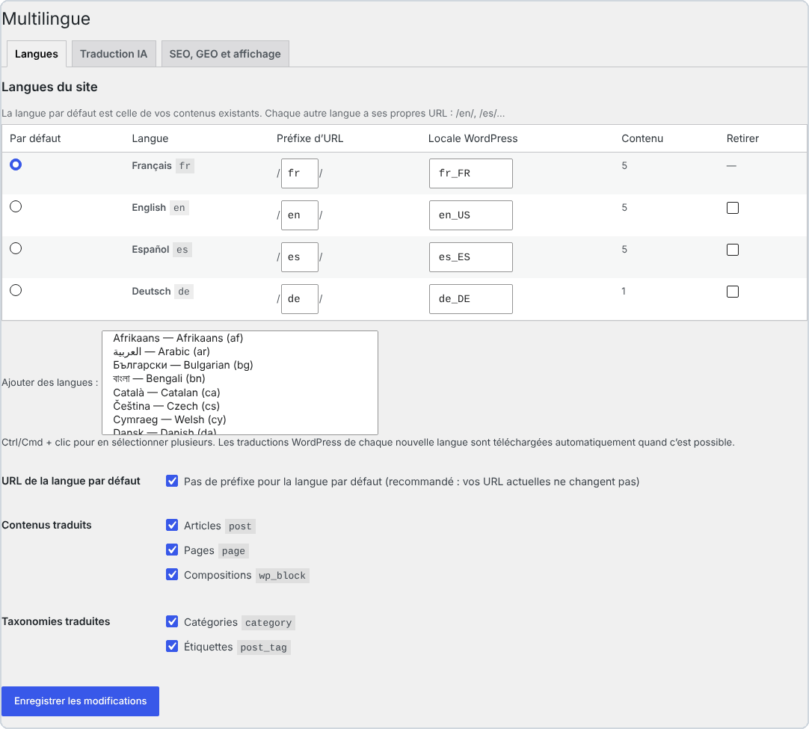
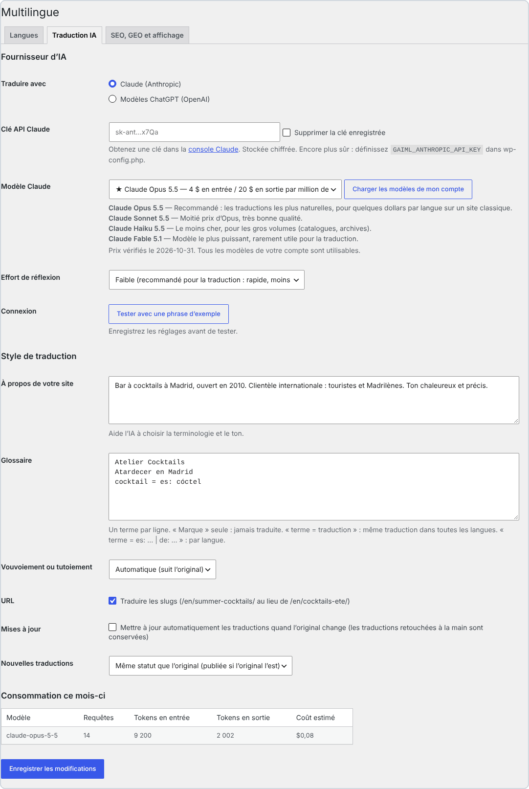
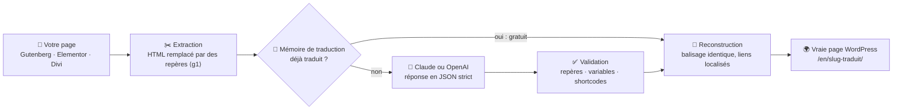
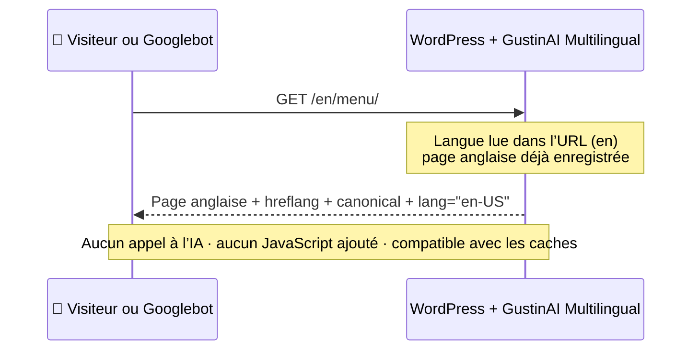

<p align="center">
  
</p>

<p align="center">
  🌐 <a href="../../README.md">English</a> · <b>Français</b> · <a href="README.es.md">Español</a> · <a href="README.it.md">Italiano</a> · <a href="README.de.md">Deutsch</a> · <a href="README.pt.md">Português</a>
</p>

<p align="center">
  
  
  
  
  
  
  
</p>

> **Transformez n’importe quel site WordPress en site multilingue traduit par l’IA : de vraies pages, des URL traduites, un SEO et un GEO irréprochables. Sans abonnement ni quota de mots : vous ne payez que l’IA que vous consommez, directement à Anthropic ou à OpenAI.**

<p align="center">
  <a href="https://github.com/Jacckisback/gustinai-multilingual/raw/main/dist/gustinai-multilingual-1.0.0.zip"><b>⬇️ Télécharger l’extension (.zip)</b></a> ·
  <a href="#-démarrage-en-5-minutes">🚀 Démarrage</a> ·
  <a href="#-combien-ça-coûte-vraiment-">💸 Coûts</a> ·
  <a href="#-comparatif-avec-les-extensions-de-traduction-payantes">📊 Comparatif</a> ·
  <a href="#-comment-ça-marche">🧠 Fonctionnement</a> ·
  <a href="#-faq">❓ FAQ</a>
</p>

---

## 📑 Sommaire

- [✨ Pourquoi GustinAI Multilingual ?](#-pourquoi-gustinai-multilingual-)
- [🌍 Pourquoi rendre votre site multilingue ?](#-pourquoi-rendre-votre-site-multilingue-)
- [📸 En images](#-en-images)
- [🚀 Démarrage en 5 minutes](#-démarrage-en-5-minutes)
- [💸 Combien ça coûte vraiment ?](#-combien-ça-coûte-vraiment-)
- [📊 Comparatif avec les extensions de traduction payantes](#-comparatif-avec-les-extensions-de-traduction-payantes)
- [🧠 Comment ça marche](#-comment-ça-marche)
- [🔎 Le SEO multilingue dans les règles de l’art](#-le-seo-multilingue-dans-les-règles-de-lart)
- [🤖 GEO : être visible dans les réponses des IA](#-geo--être-visible-dans-les-réponses-des-ia)
- [🧩 Constructeurs de pages](#-constructeurs-de-pages)
- [⚙️ Sous le capot](#️-sous-le-capot)
- [🔐 Sécurité et confidentialité](#-sécurité-et-confidentialité)
- [🛠️ Pour les développeurs](#️-pour-les-développeurs)
- [⚠️ Limites connues](#️-limites-connues)
- [✅ Qualité et tests](#-qualité-et-tests)
- [❓ FAQ](#-faq)
- [👋 À propos](#-à-propos)

---

## ✨ Pourquoi GustinAI Multilingual ?

| | |
|---|---|
| 💸 **Pas d’abonnement, pas de quota de mots** | L’extension est gratuite et open source (GPL). La traduction est facturée au prix coûtant par le fournisseur d’IA, avec votre propre clé : environ **0,06 $ par page et par langue** avec Claude Opus 5.5, le modèle le plus naturel, et moins de **0,002 $** avec Claude Haiku 5.5 (voir [les coûts](#-combien-ça-coûte-vraiment-)). |
| 🏠 **Vos traductions vous appartiennent** | Chaque traduction est une vraie page WordPress, enregistrée dans **votre** base de données. Aucun serveur tiers ne s’intercale entre vos visiteurs et votre contenu. |
| 🧱 **Votre mise en page ne casse jamais** | L’IA ne voit jamais votre HTML : seuls les textes lui sont envoyés, le balisage est remplacé par des repères numérotés puis reconstruit à l’identique. Les blocs Gutenberg, les données Elementor et les modules Divi restent intacts. |
| 🔎 **Un SEO dans les règles de l’art** | Une URL par langue, aucune redirection automatique, `hreflang` + `x-default` sur chaque page, slugs et catégories traduits : exactement ce que Google recommande.[^g-multi][^g-hreflang] |
| 🤖 **Prête pour les moteurs de réponse IA (GEO)** | Un `llms.txt` par langue[^llms], des données structurées qui relient chaque page à ses traductions[^schema], et un prompt de traduction pensé pour le SEO et le GEO. |
| ⚡ **Zéro IA pendant les visites** | Les traductions sont générées une seule fois, dans l’administration. Les visiteurs reçoivent des pages statiques : compatibles avec tous les caches et CDN, sans JavaScript ajouté. |

---

## 🌍 Pourquoi rendre votre site multilingue ?

- 🛒 **On achète dans sa langue.** Dans une enquête menée auprès de 8 709 consommateurs de 29 pays, CSA Research montre que **66 %** choisiraient un produit similaire s’il est présenté dans leur langue, et que **75 %** rachètent plus volontiers la même marque si le service client parle leur langue.[^csa]
- 🧭 **Google veut une URL par langue.** Google recommande une URL distincte pour chaque version linguistique, et des balises `hreflang` pour montrer la bonne version à chaque utilisateur.[^g-multi][^g-hreflang] Une traduction qui n’existe que dans le navigateur, ou qui dépend d’un cookie, ne peut pas être indexée.
- 🌐 **WordPress est partout.** WordPress fait tourner **39,5 %** des sites web, et **58,2 %** des sites dont le CMS est connu.[^w3techs] GustinAI Multilingual ajoute des langues à votre site existant, sans le reconstruire.

> [!TIP]
> **En clair :** un site multilingue, ce n’est pas un widget qui traduit à la volée. C’est une page par langue, à sa propre adresse (`/en/…`, `/es/…`), que Google peut lire et qu’un visiteur peut partager. C’est exactement ce que l’extension crée.

---

## 📸 En images

<p align="center">
  
  <br><sub>La même page en 4 langues. Chacune a sa propre URL, son menu traduit et un sélecteur de langue (de simples liens HTML, sans drapeaux). Site de démonstration.</sub>
</p>

<table>
  <tr>
    <td width="38%" valign="top">
      
      <p><b>Dans l’éditeur :</b> le statut de chaque langue (<i>À jour</i>, <i>Modifié à la main</i>, <i>Non traduit</i>), la traduction en un clic et le coût estimé.</p>
    </td>
    <td width="62%" valign="top">
      
      <p><b>Dans vos listes de pages :</b> 🟩 à jour, 🟨 original modifié depuis la traduction, <code>+DE</code> = traduire en allemand en un clic.</p>
      
      <p><b>Traduction en masse :</b> estimez le coût, puis traduisez tout le site en arrière-plan.</p>
    </td>
  </tr>
</table>

<details>
<summary>🖼️ <b>Plus de captures : réglages des langues et de l’IA</b></summary>
<br>
<p align="center"><br><sub>Langues : 57 langues, préfixe d’URL modifiable, langue par défaut sans préfixe (vos URL actuelles ne changent pas).</sub></p>
<p align="center"><br><sub>Traduction IA : Claude ou OpenAI, modèle recommandé avec ses prix, description du site, glossaire, vouvoiement ou tutoiement, consommation du mois.</sub></p>
</details>

---

## 🚀 Démarrage en 5 minutes

**Prérequis :** WordPress 6.5+, PHP 8.1+, permaliens « jolis », et une clé API Claude (Anthropic) ou OpenAI.

1. **Installez.** [Téléchargez le zip](https://github.com/Jacckisback/gustinai-multilingual/raw/main/dist/gustinai-multilingual-1.0.0.zip), puis allez dans **Extensions → Ajouter → Téléverser une extension** et activez-la.
2. **Choisissez vos langues.** Allez dans **Multilingue → Réglages → Langues**. La langue actuelle de votre site devient la langue par défaut. Les traductions de WordPress pour chaque nouvelle langue sont téléchargées automatiquement.
3. **Créez une clé API.**
   - **Claude :** créez une clé sur la [page des clés API de la console Claude](https://platform.claude.com/settings/keys).[^a-key]
   - **OpenAI :** créez une clé sur la plateforme OpenAI.
4. **Réglez l’IA.** Dans **Multilingue → Réglages → Traduction IA** :
   - collez la clé et gardez le modèle recommandé ;
   - décrivez votre site en 2 ou 3 phrases, et ajoutez vos noms de marque au glossaire ;
   - cliquez sur **Tester avec une phrase d’exemple**.
5. **Traduisez.**
   - Cliquez sur **+EN** à côté d’une page et vérifiez le résultat.
   - Allez ensuite dans **Multilingue → Traduction en masse** : **Estimer le coût**, puis **Lancer la traduction**.
6. **Ajoutez le sélecteur de langue.** Utilisez le bloc *Sélecteur de langue*, le shortcode `[gaiml_switcher]`, ou laissez l’extension l’ajouter automatiquement à un menu.

> [!IMPORTANT]
> **Clés Claude et workspaces :** au moment de créer la clé, choisissez le workspace **« Default »**. L’API Claude refuse les requêtes faites avec une clé qui n’est pas rattachée à un workspace, sauf si elles portent un en-tête `anthropic-workspace-id` supplémentaire, que l’extension n’envoie pas.[^a-key]

> [!TIP]
> **Encore plus sûr :** déclarez vos clés dans `wp-config.php` plutôt qu’en base de données. Elles n’apparaissent alors jamais dans l’administration.
>
> ```php
> define( 'GAIML_ANTHROPIC_API_KEY', 'sk-ant-...' );
> define( 'GAIML_OPENAI_API_KEY', 'sk-...' );
> ```

> [!NOTE]
> Vous voulez relire avant de publier ? Réglez **Nouvelles traductions** sur **Brouillon, à relire avant publication**. Google récompense les contenus de qualité « quelle que soit la manière dont ils sont produits ».[^g-ai] Relire vos pages clés reste la meilleure garantie.

---

## 💸 Combien ça coûte vraiment ?

L’extension est **gratuite**. Vous ne payez au fournisseur d’IA que les textes envoyés, avec votre propre clé. Prix vérifiés sur les pages officielles le 2 novembre 2026 :

| Fournisseur | Modèle | Prix par million de tokens (entrée / sortie) | ≈ Coût pour 100 pages d’environ 800 mots, par langue* |
|---|---|---|---|
| Claude | **Claude Opus 5.5** ⭐ recommandé | 4 $ / 20 $[^a-pricing] | **≈ 5,80 $** |
| Claude | Claude Sonnet 5.5 | 2 $ / 10 $[^a-pricing] | ≈ 2,90 $ |
| Claude | Claude Haiku 5.5 | 0,10 $ / 0,50 $[^a-pricing] | ≈ 0,15 $ |
| OpenAI | **GPT-6.1 Sol** ⭐ recommandé | 2 $ / 10 $[^o-pricing] | ≈ 2,90 $ |
| OpenAI | GPT-6.1 Terra | 1 $ / 5 $[^o-pricing] | ≈ 1,45 $ |
| OpenAI | GPT-6 Luna | 0,10 $ / 0,50 $[^o-pricing] | ≈ 0,15 $ |

<sub>* Estimation calculée par l’extension à partir des prix publics : environ 1 token pour 3,5 caractères, plus les instructions et l’enveloppe JSON de chaque requête, avec un effort de réflexion faible. L’extension affiche sa propre estimation pour votre contenu avant toute traduction.</sub>

> [!TIP]
> **C’est quoi, un token ?** C’est l’unité facturée par les fournisseurs d’IA : environ ¾ de mot en anglais, un peu moins en français. Une page de 800 mots représente environ 1 000 à 1 500 tokens.

**Trois mécanismes gardent la facture basse :**

- 🧠 **Mémoire de traduction.** Une phrase identique n’est payée qu’une fois, et une page modifiée ne renvoie que les phrases qui ont changé.
- 🗜️ **Cache du prompt.** Chez Claude, les instructions communes à toutes les requêtes sont mises en cache. La lecture en cache coûte 5 % du prix d’entrée sur Opus 5.5 et Sonnet 5.5.[^a-cache]
- 🎚️ **Effort de réflexion faible par défaut.** Traduire ne demande pas de long raisonnement : c’est plus rapide et moins cher.

---

## 📊 Comparatif avec les extensions de traduction payantes

### Exemple chiffré : un site de 100 pages (~80 000 mots) traduit en 5 langues

Cela fait **400 000 mots à traduire**, car WPML et Weglot comptent les mots une fois par langue cible.[^wpml-words][^weglot-words]

| Solution | Ce que vous payez la 1ʳᵉ année | Et ensuite ? |
|---|---|---|
| **GustinAI Multilingual** | **0 $ d’extension + ≈ 29 $ d’IA, une seule fois** (Claude Opus 5.5)<br>≈ 14,50 $ avec Sonnet 5.5 ou GPT-6.1 Sol, **≈ 0,75 $** avec Haiku 5.5 | **0 $ de licence.** Seuls les textes nouveaux ou modifiés sont envoyés à l’IA. |
| Weglot | **2 990 € / an** : la formule *Advanced* (1 000 000 de mots, 10 langues), car *Pro* s’arrête à 200 000 mots[^weglot][^weglot-words] | La même somme chaque année. Si vous résiliez, les traductions disparaissent de votre site.[^weglot-cancel] |
| WPML | **≈ 614 €** : la formule *CMS* à 99 € (22 500 mots IA inclus) + ≈ 515 € de mots supplémentaires au tarif public dégressif[^wpml][^wpml-words] | Renouvellement annuel pour les mises à jour, plus des mots pour les nouveaux contenus. |
| TranslatePress | **≈ 195 € à 349 € / an** : *Personal* (99 €, 50 000 mots IA) + packs de 100 000 mots à 24 €, ou *Developer* (349 €, 500 000 mots)[^tp] | Licence annuelle. Le quota de mots IA est rechargé au renouvellement.[^tp] |
| GTranslate | **350 $ / an** : la formule *Business*, la première avec URL traduites (mots illimités)[^gtranslate] | Abonnement annuel. Les traductions sont servies par le proxy de GTranslate.[^gtranslate] |
| Polylang Pro | **99 € / an** (1 site) + l’API DeepL, facturée à part avec votre propre clé[^polylang] | Pas de fonction « tout traduire en un clic », selon l’éditeur.[^polylang] |

<sub>Prix publics HT, relevés sur les pages des éditeurs le 2 novembre 2026 ; ils peuvent évoluer. Nos calculs sont détaillés dans chaque case. Pour TranslatePress, nous supposons que les mots sont comptés par langue cible, comme chez WPML et Weglot. Chaque concurrent propose des fonctions que GustinAI Multilingual n’a pas : traduction humaine professionnelle, gestion de projets de traduction, multisite, WooCommerce… Comparez selon vos besoins.</sub>

### Comment chaque solution fonctionne

| | GustinAI Multilingual | WPML | Polylang Pro | TranslatePress | Weglot | GTranslate (formules payantes) |
|---|---|---|---|---|---|---|
| **Modèle économique** | Gratuit (GPL), IA payée au prix coûtant | Licence 39–199 € (1 an de mises à jour) + mots IA[^wpml] | Licence annuelle dès 99 €[^polylang] | Licence annuelle 99–349 €[^tp] | Abonnement mensuel 15–699 €[^weglot] | Abonnement mensuel 12–50 $[^gtranslate] |
| **Moteur de traduction** | Claude ou OpenAI, le modèle de votre choix, avec votre clé | Mots IA WPML, DeepL, Google, Microsoft[^wpml-words] | DeepL avec votre clé[^polylang] | TranslatePress AI (quota), Google ou DeepL avec votre clé[^tp] | Inclus dans le quota de mots[^weglot] | Inclus[^gtranslate] |
| **Où vivent les traductions** | Votre base de données, en vraies pages WordPress | Votre base de données, un article par langue[^wpml-tables] | Votre base de données, contenu dupliqué par langue[^polylang] | Votre serveur, conservées à l’expiration de la licence[^tp] | Le service de Weglot[^weglot-cancel] | Le proxy cloud de GTranslate[^gtranslate] |
| **URL traduites** | ✅ incluses | ✅ | ✅ | ✅ toutes les formules payantes[^tp] | dès *Pro* (79 €/mois)[^weglot] | dès *Business* (35 $/mois)[^gtranslate] |

<sub>WordPress, WPML, Polylang, TranslatePress, Weglot, GTranslate, Claude, OpenAI, ChatGPT, Elementor et Divi sont des marques de leurs propriétaires respectifs. GustinAI Multilingual est un projet indépendant, sans lien avec eux.</sub>

---

## 🧠 Comment ça marche



**Exemple.** Voici ce que devient une phrase de votre page :

| Étape | Contenu |
|---|---|
| 1. Votre HTML d’origine | `<p>Réservez <strong>aujourd’hui</strong> dans <a href="/contact/">notre bar</a>.</p>` |
| 2. Ce que reçoit l’IA | `Réservez <g1>aujourd’hui</g1> dans <g2>notre bar</g2>.` |
| 3. Ce que renvoie l’IA | `Book <g1>today</g1> at <g2>our bar</g2>.` |
| 4. Ce qui est enregistré | `<p>Book <strong>today</strong> at <a href="/en/contact/">our bar</a>.</p>` |

- L’IA ne voit que du texte et des repères. Elle **ne peut pas** casser une balise ou un bloc, ni injecter du HTML.
- Le lien a été localisé automatiquement, de `/contact/` vers `/en/contact/`, parce que cette page a une traduction anglaise.

**Quand un visiteur arrive :**



---

## 🔎 Le SEO multilingue dans les règles de l’art

Chaque recommandation de Google et du W3C, et ce que fait l’extension :

| Recommandation | Ce que fait GustinAI Multilingual |
|---|---|
| Utiliser **une URL différente pour chaque langue**.[^g-multi] | Sous-répertoires `/en/`, `/es/`… La langue par défaut peut garder ses URL actuelles, sans préfixe. |
| **Éviter les redirections automatiques** selon la langue de l’utilisateur.[^g-multi] | La langue vient **uniquement de l’URL** : ni cookie, ni détection. Googlebot voit toutes les versions. |
| Chaque version doit **se citer elle-même et citer toutes les autres** (`hreflang`), plus `x-default`.[^g-hreflang] | Les balises `hreflang` sont générées sur chaque page, dans les deux sens, uniquement vers les traductions réellement publiées. |
| Traduire le **contenu principal**, pas seulement les éléments autour.[^g-multi] | Tout est traduit : contenu, données des constructeurs, titre et description SEO, textes alternatifs des images, slugs, catégories, étiquettes et menus. |
| Déclarer la **langue de la page** (accessibilité).[^wcag] Ajouter `dir="rtl"` pour les langues qui s’écrivent de droite à gauche.[^w3c-dir] | `<html lang="fr-FR">` sur chaque page et `dir="rtl"` pour l’arabe, l’hébreu, le persan et l’ourdou. |
| **Ne pas utiliser de drapeaux** pour désigner les langues.[^w3c-flags] | Le sélecteur affiche des noms ou des codes (EN, Español…), sous forme de simples liens HTML que les moteurs peuvent explorer. |
| Plans de site XML (intégrés à WordPress depuis la 5.5).[^wp-sitemaps] | Toutes les langues actives sont listées dans `/wp-sitemap.xml`. Yoast SEO et Rank Math récupèrent les bonnes URL. |

**Également inclus :**

- Slugs traduits (`/en/summer-cocktails/`), ou le même slug dans toutes les langues si vous préférez (`/contact/` et `/en/contact/`).
- Champs traduits pour Yoast SEO, Rank Math, SEOPress, The SEO Framework et AIOSEO.
- Pas de contenu dupliqué : une URL `/en/` n’affiche jamais une page non traduite, et une URL erronée redirige vers la traduction dans la langue demandée.

> [!TIP]
> **C’est quoi, `hreflang` ?** Une balise dans le code de la page qui dit à Google : « cette page existe aussi en espagnol, voici son adresse ». Google montre alors la bonne version à chaque utilisateur.

---

## 🤖 GEO : être visible dans les réponses des IA

Le **GEO** (*Generative Engine Optimization*) consiste à optimiser vos contenus pour les moteurs de réponse comme ChatGPT, Claude, Perplexity ou les AI Overviews de Google. Une étude présentée à la conférence KDD 2024 montre que des optimisations adaptées **peuvent augmenter la visibilité jusqu’à 40 %** dans ces réponses.[^geo]

- 📄 **Un `llms.txt` dans chaque langue** (`/llms.txt`, `/en/llms.txt`…). Ce format, proposé en 2024, donne aux IA un index propre de votre site, en Markdown.[^llms]
- 🧬 **Des données structurées.** `inLanguage`, `workTranslation` et `translationOfWork`[^schema] indiquent aux IA que deux pages sont la traduction l’une de l’autre. Elles s’ajoutent au graphe de Yoast SEO ou de Rank Math, ou sont émises seules si vous n’utilisez pas d’extension SEO.
- ✍️ **Un prompt de traduction pensé pour le SEO et le GEO.** Il demande le vocabulaire réellement recherché dans la langue cible et des titres explicites, et interdit d’inventer des informations.
- 🔗 **Des liens internes qui restent dans la langue.** Une page anglaise pointe vers des pages anglaises, si bien que les IA qui la lisent restent dans la bonne langue.

---

## 🧩 Constructeurs de pages

| Constructeur | Ce qui est traduit |
|---|---|
| **Gutenberg** (éditeur de blocs) | Les textes, les attributs des blocs (boutons, recherche, navigation…) et les compositions synchronisées, dont les blocs pointent ensuite vers la composition traduite. Les blocs traduits restent valides dans l’éditeur. |
| **Elementor** | Tous les widgets texte (titre, éditeur de texte, bouton, onglets, accordéons, formulaires, carrousels…), les liens et les images. Le CSS est régénéré, et les modèles Elementor (en-tête, pied de page, popup) sont remplacés par leur traduction. |
| **Divi 4** (shortcodes) et **Divi 5** (blocs) | Les textes des modules, les titres, les boutons et les liens. Le module *Code* n’est jamais traduit. |
| **Éditeur classique** | Les textes, le HTML personnalisé et les shortcodes de formulaires, qui restent intacts. |

🛡️ **Jamais traduits :** `<code>`, `<pre>`, `<script>`, `<style>`, `<svg>`, et tout élément marqué `translate="no"` ou `class="notranslate"`.

---

## ⚙️ Sous le capot

Ce qui rend l’extension légère, rapide et fiable :

**🗃️ Modèle de données**
- Une seule table indexée, `wp_gaiml_translations`, associe `(type d’objet, ID)` à `(langue, groupe de traductions)`. Une clé `UNIQUE (groupe, langue)` garantit une seule traduction par langue.
- Les traductions sont des articles et des termes WordPress ordinaires. Vos thèmes, extensions, caches et sauvegardes les traitent comme n’importe quel contenu.

**🧭 Routage**
- La langue est lue dans l’URL avant que WordPress ne charge ses traductions. WordPress, votre thème et vos extensions affichent donc leurs propres textes dans la langue du visiteur.
- `home_url()` reçoit le préfixe de langue : archives, recherche, flux et pagination restent dans la langue, sans code supplémentaire.

**⚡ Performance**
- Le filtrage par langue tient en une seule jointure `LEFT JOIN` indexée, sans `meta_query`.
- Les langues des pages, des termes et des menus sont chargées par lots.
- Mesuré sur notre site de test : **environ 10 requêtes indexées de plus par page, sans temps mesurable**. Ce site tournait sous WordPress 7.1.4, PHP 8.3 et MariaDB 10.11.
- Aucun JavaScript n’est ajouté pour les visiteurs. Le CSS du sélecteur (1 Ko) n’est imprimé en ligne que si le sélecteur est affiché.

**🤖 Moteur de traduction**
- **Lots :** jusqu’à 6 000 caractères et 120 textes par requête. Si une réponse est coupée, le lot est divisé par deux automatiquement.
- **Format de sortie garanti :** les réponses suivent un schéma JSON strict, grâce aux sorties structurées de Claude[^a-so] et d’OpenAI[^o-so].
- **Validation :** chaque texte doit conserver ses repères et ses variables (`%%title%%`, `%s`, `{{name}}`…). Un texte invalide reste dans la langue d’origine : **jamais de HTML cassé**.
- **Adaptatif :** si un modèle refuse un paramètre (effort de réflexion, format JSON), l’extension le retire et s’en souvient pour ce modèle. N’importe quel modèle de votre compte fonctionne donc.

**🔁 File d’attente en arrière-plan**
- Les tâches sont réservées de façon atomique, avec un verrou de 15 minutes et jusqu’à 6 tentatives à intervalles croissants.
- La file avance en arrière-plan avec WP-Cron, ou en ligne de commande avec WP-CLI. Vous pouvez fermer la page.

**✍️ Respect de vos retouches**
- Chaque traduction mémorise l’empreinte de l’original à partir duquel elle a été faite, et celle du texte généré par l’IA.
- L’extension sait donc quand l’original a changé (*Original modifié*) et quand quelqu’un a retouché la traduction (*Modifié à la main*).
- Une traduction retouchée à la main n’est **jamais** écrasée automatiquement.

---

## 🔐 Sécurité et confidentialité

- 🔑 **Clés API chiffrées.** Les clés enregistrées en base sont chiffrées avec libsodium (XSalsa20-Poly1305) et ne sont jamais réaffichées. Encore mieux : déclarez-les comme constantes dans `wp-config.php`.
- 👮 **Droits.**
  - Chaque action vérifie un nonce et les droits de l’utilisateur.
  - Un contributeur ne peut traduire que ce qu’il peut modifier et publier.
  - Il ne peut pas écraser une traduction qu’il n’a pas le droit de modifier.
- 🧱 **Sortie de l’IA neutralisée.**
  - Seuls les repères attendus sont restaurés. Tout le reste est échappé, crochets compris : l’IA ne peut injecter ni balise ni shortcode.
  - Les attributs HTML sont lus un par un et remplacés par position.
- 🗄️ **SQL robuste.** Les requêtes sont préparées, et la file d’attente utilise des verrous atomiques qui résistent aux requêtes simultanées.
- 🕵️ **Confidentialité.**
  - Seuls les textes de votre contenu sont envoyés, jamais les données de vos visiteurs.
  - Les appels partent uniquement vers `api.anthropic.com` ou `api.openai.com`, et les requêtes OpenAI sont envoyées avec `store: false`.
  - Par défaut, ni Anthropic ni OpenAI n’utilisent les données de l’API pour entraîner leurs modèles.[^a-data][^o-data]

---

## 🛠️ Pour les développeurs

**WP-CLI**

```bash
wp gaiml translate 12 34 --lang=en,es   # traduit des contenus et attend le résultat
wp gaiml translate 7 --type=term        # traduit une catégorie
wp gaiml bulk --lang=en                 # tout ce qui manque, pages d’abord (--queue-only : laisser WP-Cron traiter)
wp gaiml queue status|run|retry|clear
wp gaiml status                         # langues, contenus, consommation du mois
```

**Fonctions PHP**

- `gaiml_current_language()`, `gaiml_default_language()` et `gaiml_languages()`.
- `gaiml_get_translation( $id, $lang, 'post'|'term' )` et `gaiml_post_language( $id )`.
- `gaiml_home_url( $lang )` et `gaiml_language_switcher( $args )`.

**API REST et requêtes**

- L’API REST expose les champs `gaiml_lang` et `gaiml_translations`, et accepte le paramètre `?lang=en` sur toutes les routes.
- `WP_Query` accepte `'gaiml_lang' => 'en'`, `'all'` ou `'active'`.
- `get_posts()` n’est filtré qu’avec `'suppress_filters' => false`, comme avec WPML.

**Hooks**

- **Filtres :** `gaiml_post_types`, `gaiml_taxonomies`, `gaiml_translatable_meta` (champs personnalisés à traduire), `gaiml_meta_skip`, `gaiml_strings`, `gaiml_system_prompt`, `gaiml_known_models`, `gaiml_provider`, `gaiml_hreflang`, `gaiml_alternates`, `gaiml_llms_txt`, `gaiml_switcher_css` et `gaiml_exclude_post`.
- **Actions :** `gaiml_post_translated`, `gaiml_translations_changed` et `gaiml_loaded`.

Architecture interne : [docs/ARCHITECTURE.md](../ARCHITECTURE.md).

---

## ⚠️ Limites connues

La version 1.0 a quelques limites :

- **Structure des URL :** sous-répertoires uniquement. Les sous-domaines et les domaines par langue ne sont pas pris en charge.
- **WooCommerce :** ne cochez pas *Produits*, car les stocks et les prix ne sont pas synchronisés entre les langues.
- **Thèmes blocs :**
  - Les parties de modèle personnalisées, comme l’en-tête et le pied de page, ne sont pas traduites, hormis la navigation, le titre et le slogan.
  - Le Divi Theme Builder n’est pas pris en charge.
- **Champs personnalisés (ACF) :** déclarez-les avec le filtre `gaiml_translatable_meta`.
- **Divi 5 :** la prise en charge repose sur le format de blocs public de Divi 5 et reste à valider sur un site réel.

---

## ✅ Qualité et tests

| Suite de tests | Vérifications | Ce qu’elle couvre |
|---|---|---|
| `php tests/unit.php` | 52 | Extraction des textes : Gutenberg, Divi 4 et 5, Elementor, tentatives d’injection |
| `wp eval-file tests/e2e/providers.php` | 28 | Connecteurs Claude et OpenAI, avec des réponses d’API simulées |
| `wp eval-file tests/e2e/engine.php` | 7 | Robustesse : réponses coupées, balisage cassé |
| `wp eval-file tests/e2e/review.php` | 24 | Non-régression : corbeille, concurrence, slugs, plans de site, verrous |

**Également testé :**

- Dans le navigateur : les pages d’administration, 0 bloc Gutenberg invalide après traduction, et Elementor sans erreur JavaScript.
- Une installation propre depuis le zip.
- L’analyse statique de sécurité avec PHPCS (WordPress.Security, PreparedSQL, PHPCompatibility 8.1).

**Environnement de test :**

- WordPress 7.1.4, PHP 8.3 et MariaDB 10.11.
- Elementor 4.3.5.
- Les thèmes Twenty Twenty-Five (blocs) et Twenty Twenty-One (classique).

Pour construire le zip vous-même : `bin/build.sh`.

---

## ❓ FAQ

<details>
<summary><b>Google va-t-il pénaliser des pages traduites par l’IA ?</b></summary>

Google dit récompenser les contenus de qualité « quelle que soit la manière dont ils sont produits », et précise qu’« une utilisation appropriée de l’IA ou de l’automatisation n’enfreint pas ses consignes ».[^g-ai] Pour viser la qualité :

- décrivez votre site et remplissez le glossaire ;
- choisissez un bon modèle ;
- relisez vos pages clés (vous pouvez publier les nouvelles traductions en brouillon).

Vos retouches sont protégées.
</details>

<details>
<summary><b>Que deviennent mes traductions si je désinstalle l’extension ?</b></summary>

Elles restent dans votre base de données, sous forme de pages et d’articles WordPress ordinaires : vous gardez tout votre contenu. En revanche, sans l’extension, WordPress ne sait plus dans quelle langue est chaque page.

Les tables et les réglages de l’extension ne sont supprimés que si vous cochez l’option prévue avant la désinstallation.
</details>

<details>
<summary><b>Puis-je retoucher une traduction à la main ?</b></summary>

Oui, comme n’importe quelle page WordPress, avec votre constructeur habituel. L’extension détecte la retouche (statut *Modifié à la main*) et ne l’écrase jamais automatiquement.
</details>

<details>
<summary><b>Mes visiteurs déclenchent-ils des appels à l’IA ?</b></summary>

Jamais. Les traductions sont créées dans l’administration, puis servies comme des pages normales. Une visite ne coûte rien en IA.
</details>

<details>
<summary><b>Quel modèle choisir ?</b></summary>

- **Claude Opus 5.5** donne les traductions les plus naturelles, pour quelques dollars par langue sur un site classique.
- **Claude Sonnet 5.5** ou **GPT-6.1 Sol** coûtent deux fois moins cher, pour une très bonne qualité.
- **Claude Haiku 5.5** ou **GPT-6 Luna** conviennent aux très gros volumes, comme les catalogues et les archives.

N’importe quel modèle de votre compte peut être utilisé.
</details>

<details>
<summary><b>Mon contenu sert-il à entraîner les IA ?</b></summary>

Pas par défaut. Anthropic n’utilise pas les entrées et les sorties de ses produits commerciaux, API comprise, pour entraîner ses modèles,[^a-data] et OpenAI n’utilise pas les données envoyées à son API, sauf si vous l’acceptez explicitement.[^o-data]
</details>

<details>
<summary><b>Combien de langues sont disponibles ?</b></summary>

57 langues, dont des variantes régionales (fr-CA, pt-BR, es-MX, de-CH…) et 4 langues qui s’écrivent de droite à gauche (arabe, hébreu, persan, ourdou). Vous pouvez modifier le préfixe d’URL de chaque langue.
</details>

---

## 👋 À propos

GustinAI Multilingual est développé par **Thierry Gustin**, fondateur de **[GustinAI](https://gustinai.com)**, qui propose des formations à l’IA pour les entreprises en France et en Espagne.

- 💼 **Besoin d’aide pour lancer un site multilingue, ou pour former votre équipe à l’IA ?** → [gustinai.com](https://gustinai.com)
- ⭐ **Cette extension vous évite un abonnement ?** Mettez une étoile au dépôt : cela aide d’autres personnes à la trouver.
- 🐛 **Un bug ou une idée ?** Ouvrez une [issue](https://github.com/Jacckisback/gustinai-multilingual/issues).

## 📄 Licence

[GPL-2.0-or-later](../../LICENSE) : libre d’utilisation, de modification et de redistribution.

---

## 📚 Sources

Tous les chiffres et toutes les recommandations cités ci-dessus sont sourcés ci-dessous. Les pages ont été consultées le 2 novembre 2026.

[^csa]: CSA Research, *Does Language Matter? The Impact of Language on the Customer Journey* (Can’t Read, Won’t Buy – B2C), 10 juin 2020 : 8 709 consommateurs de 29 pays. <https://csa-research.com/Blogs-Events/Blog/customer-online-buying-experience>
[^w3techs]: W3Techs, *Usage statistics and market share of WordPress* (2 novembre 2026). <https://w3techs.com/technologies/details/cm-wordpress>
[^g-multi]: Google Search Central, *Gérer des sites multirégionaux et multilingues*. <https://developers.google.com/search/docs/specialty/international/managing-multi-regional-sites>
[^g-hreflang]: Google Search Central, *Informer Google des versions localisées de votre page*. <https://developers.google.com/search/docs/specialty/international/localized-versions>
[^g-ai]: Google Search Central Blog, *Google Search’s guidance about AI-generated content*, février 2023. <https://developers.google.com/search/blog/2023/02/google-search-and-ai-content>
[^llms]: Jeremy Howard, *The /llms.txt file*, proposition du 3 septembre 2024. <https://llmstxt.org/>
[^geo]: P. Aggarwal et al., *GEO: Generative Engine Optimization*, KDD 2024 (arXiv:2311.09735). <https://arxiv.org/abs/2311.09735>
[^schema]: Schema.org, propriétés `workTranslation` / `translationOfWork` et `inLanguage`. <https://schema.org/workTranslation>, <https://schema.org/inLanguage>
[^wcag]: W3C, WCAG 2.2, *Understanding Success Criterion 3.1.1: Language of Page*. <https://www.w3.org/WAI/WCAG22/Understanding/language-of-page.html>
[^w3c-dir]: W3C Internationalisation, *Structural markup and right-to-left text in HTML*. <https://www.w3.org/International/questions/qa-html-dir>
[^w3c-flags]: W3C Internationalisation, *Indicating the language of a link destination* (« Don’t use flags to indicate languages! »). <https://www.w3.org/International/questions/qa-link-lang>
[^wp-sitemaps]: Make WordPress Core, *New XML Sitemaps Functionality in WordPress 5.5*, 22 juillet 2020. <https://make.wordpress.org/core/2020/07/22/new-xml-sitemaps-functionality-in-wordpress-5-5/>
[^a-pricing]: Anthropic, *Pricing* (API Claude). <https://platform.claude.com/docs/en/about-claude/pricing>
[^o-pricing]: OpenAI, *API Pricing*. <https://developers.openai.com/api/docs/pricing>
[^a-cache]: Anthropic, *Prompt caching*. <https://platform.claude.com/docs/en/build-with-claude/prompt-caching>
[^a-so]: Anthropic, *Structured outputs*. <https://platform.claude.com/docs/en/build-with-claude/structured-outputs>
[^o-so]: OpenAI, *Structured Outputs*. <https://developers.openai.com/api/docs/guides/structured-outputs>
[^a-data]: Anthropic Privacy Center, *Is my data used for model training?* <https://privacy.claude.com/en/articles/7996868-is-my-data-used-for-model-training>
[^o-data]: OpenAI, *Data controls in the OpenAI platform*. <https://developers.openai.com/api/docs/guides/your-data>
[^a-key]: Anthropic, *Get your Claude API key* et *Authentication : Select a workspace*. <https://platform.claude.com/docs/en/get-api-key>, <https://platform.claude.com/docs/en/manage-claude/authentication>
[^wpml]: WPML, *Pricing* : Multilingual Blog 39 €, Multilingual CMS 99 € (22 500 mots IA), Multilingual Agency 199 € (45 000 mots IA). <https://app.wpml.org/purchase>
[^wpml-words]: WPML, *Pricing for Automatic Translation* : mots comptés « une fois par langue cible » ; paiement à l’usage de 3,00 € à 0,40 € les 1 000 mots. <https://wpml.org/documentation/automatic-translation/automatic-translation-pricing/>
[^wpml-tables]: WPML, *WPML’s Database Tables* (table `icl_translations` : un article et sa traduction sont deux entrées distinctes). <https://wpml.org/documentation/support/wpml-tables/>
[^polylang]: Polylang, *Polylang Pro* : dès 99 €/an pour 1 site, intégration DeepL avec votre propre clé API, pas de fonction « tout traduire en un clic ». <https://polylang.pro/pricing/polylang-pro/>
[^tp]: TranslatePress, *Pricing* : Personal 99 €/an (50 000 mots IA), Business 199 € (200 000), Developer 349 € (500 000), 100 000 mots supplémentaires pour 24 €, traductions conservées sur votre serveur à l’expiration de la licence. <https://translatepress.com/pricing/>
[^weglot]: Weglot, *Pricing* : de Starter 15 €/mois (10 000 mots, 1 langue) à Extended 699 €/mois ; Pro 79 €/mois (200 000 mots, 5 langues, URL traduites) ; Advanced 299 €/mois ou 2 990 €/an (1 000 000 de mots, 10 langues). <https://www.weglot.com/pricing>
[^weglot-words]: Centre d’aide Weglot, *What is the number of translated words and how is it calculated?* (« 3 x 8,000 = 24,000 translated words »). <https://support.weglot.com/article/59-total-number-translated-words>
[^weglot-cancel]: Centre d’aide Weglot, *How can I pause/cancel my subscription* : après résiliation, les traductions n’apparaissent plus et les pages traduites sont progressivement retirées des moteurs de recherche. <https://support.weglot.com/article/247-how-to-cancel-my-subscription>
[^gtranslate]: GTranslate, page d’accueil et formules : Custom 12 $, Startup 25 $, Business 35 $ (URL traduites), Enterprise 50 $ par mois ; les formules payantes fonctionnent comme un proxy de traduction, avec des traductions hébergées sur le réseau cloud de GTranslate. <https://gtranslate.io/>
