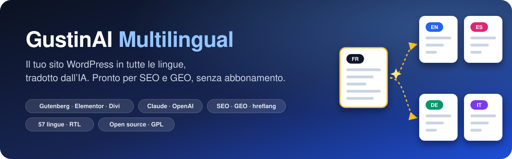
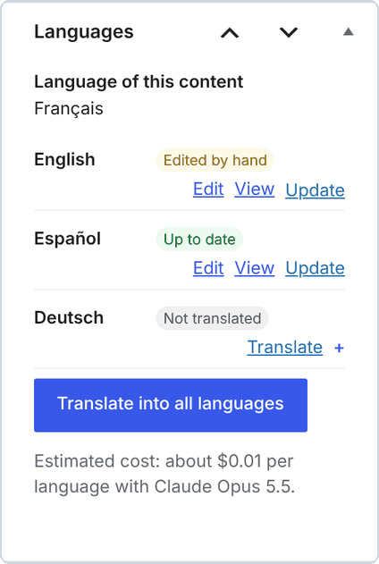
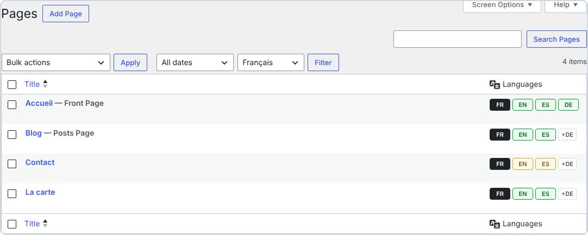
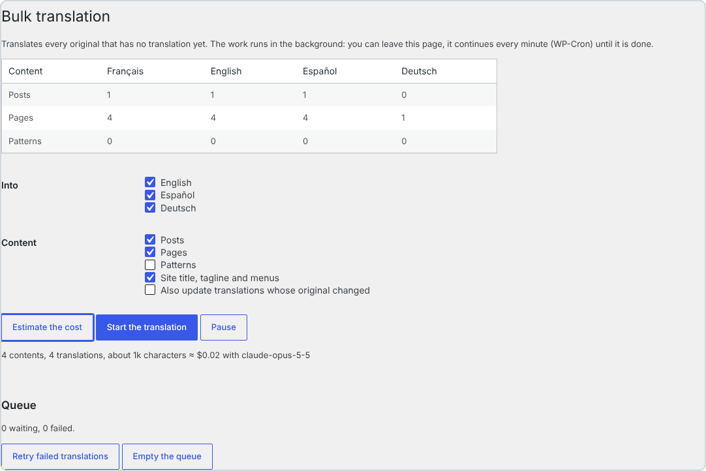
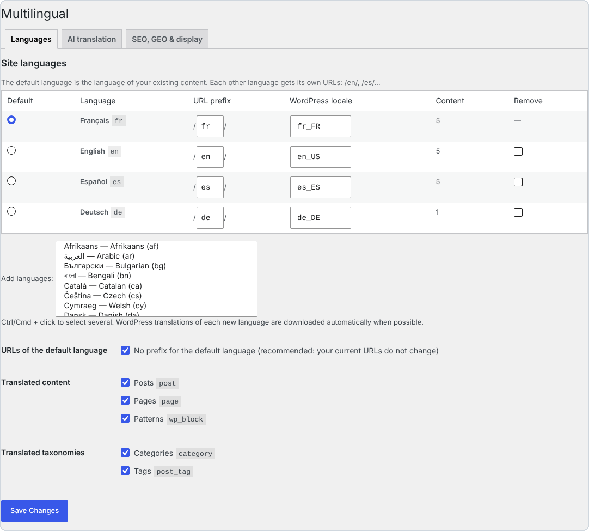
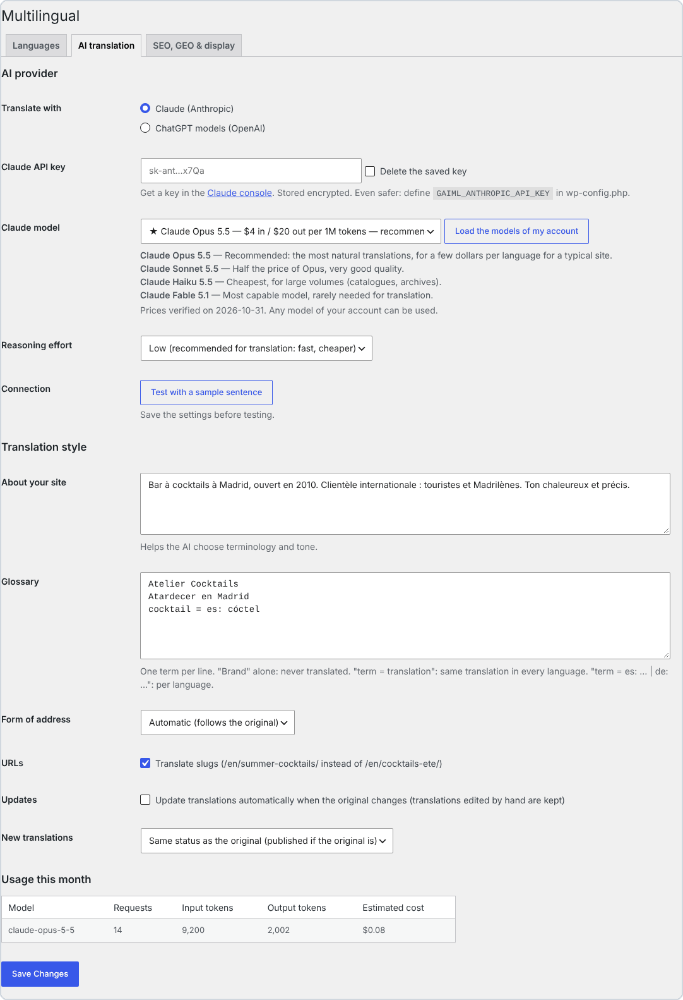
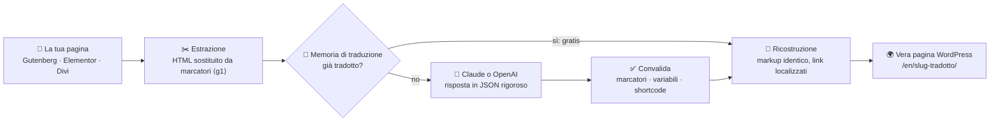
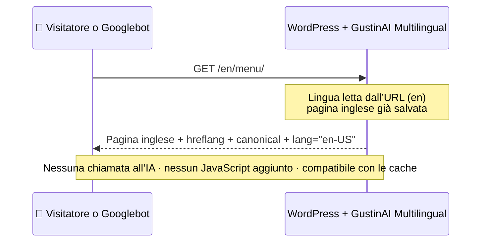

<p align="center">
  
</p>

<p align="center">
  🌐 <a href="../../README.md">English</a> · <a href="README.fr.md">Français</a> · <a href="README.es.md">Español</a> · <b>Italiano</b> · <a href="README.de.md">Deutsch</a> · <a href="README.pt.md">Português</a>
</p>

<p align="center">
  
  
  
  
  
  
  
</p>

> **Trasforma qualsiasi sito WordPress in un sito multilingue tradotto dall’IA: pagine vere, URL tradotti, SEO e GEO impeccabili. Niente abbonamento e niente limiti di parole: paghi solo l’IA che usi, direttamente ad Anthropic o a OpenAI.**

<p align="center">
  <a href="https://github.com/Jacckisback/gustinai-multilingual/raw/main/dist/gustinai-multilingual-1.0.0.zip"><b>⬇️ Scarica il plugin (.zip)</b></a> ·
  <a href="#-inizia-in-5-minuti">🚀 Inizia</a> ·
  <a href="#-quanto-costa-davvero">💸 Costi</a> ·
  <a href="#-confronto-con-i-plugin-di-traduzione-a-pagamento">📊 Confronto</a> ·
  <a href="#-come-funziona">🧠 Come funziona</a> ·
  <a href="#-domande-frequenti">❓ FAQ</a>
</p>

---

## 📑 Indice

- [✨ Perché GustinAI Multilingual?](#-perché-gustinai-multilingual)
- [🌍 Perché rendere il tuo sito multilingue?](#-perché-rendere-il-tuo-sito-multilingue)
- [📸 In immagini](#-in-immagini)
- [🚀 Inizia in 5 minuti](#-inizia-in-5-minuti)
- [💸 Quanto costa davvero?](#-quanto-costa-davvero)
- [📊 Confronto con i plugin di traduzione a pagamento](#-confronto-con-i-plugin-di-traduzione-a-pagamento)
- [🧠 Come funziona](#-come-funziona)
- [🔎 SEO multilingue a regola d’arte](#-seo-multilingue-a-regola-darte)
- [🤖 GEO: essere visibili nelle risposte delle IA](#-geo-essere-visibili-nelle-risposte-delle-ia)
- [🧩 Page builder](#-page-builder)
- [⚙️ Sotto il cofano](#️-sotto-il-cofano)
- [🔐 Sicurezza e privacy](#-sicurezza-e-privacy)
- [🛠️ Per gli sviluppatori](#️-per-gli-sviluppatori)
- [⚠️ Limiti noti](#️-limiti-noti)
- [✅ Qualità e test](#-qualità-e-test)
- [❓ Domande frequenti](#-domande-frequenti)
- [👋 Chi siamo](#-chi-siamo)

---

## ✨ Perché GustinAI Multilingual?

| | |
|---|---|
| 💸 **Niente abbonamento, niente limiti di parole** | Il plugin è gratuito e open source (GPL). La traduzione viene fatturata dal fornitore di IA a prezzo di costo, con la tua chiave: circa **0,06 $ per pagina e per lingua** con Claude Opus 5.5, il modello più naturale, e meno di **0,002 $** con Claude Haiku 5.5 (vedi [i costi](#-quanto-costa-davvero)). |
| 🏠 **Le traduzioni sono tue** | Ogni traduzione è una vera pagina WordPress, salvata nel **tuo** database. Nessun server di terzi si mette tra i tuoi visitatori e i tuoi contenuti. |
| 🧱 **Il layout non si rompe mai** | L’IA non vede mai il tuo HTML: riceve solo i testi. Il markup viene sostituito da marcatori numerati e poi ricostruito identico. I blocchi di Gutenberg, i dati di Elementor e i moduli di Divi restano intatti. |
| 🔎 **SEO a regola d’arte** | Un URL per lingua, nessun reindirizzamento automatico, `hreflang` + `x-default` su ogni pagina, slug e categorie tradotti: esattamente ciò che raccomanda Google.[^g-multi][^g-hreflang] |
| 🤖 **Pronto per i motori di risposta IA (GEO)** | Un `llms.txt` per lingua[^llms], dati strutturati che collegano ogni pagina alle sue traduzioni[^schema] e un prompt di traduzione pensato per SEO e GEO. |
| ⚡ **Zero IA durante le visite** | Le traduzioni si generano una volta sola, nella bacheca. I visitatori ricevono pagine statiche: compatibili con qualsiasi cache e CDN, senza JavaScript aggiunto. |

---

## 🌍 Perché rendere il tuo sito multilingue?

- 🛒 **Si compra nella propria lingua.** In un sondaggio su 8.709 consumatori di 29 paesi, CSA Research ha rilevato che il **66%** sceglierebbe un prodotto simile se le informazioni sono nella sua lingua, e che il **75%** è più propenso a ricomprare lo stesso marchio se l’assistenza clienti parla la sua lingua.[^csa]
- 🧭 **Google vuole un URL per lingua.** Google raccomanda un URL distinto per ogni versione linguistica e i tag `hreflang` per mostrare a ciascun utente la versione giusta.[^g-multi][^g-hreflang] Una traduzione che esiste solo nel browser, o che dipende da un cookie, non può essere indicizzata.
- 🌐 **WordPress è ovunque.** WordPress alimenta il **39,5%** di tutti i siti web e il **58,2%** dei siti di cui si conosce il CMS.[^w3techs] GustinAI Multilingual aggiunge lingue al sito che hai già, senza rifarlo.

> [!TIP]
> **In parole semplici:** un sito multilingue non è un widget che traduce al volo. È una pagina per lingua, con un indirizzo proprio (`/en/…`, `/es/…`), che Google può leggere e che un visitatore può condividere. È esattamente ciò che crea il plugin.

---

## 📸 In immagini

<p align="center">
  
  <br><sub>La stessa pagina in 4 lingue. Ognuna ha il proprio URL, il menu tradotto e un selettore di lingua (semplici link HTML, senza bandiere). Sito dimostrativo.</sub>
</p>

> [!NOTE]
> L’interfaccia di amministrazione del plugin è disponibile in inglese, francese e spagnolo. Le schermate qui sotto mostrano la versione inglese.

<table>
  <tr>
    <td width="38%" valign="top">
      
      <p><b>Nell’editor:</b> lo stato di ogni lingua (<i>Up to date</i>, <i>Edited by hand</i>, <i>Not translated</i>), la traduzione con un clic e il costo stimato.</p>
    </td>
    <td width="62%" valign="top">
      
      <p><b>Negli elenchi delle pagine:</b> 🟩 aggiornata, 🟨 originale modificato dopo la traduzione, <code>+DE</code> = traduci in tedesco con un clic.</p>
      
      <p><b>Traduzione in blocco:</b> stima il costo, poi traduci tutto il sito in background.</p>
    </td>
  </tr>
</table>

<details>
<summary>🖼️ <b>Altre schermate: impostazioni delle lingue e dell’IA</b></summary>
<br>
<p align="center"><br><sub>Lingue: 57 lingue, prefisso URL modificabile, lingua predefinita senza prefisso (i tuoi URL attuali non cambiano).</sub></p>
<p align="center"><br><sub>Traduzione IA: Claude o OpenAI, modello consigliato con i prezzi, descrizione del sito, glossario, registro formale o informale, consumo del mese.</sub></p>
</details>

---

## 🚀 Inizia in 5 minuti

**Requisiti:** WordPress 6.5+, PHP 8.1+, permalink “belli” e una chiave API di Claude (Anthropic) o di OpenAI.

1. **Installa.** [Scarica lo zip](https://github.com/Jacckisback/gustinai-multilingual/raw/main/dist/gustinai-multilingual-1.0.0.zip), vai su **Plugin → Aggiungi nuovo plugin → Carica plugin** e attivalo.
2. **Scegli le lingue.** Vai su **Multilingual → Settings → Languages**. La lingua attuale del sito diventa la lingua predefinita. Le traduzioni di WordPress per ogni nuova lingua vengono scaricate automaticamente.
3. **Ottieni una chiave API.**
   - **Claude:** crea una chiave nella [pagina delle chiavi API della console di Claude](https://platform.claude.com/settings/keys).[^a-key]
   - **OpenAI:** crea una chiave sulla piattaforma di OpenAI.
4. **Configura l’IA.** In **Multilingual → Settings → AI translation**:
   - incolla la chiave e lascia il modello consigliato;
   - descrivi il tuo sito in 2 o 3 frasi e aggiungi i nomi dei tuoi marchi al glossario;
   - clicca su **Test with a sample sentence**.
5. **Traduci.**
   - Clicca su **+EN** accanto a una pagina e controlla il risultato.
   - Poi vai su **Multilingual → Bulk translation**: **Estimate the cost**, poi **Start the translation**.
6. **Aggiungi il selettore di lingua.** Usa il blocco *Language switcher*, lo shortcode `[gaiml_switcher]`, oppure lascia che il plugin lo aggiunga automaticamente a un menu.

> [!IMPORTANT]
> **Chiavi Claude e workspace:** quando crei la chiave, scegli il workspace **“Default”**. L’API di Claude rifiuta le richieste fatte con una chiave non associata a un workspace, a meno che non contengano un’intestazione `anthropic-workspace-id` aggiuntiva, che il plugin non invia.[^a-key]

> [!TIP]
> **Ancora più sicuro:** dichiara le chiavi in `wp-config.php` invece che nel database. Così non compaiono mai nella bacheca.
>
> ```php
> define( 'GAIML_ANTHROPIC_API_KEY', 'sk-ant-...' );
> define( 'GAIML_OPENAI_API_KEY', 'sk-...' );
> ```

> [!NOTE]
> Vuoi rileggere prima di pubblicare? In **New translations** scegli **Draft, to review before publishing**. Google premia i contenuti di qualità “indipendentemente da come sono prodotti”.[^g-ai] Rileggere le pagine chiave resta la garanzia migliore.

---

## 💸 Quanto costa davvero?

Il plugin è **gratuito**. Paghi al fornitore di IA solo i testi che invii, con la tua chiave. Prezzi verificati sulle pagine ufficiali il 2 novembre 2026:

| Fornitore | Modello | Prezzo per milione di token (input / output) | ≈ Costo per 100 pagine di circa 800 parole, per lingua* |
|---|---|---|---|
| Claude | **Claude Opus 5.5** ⭐ consigliato | 4 $ / 20 $[^a-pricing] | **≈ 5,80 $** |
| Claude | Claude Sonnet 5.5 | 2 $ / 10 $[^a-pricing] | ≈ 2,90 $ |
| Claude | Claude Haiku 5.5 | 0,10 $ / 0,50 $[^a-pricing] | ≈ 0,15 $ |
| OpenAI | **GPT-6.1 Sol** ⭐ consigliato | 2 $ / 10 $[^o-pricing] | ≈ 2,90 $ |
| OpenAI | GPT-6.1 Terra | 1 $ / 5 $[^o-pricing] | ≈ 1,45 $ |
| OpenAI | GPT-6 Luna | 0,10 $ / 0,50 $[^o-pricing] | ≈ 0,15 $ |

<sub>* Stima calcolata dal plugin a partire dai prezzi pubblici: circa 1 token ogni 3,5 caratteri, più le istruzioni e l’involucro JSON di ogni richiesta, con un impegno di ragionamento basso. Il plugin mostra la propria stima per i tuoi contenuti prima di tradurre qualsiasi cosa.</sub>

> [!TIP]
> **Che cos’è un token?** È l’unità che fatturano i fornitori di IA: circa ¾ di parola in inglese, un po’ meno in italiano. Una pagina di 800 parole vale circa da 1.000 a 1.500 token.

**Tre meccanismi tengono bassa la bolletta:**

- 🧠 **Memoria di traduzione.** Una frase identica si paga una volta sola, e una pagina modificata rimanda solo le frasi cambiate.
- 🗜️ **Cache del prompt.** Su Claude, le istruzioni comuni a tutte le richieste vengono messe in cache. La lettura dalla cache costa il 5% del prezzo di input su Opus 5.5 e Sonnet 5.5.[^a-cache]
- 🎚️ **Impegno di ragionamento basso per impostazione predefinita.** Tradurre non richiede ragionamenti lunghi: è più veloce e costa meno.

---

## 📊 Confronto con i plugin di traduzione a pagamento

### Esempio concreto: un sito di 100 pagine (~80.000 parole) tradotto in 5 lingue

Sono **400.000 parole da tradurre**, perché WPML e Weglot contano le parole una volta per ogni lingua di destinazione.[^wpml-words][^weglot-words]

| Soluzione | Quanto paghi il primo anno | E dopo? |
|---|---|---|
| **GustinAI Multilingual** | **0 $ di plugin + ≈ 29 $ di IA, una volta sola** (Claude Opus 5.5)<br>≈ 14,50 $ con Sonnet 5.5 o GPT-6.1 Sol, **≈ 0,75 $** con Haiku 5.5 | **0 $ di licenza.** All’IA vengono inviati solo i testi nuovi o modificati. |
| Weglot | **2.990 € all’anno**: il piano *Advanced* (1.000.000 di parole, 10 lingue), perché *Pro* si ferma a 200.000 parole[^weglot][^weglot-words] | La stessa cifra ogni anno. Se disdici, le traduzioni spariscono dal tuo sito.[^weglot-cancel] |
| WPML | **≈ 614 €**: il piano *CMS* a 99 € (22.500 parole IA incluse) + ≈ 515 € di parole extra alla tariffa pubblica a scaglioni[^wpml][^wpml-words] | Rinnovo annuale per gli aggiornamenti, più parole per i nuovi contenuti. |
| TranslatePress | **≈ 195–349 € all’anno**: *Personal* (99 €, 50.000 parole IA) + pacchetti da 100.000 parole a 24 €, oppure *Developer* (349 €, 500.000 parole)[^tp] | Licenza annuale. La quota di parole IA si ricarica al rinnovo.[^tp] |
| GTranslate | **350 $ all’anno**: il piano *Business*, il primo con URL tradotti (parole illimitate)[^gtranslate] | Abbonamento annuale. Le traduzioni sono servite dal proxy di GTranslate.[^gtranslate] |
| Polylang Pro | **99 € all’anno** (1 sito) + l’API di DeepL, fatturata a parte con la tua chiave[^polylang] | Nessuna funzione “traduci tutto con un clic”, secondo il produttore.[^polylang] |

<sub>Prezzi di listino pubblici IVA esclusa, rilevati sulle pagine dei produttori il 2 novembre 2026; possono cambiare. I nostri calcoli sono indicati in ogni cella. Per TranslatePress ipotizziamo che le parole siano contate per lingua di destinazione, come per WPML e Weglot. Ogni concorrente offre funzioni che GustinAI Multilingual non ha, come traduzione umana professionale, gestione dei progetti di traduzione, multisito e WooCommerce. Confronta in base alle tue esigenze.</sub>

### Come funziona ciascuna soluzione

| | GustinAI Multilingual | WPML | Polylang Pro | TranslatePress | Weglot | GTranslate (piani a pagamento) |
|---|---|---|---|---|---|---|
| **Modello di business** | Gratuito (GPL), IA a prezzo di costo | Licenza 39–199 € (1 anno di aggiornamenti) + parole IA[^wpml] | Licenza annuale da 99 €[^polylang] | Licenza annuale 99–349 €[^tp] | Abbonamento mensile 15–699 €[^weglot] | Abbonamento mensile 12–50 $[^gtranslate] |
| **Motore di traduzione** | Claude o OpenAI, il modello che preferisci, con la tua chiave | Parole IA di WPML, DeepL, Google, Microsoft[^wpml-words] | DeepL con la tua chiave[^polylang] | TranslatePress AI (quota), Google o DeepL con la tua chiave[^tp] | Incluso nella quota di parole[^weglot] | Incluso[^gtranslate] |
| **Dove vivono le traduzioni** | Il tuo database, come vere pagine WordPress | Il tuo database, un articolo per lingua[^wpml-tables] | Il tuo database, contenuto duplicato per lingua[^polylang] | Il tuo server, conservate alla scadenza della licenza[^tp] | Il servizio di Weglot[^weglot-cancel] | Il proxy cloud di GTranslate[^gtranslate] |
| **URL tradotti** | ✅ inclusi | ✅ | ✅ | ✅ tutti i piani a pagamento[^tp] | da *Pro* (79 €/mese)[^weglot] | da *Business* (35 $/mese)[^gtranslate] |

<sub>WordPress, WPML, Polylang, TranslatePress, Weglot, GTranslate, Claude, OpenAI, ChatGPT, Elementor e Divi sono marchi dei rispettivi proprietari. GustinAI Multilingual è un progetto indipendente, non affiliato a loro.</sub>

---

## 🧠 Come funziona



**Esempio.** Ecco che cosa succede a una frase della tua pagina:

| Passaggio | Contenuto |
|---|---|
| 1. Il tuo HTML originale | `<p>Prenota <strong>oggi</strong> nel <a href="/contatti/">nostro bar</a>.</p>` |
| 2. Ciò che riceve l’IA | `Prenota <g1>oggi</g1> nel <g2>nostro bar</g2>.` |
| 3. Ciò che restituisce l’IA | `Book <g1>today</g1> at <g2>our bar</g2>.` |
| 4. Ciò che viene salvato | `<p>Book <strong>today</strong> at <a href="/en/contact/">our bar</a>.</p>` |

- L’IA vede solo testo e marcatori. **Non può** rompere un tag o un blocco, né iniettare HTML.
- Il link è stato localizzato automaticamente, da `/contatti/` a `/en/contact/`, perché quella pagina ha una traduzione in inglese.

**Quando arriva un visitatore:**



---

## 🔎 SEO multilingue a regola d’arte

Ogni raccomandazione di Google e del W3C, e che cosa fa il plugin:

| Raccomandazione | Che cosa fa GustinAI Multilingual |
|---|---|
| Usare **un URL diverso per ogni lingua**.[^g-multi] | Sottocartelle `/en/`, `/es/`… La lingua predefinita può mantenere i suoi URL attuali, senza prefisso. |
| **Evitare i reindirizzamenti automatici** in base alla lingua dell’utente.[^g-multi] | La lingua viene **solo dall’URL**: niente cookie, niente rilevamento. Googlebot vede tutte le versioni. |
| Ogni versione deve **elencare se stessa e tutte le altre** (`hreflang`), più `x-default`.[^g-hreflang] | I tag `hreflang` sono generati su ogni pagina, in entrambe le direzioni, solo verso le traduzioni davvero pubblicate. |
| Tradurre il **contenuto principale**, non solo gli elementi di contorno.[^g-multi] | Si traduce tutto: contenuti, dati dei page builder, titolo e descrizione SEO, testi alternativi delle immagini, slug, categorie, tag e menu. |
| Dichiarare la **lingua della pagina** (accessibilità).[^wcag] Aggiungere `dir="rtl"` per le lingue che si scrivono da destra a sinistra.[^w3c-dir] | `<html lang="it-IT">` su ogni pagina e `dir="rtl"` per arabo, ebraico, persiano e urdu. |
| **Non usare bandiere** per indicare le lingue.[^w3c-flags] | Il selettore mostra nomi o codici (EN, Italiano…), come semplici link HTML che i motori di ricerca possono scansionare. |
| Sitemap XML (integrate in WordPress dalla versione 5.5).[^wp-sitemaps] | Tutte le lingue attive sono elencate in `/wp-sitemap.xml`. Yoast SEO e Rank Math recuperano gli URL corretti. |

**Incluso anche:**

- Slug tradotti (`/en/summer-cocktails/`), oppure lo stesso slug in tutte le lingue se preferisci (`/contact/` e `/en/contact/`).
- Campi tradotti per Yoast SEO, Rank Math, SEOPress, The SEO Framework e AIOSEO.
- Niente contenuti duplicati: un URL `/en/` non mostra mai una pagina non tradotta, e un URL errato reindirizza alla traduzione nella lingua richiesta.

> [!TIP]
> **Che cos’è `hreflang`?** Un tag nel codice della pagina che dice a Google: “questa pagina esiste anche in inglese, ecco il suo indirizzo”. Google mostra così la versione giusta a ogni utente.

---

## 🤖 GEO: essere visibili nelle risposte delle IA

Il **GEO** (*Generative Engine Optimization*) consiste nell’ottimizzare i contenuti per i motori di risposta come ChatGPT, Claude, Perplexity o le AI Overviews di Google. Uno studio presentato alla conferenza KDD 2024 ha dimostrato che ottimizzazioni adeguate **possono aumentare la visibilità fino al 40%** in queste risposte.[^geo]

- 📄 **Un `llms.txt` in ogni lingua** (`/llms.txt`, `/en/llms.txt`…). Questo formato, proposto nel 2024, offre alle IA un indice pulito del tuo sito in Markdown.[^llms]
- 🧬 **Dati strutturati.** `inLanguage`, `workTranslation` e `translationOfWork`[^schema] dicono alle IA che due pagine sono l’una la traduzione dell’altra. Vengono aggiunti al grafo di Yoast SEO o di Rank Math, oppure emessi da soli se non usi un plugin SEO.
- ✍️ **Un prompt di traduzione pensato per SEO e GEO.** Chiede il vocabolario che le persone cercano davvero nella lingua di destinazione e titoli espliciti, e vieta di inventare informazioni.
- 🔗 **Link interni che restano nella lingua.** Una pagina inglese rimanda a pagine inglesi, così le IA che la leggono restano nella lingua giusta.

---

## 🧩 Page builder

| Builder | Che cosa viene tradotto |
|---|---|
| **Gutenberg** (editor a blocchi) | I testi, gli attributi dei blocchi (pulsanti, ricerca, navigazione…) e i pattern sincronizzati, i cui blocchi puntano poi al pattern tradotto. I blocchi tradotti restano validi nell’editor. |
| **Elementor** | Tutti i widget di testo (titolo, editor di testo, pulsante, schede, accordion, moduli, caroselli…), i link e le immagini. Il CSS viene rigenerato, e i template di Elementor (header, footer, popup) vengono sostituiti dalla loro traduzione. |
| **Divi 4** (shortcode) e **Divi 5** (blocchi) | I testi dei moduli, i titoli, i pulsanti e i link. Il modulo *Code* non viene mai tradotto. |
| **Editor classico** | I testi, l’HTML personalizzato e gli shortcode dei moduli di contatto, che restano intatti. |

🛡️ **Mai tradotti:** `<code>`, `<pre>`, `<script>`, `<style>`, `<svg>` e qualsiasi elemento marcato con `translate="no"` o `class="notranslate"`.

---

## ⚙️ Sotto il cofano

Ciò che rende il plugin leggero, veloce e affidabile:

**🗃️ Modello dei dati**
- Una sola tabella indicizzata, `wp_gaiml_translations`, associa `(tipo di oggetto, ID)` a `(lingua, gruppo di traduzioni)`. Una chiave `UNIQUE (gruppo, lingua)` garantisce una sola traduzione per lingua.
- Le traduzioni sono normali articoli e termini di WordPress. Temi, plugin, cache e backup le gestiscono come qualsiasi altro contenuto.

**🧭 Routing**
- La lingua viene letta dall’URL prima che WordPress carichi le sue traduzioni. Così WordPress, il tuo tema e i tuoi plugin mostrano i propri testi nella lingua del visitatore.
- `home_url()` riceve il prefisso della lingua: archivi, ricerca, feed e paginazione restano nella lingua senza codice aggiuntivo.

**⚡ Prestazioni**
- Il filtro per lingua è un solo `LEFT JOIN` indicizzato, senza `meta_query`.
- Le lingue di pagine, termini e menu vengono caricate in blocco.
- Misurato sul nostro sito di test: **circa 10 query indicizzate in più per pagina, senza tempo misurabile**. Quel sito usava WordPress 7.1.4, PHP 8.3 e MariaDB 10.11.
- Nessun JavaScript aggiunto per i visitatori. Il CSS del selettore (1 KB) viene stampato inline solo quando il selettore è visibile.

**🤖 Motore di traduzione**
- **Lotti:** fino a 6.000 caratteri e 120 testi per richiesta. Se una risposta arriva troncata, il lotto viene dimezzato automaticamente.
- **Formato di uscita garantito:** le risposte seguono uno schema JSON rigoroso, grazie agli output strutturati di Claude[^a-so] e di OpenAI[^o-so].
- **Convalida:** ogni testo deve conservare i suoi marcatori e le sue variabili (`%%title%%`, `%s`, `{{name}}`…). Un testo non valido resta nella lingua originale: **mai HTML rotto**.
- **Adattivo:** se un modello rifiuta un parametro (impegno di ragionamento, formato JSON), il plugin lo toglie e se lo ricorda per quel modello. Così funziona qualsiasi modello del tuo account.

**🔁 Coda in background**
- I job vengono prenotati in modo atomico, con un blocco di 15 minuti e fino a 6 tentativi a intervalli crescenti.
- La coda avanza in background con WP-Cron, o dalla riga di comando con WP-CLI. Puoi chiudere la pagina.

**✍️ Rispetto delle tue modifiche**
- Ogni traduzione memorizza l’impronta dell’originale da cui è stata fatta e quella del testo generato dall’IA.
- Così il plugin sa quando l’originale è cambiato (*Original changed*) e quando qualcuno ha ritoccato la traduzione (*Edited by hand*).
- Una traduzione ritoccata a mano **non** viene **mai** sovrascritta automaticamente.

---

## 🔐 Sicurezza e privacy

- 🔑 **Chiavi API cifrate.** Le chiavi salvate nel database sono cifrate con libsodium (XSalsa20-Poly1305) e non vengono mai più mostrate. Meglio ancora: dichiarale come costanti in `wp-config.php`.
- 👮 **Permessi.**
  - Ogni azione verifica un nonce e i permessi dell’utente.
  - Un collaboratore può tradurre solo ciò che può modificare e pubblicare.
  - Non può sovrascrivere una traduzione che non ha il permesso di modificare.
- 🧱 **Output dell’IA neutralizzato.**
  - Vengono ripristinati solo i marcatori attesi. Tutto il resto viene sottoposto a escape, parentesi quadre comprese: l’IA non può iniettare né tag né shortcode.
  - Gli attributi HTML vengono letti uno a uno e sostituiti per posizione.
- 🗄️ **SQL robusto.** Le query sono preparate, e la coda usa blocchi atomici che resistono alle richieste simultanee.
- 🕵️ **Privacy.**
  - Vengono inviati solo i testi dei tuoi contenuti, mai i dati dei tuoi visitatori.
  - Le chiamate vanno solo verso `api.anthropic.com` o `api.openai.com`, e le richieste a OpenAI vengono inviate con `store: false`.
  - Per impostazione predefinita, né Anthropic né OpenAI usano i dati dell’API per addestrare i loro modelli.[^a-data][^o-data]

---

## 🛠️ Per gli sviluppatori

**WP-CLI**

```bash
wp gaiml translate 12 34 --lang=en,es   # traduce contenuti e attende il risultato
wp gaiml translate 7 --type=term        # traduce una categoria
wp gaiml bulk --lang=en                 # tutto ciò che manca, prima le pagine (--queue-only: lascia fare a WP-Cron)
wp gaiml queue status|run|retry|clear
wp gaiml status                         # lingue, contenuti, consumo del mese
```

**Funzioni PHP**

- `gaiml_current_language()`, `gaiml_default_language()` e `gaiml_languages()`.
- `gaiml_get_translation( $id, $lang, 'post'|'term' )` e `gaiml_post_language( $id )`.
- `gaiml_home_url( $lang )` e `gaiml_language_switcher( $args )`.

**API REST e query**

- L’API REST espone i campi `gaiml_lang` e `gaiml_translations`, e accetta il parametro `?lang=en` su tutte le rotte.
- `WP_Query` accetta `'gaiml_lang' => 'en'`, `'all'` o `'active'`.
- `get_posts()` viene filtrato solo con `'suppress_filters' => false`, come con WPML.

**Hook**

- **Filtri:** `gaiml_post_types`, `gaiml_taxonomies`, `gaiml_translatable_meta` (campi personalizzati da tradurre), `gaiml_meta_skip`, `gaiml_strings`, `gaiml_system_prompt`, `gaiml_known_models`, `gaiml_provider`, `gaiml_hreflang`, `gaiml_alternates`, `gaiml_llms_txt`, `gaiml_switcher_css` e `gaiml_exclude_post`.
- **Azioni:** `gaiml_post_translated`, `gaiml_translations_changed` e `gaiml_loaded`.

Architettura interna (in francese): [docs/ARCHITECTURE.md](../ARCHITECTURE.md).

---

## ⚠️ Limiti noti

La versione 1.0 ha alcuni limiti:

- **Struttura degli URL:** solo sottocartelle. Sottodomini e domini per lingua non sono supportati.
- **WooCommerce:** non selezionare *Prodotti*, perché scorte e prezzi non sono sincronizzati tra le lingue.
- **Temi a blocchi:**
  - Le parti di template personalizzate, come header e footer, non vengono tradotte, tranne la navigazione, il titolo e il motto del sito.
  - Il Divi Theme Builder non è supportato.
- **Campi personalizzati (ACF):** dichiarali con il filtro `gaiml_translatable_meta`.
- **Divi 5:** il supporto si basa sul formato a blocchi pubblico di Divi 5 e va ancora convalidato su un sito reale.

---

## ✅ Qualità e test

| Suite di test | Controlli | Che cosa copre |
|---|---|---|
| `php tests/unit.php` | 52 | Estrazione dei testi: Gutenberg, Divi 4 e 5, Elementor, tentativi di iniezione |
| `wp eval-file tests/e2e/providers.php` | 28 | Connettori Claude e OpenAI, con risposte API simulate |
| `wp eval-file tests/e2e/engine.php` | 7 | Robustezza: risposte troncate, markup rotto |
| `wp eval-file tests/e2e/review.php` | 24 | Non regressione: cestino, concorrenza, slug, sitemap, blocchi |

**Testato anche:**

- Nel browser: le pagine di amministrazione, 0 blocchi Gutenberg non validi dopo la traduzione, e Elementor senza errori JavaScript.
- Un’installazione pulita dallo zip.
- L’analisi statica di sicurezza con PHPCS (WordPress.Security, PreparedSQL, PHPCompatibility 8.1).

**Ambiente di test:**

- WordPress 7.1.4, PHP 8.3 e MariaDB 10.11.
- Elementor 4.3.5.
- I temi Twenty Twenty-Five (a blocchi) e Twenty Twenty-One (classico).

Per creare lo zip da solo: `bin/build.sh`.

---

## ❓ Domande frequenti

<details>
<summary><b>Google penalizzerà le pagine tradotte dall’IA?</b></summary>

Google dichiara di premiare i contenuti di qualità “indipendentemente da come sono prodotti” e che “l’uso appropriato dell’IA o dell’automazione non viola le sue linee guida”.[^g-ai] Per puntare alla qualità:

- descrivi il tuo sito e compila il glossario;
- scegli un buon modello;
- rileggi le pagine chiave (puoi pubblicare le nuove traduzioni come bozze).

Le tue modifiche sono protette.
</details>

<details>
<summary><b>Che fine fanno le traduzioni se disinstallo il plugin?</b></summary>

Restano nel tuo database come normali pagine e articoli di WordPress: conservi tutti i tuoi contenuti. Senza il plugin, però, WordPress non sa più in quale lingua è ogni pagina.

Le tabelle e le impostazioni del plugin vengono eliminate solo se selezioni l’apposita opzione prima della disinstallazione.
</details>

<details>
<summary><b>Posso ritoccare una traduzione a mano?</b></summary>

Sì, come qualsiasi pagina di WordPress, con il tuo builder abituale. Il plugin rileva la modifica (stato *Edited by hand*) e non la sovrascrive mai automaticamente.
</details>

<details>
<summary><b>I visitatori fanno partire chiamate all’IA?</b></summary>

Mai. Le traduzioni vengono create nella bacheca e poi servite come pagine normali. Una visita non costa nulla in IA.
</details>

<details>
<summary><b>Quale modello scegliere?</b></summary>

- **Claude Opus 5.5** offre le traduzioni più naturali, per pochi dollari per lingua su un sito tipico.
- **Claude Sonnet 5.5** o **GPT-6.1 Sol** costano la metà, con un’ottima qualità.
- **Claude Haiku 5.5** o **GPT-6 Luna** sono ideali per volumi molto grandi, come cataloghi e archivi.

Puoi usare qualsiasi modello del tuo account.
</details>

<details>
<summary><b>I miei contenuti servono ad addestrare le IA?</b></summary>

Non per impostazione predefinita. Anthropic non usa gli input e gli output dei suoi prodotti commerciali, API compresa, per addestrare i suoi modelli,[^a-data] e OpenAI non usa i dati inviati alla sua API a meno che tu non lo accetti esplicitamente.[^o-data]
</details>

<details>
<summary><b>Quante lingue sono disponibili?</b></summary>

57 lingue, incluse varianti regionali (fr-CA, pt-BR, es-MX, de-CH…) e 4 lingue che si scrivono da destra a sinistra (arabo, ebraico, persiano e urdu). Puoi modificare il prefisso URL di ogni lingua.
</details>

---

## 👋 Chi siamo

GustinAI Multilingual è sviluppato da **Thierry Gustin**, fondatore di **[GustinAI](https://gustinai.com)**, che offre formazione sull’IA alle aziende in Francia e in Spagna.

- 💼 **Ti serve aiuto per lanciare un sito multilingue, o per formare il tuo team sull’IA?** → [gustinai.com](https://gustinai.com)
- ⭐ **Questo plugin ti fa risparmiare un abbonamento?** Lascia una stella al repository: aiuta altre persone a trovarlo.
- 🐛 **Un bug o un’idea?** Apri una [issue](https://github.com/Jacckisback/gustinai-multilingual/issues).

## 📄 Licenza

[GPL-2.0-or-later](../../LICENSE): libero di usarlo, modificarlo e ridistribuirlo.

---

## 📚 Fonti

Tutti i dati e le raccomandazioni citati sopra sono documentati qui sotto. Le pagine sono state consultate il 2 novembre 2026.

[^csa]: CSA Research, *Does Language Matter? The Impact of Language on the Customer Journey* (Can’t Read, Won’t Buy – B2C), 10 giugno 2020: 8.709 consumatori di 29 paesi. <https://csa-research.com/Blogs-Events/Blog/customer-online-buying-experience>
[^w3techs]: W3Techs, *Usage statistics and market share of WordPress* (2 novembre 2026). <https://w3techs.com/technologies/details/cm-wordpress>
[^g-multi]: Google Search Central, *Gestire siti multiregionali e multilingue*. <https://developers.google.com/search/docs/specialty/international/managing-multi-regional-sites>
[^g-hreflang]: Google Search Central, *Comunicare a Google le versioni localizzate della pagina*. <https://developers.google.com/search/docs/specialty/international/localized-versions>
[^g-ai]: Google Search Central Blog, *Google Search’s guidance about AI-generated content*, febbraio 2023. <https://developers.google.com/search/blog/2023/02/google-search-and-ai-content>
[^llms]: Jeremy Howard, *The /llms.txt file*, proposta del 3 settembre 2024. <https://llmstxt.org/>
[^geo]: P. Aggarwal et al., *GEO: Generative Engine Optimization*, KDD 2024 (arXiv:2311.09735). <https://arxiv.org/abs/2311.09735>
[^schema]: Schema.org, proprietà `workTranslation` / `translationOfWork` e `inLanguage`. <https://schema.org/workTranslation>, <https://schema.org/inLanguage>
[^wcag]: W3C, WCAG 2.2, *Understanding Success Criterion 3.1.1: Language of Page*. <https://www.w3.org/WAI/WCAG22/Understanding/language-of-page.html>
[^w3c-dir]: W3C Internazionalizzazione, *Structural markup and right-to-left text in HTML*. <https://www.w3.org/International/questions/qa-html-dir>
[^w3c-flags]: W3C Internazionalizzazione, *Indicating the language of a link destination* (“Don’t use flags to indicate languages!”). <https://www.w3.org/International/questions/qa-link-lang>
[^wp-sitemaps]: Make WordPress Core, *New XML Sitemaps Functionality in WordPress 5.5*, 22 luglio 2020. <https://make.wordpress.org/core/2020/07/22/new-xml-sitemaps-functionality-in-wordpress-5-5/>
[^a-pricing]: Anthropic, *Pricing* (API di Claude). <https://platform.claude.com/docs/en/about-claude/pricing>
[^o-pricing]: OpenAI, *API Pricing*. <https://developers.openai.com/api/docs/pricing>
[^a-cache]: Anthropic, *Prompt caching*. <https://platform.claude.com/docs/en/build-with-claude/prompt-caching>
[^a-so]: Anthropic, *Structured outputs*. <https://platform.claude.com/docs/en/build-with-claude/structured-outputs>
[^o-so]: OpenAI, *Structured Outputs*. <https://developers.openai.com/api/docs/guides/structured-outputs>
[^a-data]: Anthropic Privacy Center, *Is my data used for model training?* <https://privacy.claude.com/en/articles/7996868-is-my-data-used-for-model-training>
[^o-data]: OpenAI, *Data controls in the OpenAI platform*. <https://developers.openai.com/api/docs/guides/your-data>
[^a-key]: Anthropic, *Get your Claude API key* e *Authentication: Select a workspace*. <https://platform.claude.com/docs/en/get-api-key>, <https://platform.claude.com/docs/en/manage-claude/authentication>
[^wpml]: WPML, *Pricing*: Multilingual Blog 39 €, Multilingual CMS 99 € (22.500 parole IA), Multilingual Agency 199 € (45.000 parole IA). <https://app.wpml.org/purchase>
[^wpml-words]: WPML, *Pricing for Automatic Translation*: parole contate “una volta per ogni lingua di destinazione”; pagamento a consumo da 3,00 € a 0,40 € ogni 1.000 parole. <https://wpml.org/documentation/automatic-translation/automatic-translation-pricing/>
[^wpml-tables]: WPML, *WPML’s Database Tables* (tabella `icl_translations`: un articolo e la sua traduzione sono due voci distinte). <https://wpml.org/documentation/support/wpml-tables/>
[^polylang]: Polylang, *Polylang Pro*: da 99 € all’anno per 1 sito, integrazione con DeepL con la tua chiave API, nessuna funzione “traduci tutto con un clic”. <https://polylang.pro/pricing/polylang-pro/>
[^tp]: TranslatePress, *Pricing*: Personal 99 € all’anno (50.000 parole IA), Business 199 € (200.000), Developer 349 € (500.000), 100.000 parole extra a 24 €, traduzioni conservate sul tuo server alla scadenza della licenza. <https://translatepress.com/pricing/>
[^weglot]: Weglot, *Pricing*: da Starter 15 €/mese (10.000 parole, 1 lingua) a Extended 699 €/mese; Pro 79 €/mese (200.000 parole, 5 lingue, URL tradotti); Advanced 299 €/mese o 2.990 €/anno (1.000.000 di parole, 10 lingue). <https://www.weglot.com/pricing>
[^weglot-words]: Centro assistenza Weglot, *What is the number of translated words and how is it calculated?* (“3 x 8,000 = 24,000 translated words”). <https://support.weglot.com/article/59-total-number-translated-words>
[^weglot-cancel]: Centro assistenza Weglot, *How can I pause/cancel my subscription*: dopo la disdetta le traduzioni non compaiono più e le pagine tradotte vengono rimosse progressivamente dai motori di ricerca. <https://support.weglot.com/article/247-how-to-cancel-my-subscription>
[^gtranslate]: GTranslate, home page e piani: Custom 12 $, Startup 25 $, Business 35 $ (URL tradotti), Enterprise 50 $ al mese; i piani a pagamento funzionano come un proxy di traduzione, con traduzioni ospitate sulla rete cloud di GTranslate. <https://gtranslate.io/>
