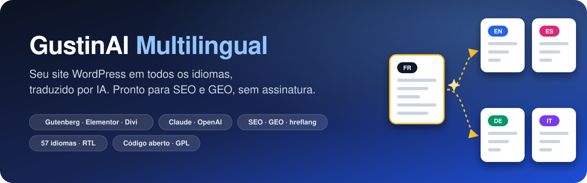
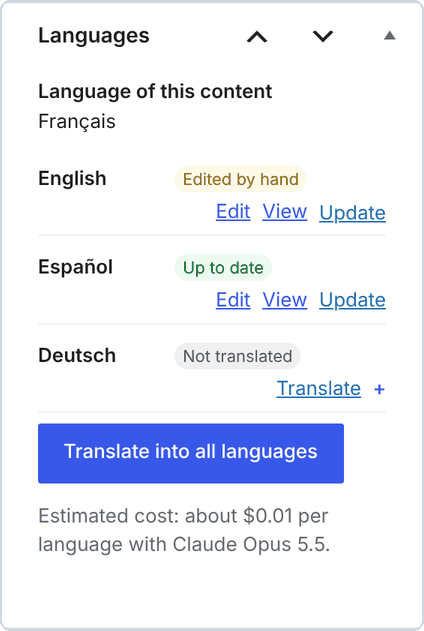
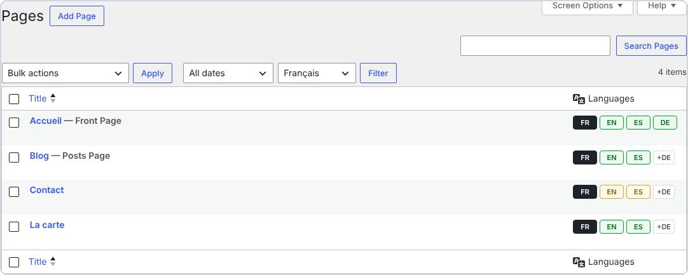
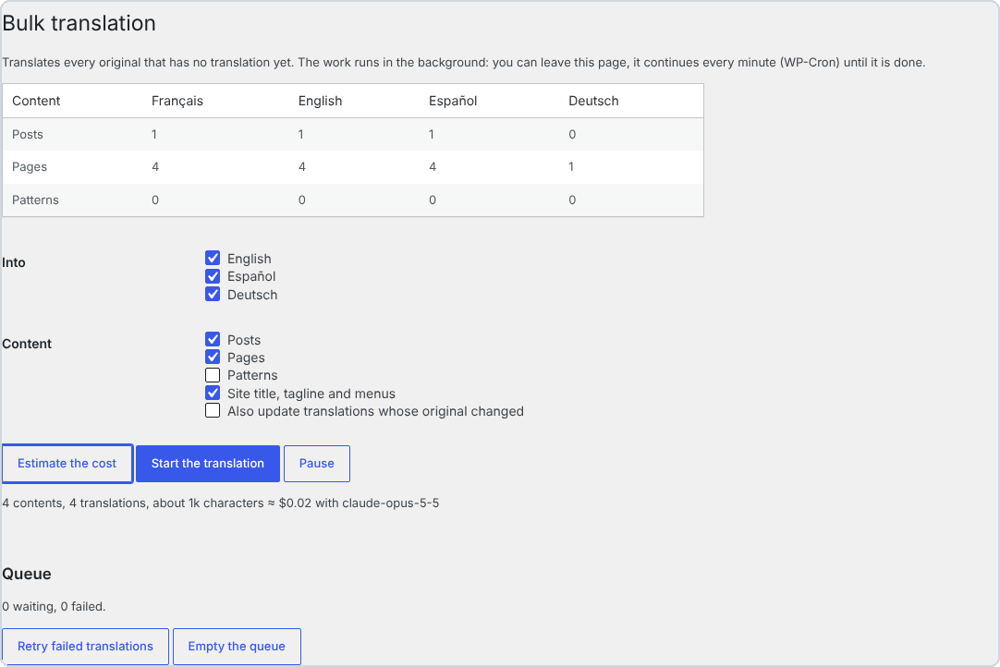
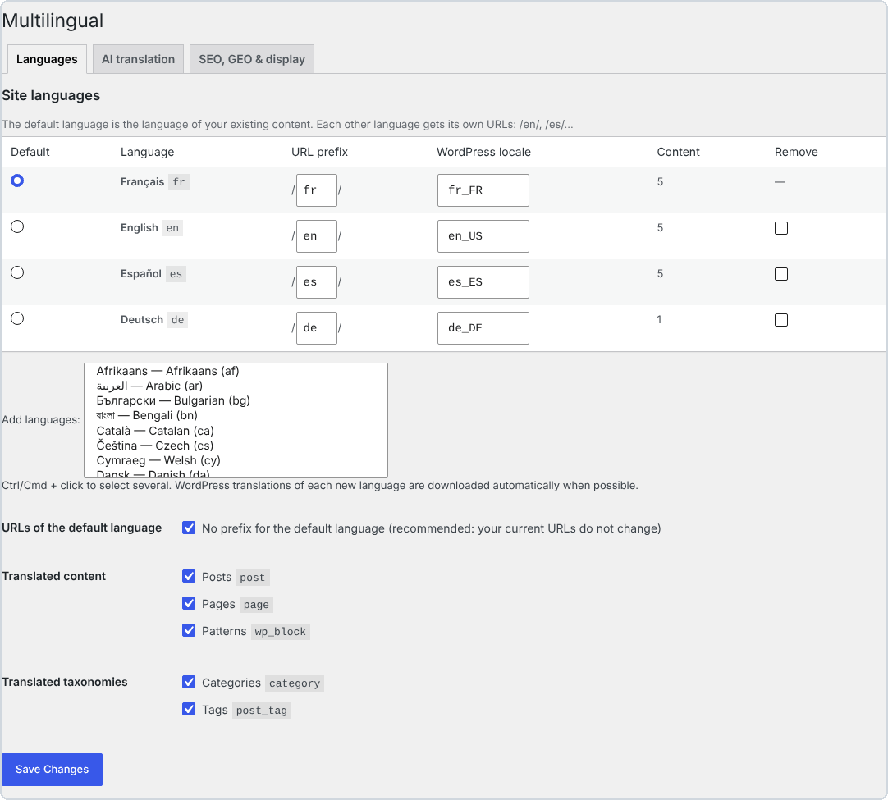
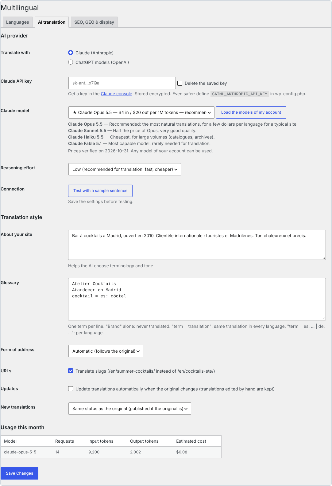
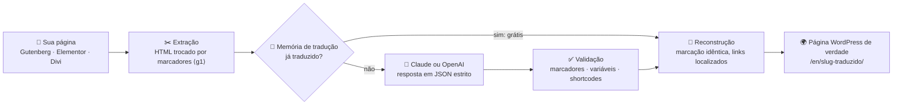
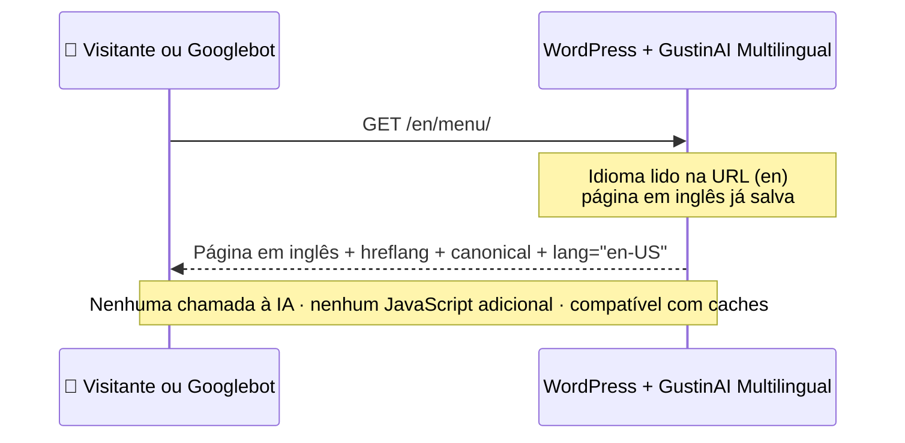

<p align="center">
  
</p>

<p align="center">
  🌐 <a href="../../README.md">English</a> · <a href="README.fr.md">Français</a> · <a href="README.es.md">Español</a> · <a href="README.it.md">Italiano</a> · <a href="README.de.md">Deutsch</a> · <b>Português</b>
</p>

<p align="center">
  
  
  
  
  
  
  
</p>

> **Transforme qualquer site WordPress em um site multilíngue traduzido por IA: páginas reais, URLs traduzidas, SEO e GEO impecáveis. Sem assinatura e sem cota de palavras: você só paga a IA que usa, direto para a Anthropic ou para a OpenAI.**

<p align="center">
  <a href="https://github.com/Jacckisback/gustinai-multilingual/raw/main/dist/gustinai-multilingual-1.0.0.zip"><b>⬇️ Baixar o plugin (.zip)</b></a> ·
  <a href="#-comece-em-5-minutos">🚀 Comece</a> ·
  <a href="#-quanto-custa-de-verdade">💸 Custos</a> ·
  <a href="#-comparativo-com-os-plugins-de-tradução-pagos">📊 Comparativo</a> ·
  <a href="#-como-funciona">🧠 Como funciona</a> ·
  <a href="#-perguntas-frequentes">❓ FAQ</a>
</p>

---

## 📑 Sumário

- [✨ Por que o GustinAI Multilingual?](#-por-que-o-gustinai-multilingual)
- [🌍 Por que tornar seu site multilíngue?](#-por-que-tornar-seu-site-multilíngue)
- [📸 Em imagens](#-em-imagens)
- [🚀 Comece em 5 minutos](#-comece-em-5-minutos)
- [💸 Quanto custa de verdade?](#-quanto-custa-de-verdade)
- [📊 Comparativo com os plugins de tradução pagos](#-comparativo-com-os-plugins-de-tradução-pagos)
- [🧠 Como funciona](#-como-funciona)
- [🔎 SEO multilíngue como manda o figurino](#-seo-multilíngue-como-manda-o-figurino)
- [🤖 GEO: ser visível nas respostas das IAs](#-geo-ser-visível-nas-respostas-das-ias)
- [🧩 Construtores de páginas](#-construtores-de-páginas)
- [⚙️ Por dentro](#️-por-dentro)
- [🔐 Segurança e privacidade](#-segurança-e-privacidade)
- [🛠️ Para desenvolvedores](#️-para-desenvolvedores)
- [⚠️ Limitações conhecidas](#️-limitações-conhecidas)
- [✅ Qualidade e testes](#-qualidade-e-testes)
- [❓ Perguntas frequentes](#-perguntas-frequentes)
- [👋 Sobre](#-sobre)

---

## ✨ Por que o GustinAI Multilingual?

| | |
|---|---|
| 💸 **Sem assinatura, sem cota de palavras** | O plugin é gratuito e de código aberto (GPL). A tradução é cobrada pelo provedor de IA a preço de custo, com a sua própria chave: cerca de **US$ 0,06 por página e por idioma** com o Claude Opus 5.5, o modelo mais natural, e menos de **US$ 0,002** com o Claude Haiku 5.5 (veja [os custos](#-quanto-custa-de-verdade)). |
| 🏠 **Suas traduções são suas** | Cada tradução é uma página WordPress de verdade, salva no **seu** banco de dados. Nenhum servidor de terceiros fica entre os seus visitantes e o seu conteúdo. |
| 🧱 **Seu layout nunca quebra** | A IA nunca vê o seu HTML: ela recebe só os textos. A marcação é trocada por marcadores numerados e depois reconstruída exatamente igual. Os blocos do Gutenberg, os dados do Elementor e os módulos do Divi continuam intactos. |
| 🔎 **SEO como manda o figurino** | Uma URL por idioma, nenhum redirecionamento automático, `hreflang` + `x-default` em cada página, slugs e categorias traduzidos: exatamente o que o Google recomenda.[^g-multi][^g-hreflang] |
| 🤖 **Pronto para os buscadores com IA (GEO)** | Um `llms.txt` por idioma[^llms], dados estruturados que ligam cada página às suas traduções[^schema] e um prompt de tradução pensado para SEO e GEO. |
| ⚡ **Zero IA durante as visitas** | As traduções são geradas uma única vez, no painel. Os visitantes recebem páginas estáticas: compatíveis com qualquer cache e CDN, sem JavaScript adicional. |

---

## 🌍 Por que tornar seu site multilíngue?

- 🛒 **As pessoas compram no próprio idioma.** Em uma pesquisa com 8.709 consumidores de 29 países, a CSA Research constatou que **66%** escolheriam um produto semelhante se as informações estivessem no seu idioma, e que **75%** têm mais chance de voltar a comprar a mesma marca quando o atendimento ao cliente fala o seu idioma.[^csa]
- 🧭 **O Google precisa de uma URL por idioma.** O Google recomenda uma URL diferente para cada versão de idioma e tags `hreflang` para mostrar a versão certa a cada usuário.[^g-multi][^g-hreflang] Uma tradução que só existe no navegador, ou que depende de um cookie, não pode ser indexada.
- 🌐 **O WordPress está em toda parte.** O WordPress roda **39,5%** de todos os sites e **58,2%** dos sites cujo CMS é conhecido.[^w3techs] O GustinAI Multilingual adiciona idiomas ao site que você já tem, sem precisar refazê-lo.

> [!TIP]
> **Em poucas palavras:** um site multilíngue não é um widget que traduz na hora. É uma página por idioma, com endereço próprio (`/en/…`, `/es/…`), que o Google consegue ler e que um visitante pode compartilhar. É exatamente isso que o plugin cria.

---

## 📸 Em imagens

<p align="center">
  
  <br><sub>A mesma página em 4 idiomas. Cada uma tem sua própria URL, seu menu traduzido e um seletor de idioma (links HTML simples, sem bandeiras). Site de demonstração.</sub>
</p>

> [!NOTE]
> A interface administrativa do plugin está disponível em inglês, francês e espanhol. As capturas abaixo mostram a versão em inglês.

<table>
  <tr>
    <td width="38%" valign="top">
      
      <p><b>No editor:</b> o status de cada idioma (<i>Up to date</i>, <i>Edited by hand</i>, <i>Not translated</i>), a tradução com um clique e o custo estimado.</p>
    </td>
    <td width="62%" valign="top">
      
      <p><b>Nas suas listas de páginas:</b> 🟩 atualizada, 🟨 original alterado desde a tradução, <code>+DE</code> = traduzir para o alemão com um clique.</p>
      
      <p><b>Tradução em massa:</b> estime o custo e depois traduza o site inteiro em segundo plano.</p>
    </td>
  </tr>
</table>

<details>
<summary>🖼️ <b>Mais capturas: configurações de idiomas e de IA</b></summary>
<br>
<p align="center"><br><sub>Idiomas: 57 idiomas, prefixo de URL editável, idioma padrão sem prefixo (suas URLs atuais não mudam).</sub></p>
<p align="center"><br><sub>Tradução por IA: Claude ou OpenAI, modelo recomendado com os preços, descrição do site, glossário, tratamento formal ou informal, consumo do mês.</sub></p>
</details>

---

## 🚀 Comece em 5 minutos

**Requisitos:** WordPress 6.5+, PHP 8.1+, links permanentes “amigáveis” e uma chave de API do Claude (Anthropic) ou da OpenAI.

1. **Instale.** [Baixe o zip](https://github.com/Jacckisback/gustinai-multilingual/raw/main/dist/gustinai-multilingual-1.0.0.zip), vá em **Plugins → Adicionar novo plugin → Enviar plugin** e ative-o.
2. **Escolha os idiomas.** Vá em **Multilingual → Settings → Languages**. O idioma atual do seu site passa a ser o idioma padrão. As traduções do WordPress para cada novo idioma são baixadas automaticamente.
3. **Obtenha uma chave de API.**
   - **Claude:** crie uma chave na [página de chaves de API do console do Claude](https://platform.claude.com/settings/keys).[^a-key]
   - **OpenAI:** crie uma chave na plataforma da OpenAI.
4. **Configure a IA.** Em **Multilingual → Settings → AI translation**:
   - cole a chave e mantenha o modelo recomendado;
   - descreva o seu site em 2 ou 3 frases e adicione os nomes das suas marcas ao glossário;
   - clique em **Test with a sample sentence**.
5. **Traduza.**
   - Clique em **+EN** ao lado de uma página e confira o resultado.
   - Depois vá em **Multilingual → Bulk translation**: **Estimate the cost** e, em seguida, **Start the translation**.
6. **Adicione o seletor de idioma.** Use o bloco *Language switcher*, o shortcode `[gaiml_switcher]`, ou deixe o plugin adicioná-lo automaticamente a um menu.

> [!IMPORTANT]
> **Chaves do Claude e workspaces:** ao criar a chave, escolha o workspace **“Default”**. A API do Claude recusa requisições feitas com uma chave que não está vinculada a um workspace, a menos que elas tragam um cabeçalho `anthropic-workspace-id` adicional, que o plugin não envia.[^a-key]

> [!TIP]
> **Mais seguro ainda:** declare as chaves no `wp-config.php` em vez de no banco de dados. Assim elas nunca aparecem no painel.
>
> ```php
> define( 'GAIML_ANTHROPIC_API_KEY', 'sk-ant-...' );
> define( 'GAIML_OPENAI_API_KEY', 'sk-...' );
> ```

> [!NOTE]
> Quer revisar antes de publicar? Em **New translations**, escolha **Draft, to review before publishing**. O Google recompensa conteúdo de qualidade “independentemente de como ele é produzido”.[^g-ai] Revisar as suas páginas principais continua sendo a melhor garantia.

---

## 💸 Quanto custa de verdade?

O plugin é **gratuito**. Você só paga ao provedor de IA pelos textos que envia, com a sua própria chave. Preços conferidos nas páginas oficiais em 2 de novembro de 2026:

| Provedor | Modelo | Preço por milhão de tokens (entrada / saída) | ≈ Custo por 100 páginas de cerca de 800 palavras, por idioma* |
|---|---|---|---|
| Claude | **Claude Opus 5.5** ⭐ recomendado | US$ 4 / US$ 20[^a-pricing] | **≈ US$ 5,80** |
| Claude | Claude Sonnet 5.5 | US$ 2 / US$ 10[^a-pricing] | ≈ US$ 2,90 |
| Claude | Claude Haiku 5.5 | US$ 0,10 / US$ 0,50[^a-pricing] | ≈ US$ 0,15 |
| OpenAI | **GPT-6.1 Sol** ⭐ recomendado | US$ 2 / US$ 10[^o-pricing] | ≈ US$ 2,90 |
| OpenAI | GPT-6.1 Terra | US$ 1 / US$ 5[^o-pricing] | ≈ US$ 1,45 |
| OpenAI | GPT-6 Luna | US$ 0,10 / US$ 0,50[^o-pricing] | ≈ US$ 0,15 |

<sub>* Estimativa calculada pelo plugin a partir dos preços públicos: cerca de 1 token a cada 3,5 caracteres, mais as instruções e o envelope JSON de cada requisição, com baixo esforço de raciocínio. O plugin mostra a sua própria estimativa para o seu conteúdo antes de traduzir qualquer coisa.</sub>

> [!TIP]
> **O que é um token?** É a unidade cobrada pelos provedores de IA: mais ou menos ¾ de uma palavra em inglês, um pouco menos em português. Uma página de 800 palavras equivale a cerca de 1.000 a 1.500 tokens.

**Três mecanismos mantêm a conta baixa:**

- 🧠 **Memória de tradução.** Uma frase idêntica só é paga uma vez, e uma página editada só reenvia as frases que mudaram.
- 🗜️ **Cache do prompt.** No Claude, as instruções comuns a todas as requisições ficam em cache. A leitura do cache custa 5% do preço de entrada no Opus 5.5 e no Sonnet 5.5.[^a-cache]
- 🎚️ **Baixo esforço de raciocínio por padrão.** Traduzir não exige um raciocínio longo: fica mais rápido e mais barato.

---

## 📊 Comparativo com os plugins de tradução pagos

### Exemplo prático: um site de 100 páginas (~80.000 palavras) traduzido para 5 idiomas

São **400.000 palavras para traduzir**, porque o WPML e o Weglot contam as palavras uma vez por idioma de destino.[^wpml-words][^weglot-words]

| Solução | O que você paga no 1º ano | E depois? |
|---|---|---|
| **GustinAI Multilingual** | **US$ 0 de plugin + ≈ US$ 29 de IA, uma única vez** (Claude Opus 5.5)<br>≈ US$ 14,50 com Sonnet 5.5 ou GPT-6.1 Sol, **≈ US$ 0,75** com Haiku 5.5 | **US$ 0 de licença.** Só os textos novos ou alterados vão para a IA. |
| Weglot | **€ 2.990 por ano**: o plano *Advanced* (1.000.000 de palavras, 10 idiomas), porque o *Pro* para em 200.000 palavras[^weglot][^weglot-words] | O mesmo valor todo ano. Se você cancelar, as traduções somem do seu site.[^weglot-cancel] |
| WPML | **≈ € 614**: o plano *CMS* por € 99 (22.500 palavras de IA incluídas) + ≈ € 515 em palavras extras pela tabela pública por faixas[^wpml][^wpml-words] | Renovação anual para as atualizações, mais palavras para o conteúdo novo. |
| TranslatePress | **≈ € 195 a € 349 por ano**: *Personal* (€ 99, 50.000 palavras de IA) + pacotes de 100.000 palavras por € 24, ou *Developer* (€ 349, 500.000 palavras)[^tp] | Licença anual. A cota de palavras de IA é recarregada na renovação.[^tp] |
| GTranslate | **US$ 350 por ano**: o plano *Business*, o primeiro com URLs traduzidas (palavras ilimitadas)[^gtranslate] | Assinatura anual. As traduções são servidas pelo proxy do GTranslate.[^gtranslate] |
| Polylang Pro | **€ 99 por ano** (1 site) + a API do DeepL, cobrada à parte com a sua própria chave[^polylang] | Sem a função “traduzir tudo com um clique”, segundo o fabricante.[^polylang] |

<sub>Preços públicos de tabela sem impostos, consultados nas páginas dos fabricantes em 2 de novembro de 2026; podem mudar. Nossos cálculos aparecem em cada célula. No TranslatePress, supomos que as palavras sejam contadas por idioma de destino, como no WPML e no Weglot. Cada concorrente oferece recursos que o GustinAI Multilingual não tem, como tradução humana profissional, gestão de projetos de tradução, multisite e WooCommerce. Compare de acordo com as suas necessidades.</sub>

### Como cada solução funciona

| | GustinAI Multilingual | WPML | Polylang Pro | TranslatePress | Weglot | GTranslate (planos pagos) |
|---|---|---|---|---|---|---|
| **Modelo de negócio** | Gratuito (GPL), IA a preço de custo | Licença € 39–199 (1 ano de atualizações) + palavras de IA[^wpml] | Licença anual a partir de € 99[^polylang] | Licença anual € 99–349[^tp] | Assinatura mensal € 15–699[^weglot] | Assinatura mensal US$ 12–50[^gtranslate] |
| **Motor de tradução** | Claude ou OpenAI, o modelo que você quiser, com a sua chave | Palavras de IA do WPML, DeepL, Google, Microsoft[^wpml-words] | DeepL com a sua chave[^polylang] | TranslatePress AI (cota), Google ou DeepL com a sua chave[^tp] | Incluído na cota de palavras[^weglot] | Incluído[^gtranslate] |
| **Onde ficam as traduções** | No seu banco de dados, como páginas WordPress de verdade | No seu banco de dados, um post por idioma[^wpml-tables] | No seu banco de dados, conteúdo duplicado por idioma[^polylang] | No seu servidor, mantidas quando a licença expira[^tp] | No serviço do Weglot[^weglot-cancel] | No proxy em nuvem do GTranslate[^gtranslate] |
| **URLs traduzidas** | ✅ incluídas | ✅ | ✅ | ✅ todos os planos pagos[^tp] | a partir do *Pro* (€ 79/mês)[^weglot] | a partir do *Business* (US$ 35/mês)[^gtranslate] |

<sub>WordPress, WPML, Polylang, TranslatePress, Weglot, GTranslate, Claude, OpenAI, ChatGPT, Elementor e Divi são marcas de seus respectivos proprietários. O GustinAI Multilingual é um projeto independente, sem vínculo com eles.</sub>

---

## 🧠 Como funciona



**Exemplo.** Veja o que acontece com uma frase da sua página:

| Etapa | Conteúdo |
|---|---|
| 1. Seu HTML original | `<p>Reserve <strong>hoje</strong> no <a href="/contato/">nosso bar</a>.</p>` |
| 2. O que a IA recebe | `Reserve <g1>hoje</g1> no <g2>nosso bar</g2>.` |
| 3. O que a IA devolve | `Book <g1>today</g1> at <g2>our bar</g2>.` |
| 4. O que é salvo | `<p>Book <strong>today</strong> at <a href="/en/contact/">our bar</a>.</p>` |

- A IA só vê texto e marcadores. Ela **não consegue** quebrar uma tag ou um bloco, nem injetar HTML.
- O link foi localizado automaticamente, de `/contato/` para `/en/contact/`, porque essa página tem uma tradução para o inglês.

**Quando chega um visitante:**



---

## 🔎 SEO multilíngue como manda o figurino

Cada recomendação do Google e do W3C, e o que o plugin faz:

| Recomendação | O que o GustinAI Multilingual faz |
|---|---|
| Usar **uma URL diferente para cada idioma**.[^g-multi] | Subdiretórios `/en/`, `/es/`… O idioma padrão pode manter as URLs atuais, sem prefixo. |
| **Evitar redirecionar automaticamente** conforme o idioma do usuário.[^g-multi] | O idioma vem **só da URL**: sem cookie, sem detecção. O Googlebot vê todas as versões. |
| Cada versão deve **listar a si mesma e todas as outras** (`hreflang`), além de `x-default`.[^g-hreflang] | As tags `hreflang` são geradas em cada página, nos dois sentidos, apenas para traduções realmente publicadas. |
| Traduzir o **conteúdo principal**, não só os elementos ao redor.[^g-multi] | Tudo é traduzido: conteúdo, dados dos construtores, título e descrição de SEO, textos alternativos das imagens, slugs, categorias, tags e menus. |
| Declarar o **idioma da página** (acessibilidade).[^wcag] Adicionar `dir="rtl"` para idiomas escritos da direita para a esquerda.[^w3c-dir] | `<html lang="pt-BR">` em cada página e `dir="rtl"` para árabe, hebraico, persa e urdu. |
| **Não usar bandeiras** para indicar idiomas.[^w3c-flags] | O seletor mostra nomes ou códigos (EN, Português…), como links HTML simples que os buscadores conseguem rastrear. |
| Sitemaps XML (nativos no WordPress desde a versão 5.5).[^wp-sitemaps] | Todos os idiomas ativos aparecem em `/wp-sitemap.xml`. O Yoast SEO e o Rank Math usam as URLs certas. |

**Também incluído:**

- Slugs traduzidos (`/en/summer-cocktails/`), ou o mesmo slug em todos os idiomas, se você preferir (`/contact/` e `/en/contact/`).
- Campos traduzidos para Yoast SEO, Rank Math, SEOPress, The SEO Framework e AIOSEO.
- Sem conteúdo duplicado: uma URL `/en/` nunca mostra uma página sem tradução, e uma URL errada redireciona para a tradução no idioma pedido.

> [!TIP]
> **O que é `hreflang`?** Uma tag no código da página que diz ao Google: “esta página também existe em inglês, este é o endereço dela”. Assim o Google mostra a versão certa a cada usuário.

---

## 🤖 GEO: ser visível nas respostas das IAs

**GEO** (*Generative Engine Optimization*) é otimizar o seu conteúdo para os mecanismos de resposta, como ChatGPT, Claude, Perplexity ou as AI Overviews do Google. Um estudo apresentado na conferência KDD 2024 mostrou que otimizações adequadas **podem aumentar a visibilidade em até 40%** nessas respostas.[^geo]

- 📄 **Um `llms.txt` em cada idioma** (`/llms.txt`, `/en/llms.txt`…). Esse formato, proposto em 2024, oferece às IAs um índice limpo do seu site em Markdown.[^llms]
- 🧬 **Dados estruturados.** `inLanguage`, `workTranslation` e `translationOfWork`[^schema] informam às IAs que duas páginas são traduções uma da outra. Eles são adicionados ao grafo do Yoast SEO ou do Rank Math, ou emitidos sozinhos se você não usa um plugin de SEO.
- ✍️ **Um prompt de tradução pensado para SEO e GEO.** Ele pede o vocabulário que as pessoas realmente buscam no idioma de destino e títulos explícitos, e proíbe inventar informações.
- 🔗 **Links internos que ficam no idioma.** Uma página em inglês aponta para páginas em inglês, então as IAs que a leem continuam no idioma certo.

---

## 🧩 Construtores de páginas

| Construtor | O que é traduzido |
|---|---|
| **Gutenberg** (editor de blocos) | Os textos, os atributos dos blocos (botões, busca, navegação…) e os padrões sincronizados, cujos blocos passam a apontar para o padrão traduzido. Os blocos traduzidos continuam válidos no editor. |
| **Elementor** | Todos os widgets de texto (título, editor de texto, botão, abas, acordeões, formulários, carrosséis…), os links e as imagens. O CSS é regenerado, e os modelos do Elementor (cabeçalho, rodapé, popup) são substituídos pela tradução. |
| **Divi 4** (shortcodes) e **Divi 5** (blocos) | Os textos dos módulos, os títulos, os botões e os links. O módulo *Código* nunca é traduzido. |
| **Editor clássico** | Os textos, o HTML personalizado e os shortcodes de formulários, que continuam intactos. |

🛡️ **Nunca traduzidos:** `<code>`, `<pre>`, `<script>`, `<style>`, `<svg>` e qualquer elemento marcado com `translate="no"` ou `class="notranslate"`.

---

## ⚙️ Por dentro

O que deixa o plugin leve, rápido e confiável:

**🗃️ Modelo de dados**
- Uma única tabela indexada, `wp_gaiml_translations`, associa `(tipo de objeto, ID)` a `(idioma, grupo de traduções)`. Uma chave `UNIQUE (grupo, idioma)` garante uma única tradução por idioma.
- As traduções são posts e termos comuns do WordPress. Seus temas, plugins, caches e backups lidam com elas como qualquer outro conteúdo.

**🧭 Roteamento**
- O idioma é lido na URL antes de o WordPress carregar as suas traduções. Assim, o WordPress, o seu tema e os seus plugins mostram os próprios textos no idioma do visitante.
- `home_url()` recebe o prefixo do idioma: arquivos, busca, feeds e paginação ficam no idioma sem código adicional.

**⚡ Desempenho**
- O filtro por idioma é um único `LEFT JOIN` indexado, sem `meta_query`.
- Os idiomas de páginas, termos e menus são carregados em lote.
- Medido no nosso site de teste: **cerca de 10 consultas indexadas a mais por página, sem tempo mensurável**. Esse site rodava WordPress 7.1.4, PHP 8.3 e MariaDB 10.11.
- Nenhum JavaScript é adicionado para os visitantes. O CSS do seletor (1 KB) só é impresso inline quando o seletor aparece.

**🤖 Motor de tradução**
- **Lotes:** até 6.000 caracteres e 120 textos por requisição. Se uma resposta vier cortada, o lote é dividido pela metade automaticamente.
- **Formato de saída garantido:** as respostas seguem um esquema JSON estrito, graças às saídas estruturadas do Claude[^a-so] e da OpenAI[^o-so].
- **Validação:** cada texto precisa manter os seus marcadores e as suas variáveis (`%%title%%`, `%s`, `{{name}}`…). Um texto inválido fica no idioma original: **nunca HTML quebrado**.
- **Adaptativo:** se um modelo recusar um parâmetro (esforço de raciocínio, formato JSON), o plugin o remove e se lembra disso para esse modelo. Assim, qualquer modelo da sua conta funciona.

**🔁 Fila em segundo plano**
- As tarefas são reservadas de forma atômica, com um bloqueio de 15 minutos e até 6 tentativas com intervalos crescentes.
- A fila avança em segundo plano com o WP-Cron, ou pela linha de comando com o WP-CLI. Você pode fechar a página.

**✍️ Respeito às suas edições**
- Cada tradução guarda a impressão digital do original de que veio e a do texto gerado pela IA.
- Assim o plugin sabe quando o original mudou (*Original changed*) e quando alguém editou a tradução (*Edited by hand*).
- Uma tradução editada à mão **nunca** é sobrescrita automaticamente.

---

## 🔐 Segurança e privacidade

- 🔑 **Chaves de API criptografadas.** As chaves salvas no banco de dados são criptografadas com libsodium (XSalsa20-Poly1305) e nunca mais aparecem. Melhor ainda: declare-as como constantes no `wp-config.php`.
- 👮 **Permissões.**
  - Cada ação verifica um nonce e as permissões do usuário.
  - Um colaborador só pode traduzir o que pode editar e publicar.
  - Ele não pode sobrescrever uma tradução que não tem permissão para alterar.
- 🧱 **Saída da IA neutralizada.**
  - Só os marcadores esperados são restaurados. Todo o resto é escapado, colchetes incluídos: a IA não consegue injetar tags nem shortcodes.
  - Os atributos HTML são lidos um a um e substituídos pela posição.
- 🗄️ **SQL robusto.** As consultas são preparadas, e a fila usa bloqueios atômicos que resistem a requisições simultâneas.
- 🕵️ **Privacidade.**
  - Só os textos do seu conteúdo são enviados, nunca os dados dos seus visitantes.
  - As chamadas vão apenas para `api.anthropic.com` ou `api.openai.com`, e as requisições à OpenAI são enviadas com `store: false`.
  - Por padrão, nem a Anthropic nem a OpenAI usam os dados da API para treinar os seus modelos.[^a-data][^o-data]

---

## 🛠️ Para desenvolvedores

**WP-CLI**

```bash
wp gaiml translate 12 34 --lang=en,es   # traduz conteúdos e aguarda o resultado
wp gaiml translate 7 --type=term        # traduz uma categoria
wp gaiml bulk --lang=en                 # tudo o que falta, páginas primeiro (--queue-only: deixa o WP-Cron processar)
wp gaiml queue status|run|retry|clear
wp gaiml status                         # idiomas, conteúdos, consumo do mês
```

**Funções PHP**

- `gaiml_current_language()`, `gaiml_default_language()` e `gaiml_languages()`.
- `gaiml_get_translation( $id, $lang, 'post'|'term' )` e `gaiml_post_language( $id )`.
- `gaiml_home_url( $lang )` e `gaiml_language_switcher( $args )`.

**API REST e consultas**

- A API REST expõe os campos `gaiml_lang` e `gaiml_translations`, e aceita o parâmetro `?lang=en` em todas as rotas.
- `WP_Query` aceita `'gaiml_lang' => 'en'`, `'all'` ou `'active'`.
- `get_posts()` só é filtrado com `'suppress_filters' => false`, como no WPML.

**Hooks**

- **Filtros:** `gaiml_post_types`, `gaiml_taxonomies`, `gaiml_translatable_meta` (campos personalizados a traduzir), `gaiml_meta_skip`, `gaiml_strings`, `gaiml_system_prompt`, `gaiml_known_models`, `gaiml_provider`, `gaiml_hreflang`, `gaiml_alternates`, `gaiml_llms_txt`, `gaiml_switcher_css` e `gaiml_exclude_post`.
- **Ações:** `gaiml_post_translated`, `gaiml_translations_changed` e `gaiml_loaded`.

Arquitetura interna (em francês): [docs/ARCHITECTURE.md](../ARCHITECTURE.md).

---

## ⚠️ Limitações conhecidas

A versão 1.0 tem alguns limites:

- **Estrutura das URLs:** apenas subdiretórios. Subdomínios e um domínio por idioma não são suportados.
- **WooCommerce:** não marque *Produtos*, porque estoque e preços não são sincronizados entre os idiomas.
- **Temas de blocos:**
  - As partes de modelo personalizadas, como cabeçalho e rodapé, não são traduzidas, exceto a navegação, o título e a descrição do site.
  - O Divi Theme Builder não é suportado.
- **Campos personalizados (ACF):** declare-os com o filtro `gaiml_translatable_meta`.
- **Divi 5:** o suporte se baseia no formato de blocos público do Divi 5 e ainda precisa ser validado em um site real.

---

## ✅ Qualidade e testes

| Conjunto de testes | Verificações | O que cobre |
|---|---|---|
| `php tests/unit.php` | 52 | Extração de textos: Gutenberg, Divi 4 e 5, Elementor, tentativas de injeção |
| `wp eval-file tests/e2e/providers.php` | 28 | Conectores do Claude e da OpenAI, com respostas de API simuladas |
| `wp eval-file tests/e2e/engine.php` | 7 | Robustez: respostas cortadas, marcação quebrada |
| `wp eval-file tests/e2e/review.php` | 24 | Não regressão: lixeira, concorrência, slugs, sitemaps, bloqueios |

**Também testado:**

- No navegador: as páginas do painel, 0 blocos do Gutenberg inválidos após a tradução e o Elementor sem erros de JavaScript.
- Uma instalação limpa a partir do zip.
- A análise estática de segurança com o PHPCS (WordPress.Security, PreparedSQL, PHPCompatibility 8.1).

**Ambiente de teste:**

- WordPress 7.1.4, PHP 8.3 e MariaDB 10.11.
- Elementor 4.3.5.
- Os temas Twenty Twenty-Five (de blocos) e Twenty Twenty-One (clássico).

Para gerar o zip você mesmo: `bin/build.sh`.

---

## ❓ Perguntas frequentes

<details>
<summary><b>O Google vai penalizar páginas traduzidas por IA?</b></summary>

O Google afirma que recompensa conteúdo de qualidade “independentemente de como ele é produzido” e que “o uso adequado de IA ou de automação não viola as suas diretrizes”.[^g-ai] Para apostar na qualidade:

- descreva o seu site e preencha o glossário;
- escolha um bom modelo;
- revise as suas páginas principais (você pode publicar as traduções novas como rascunho).

As suas edições ficam protegidas.
</details>

<details>
<summary><b>O que acontece com as minhas traduções se eu desinstalar o plugin?</b></summary>

Elas continuam no seu banco de dados como páginas e posts comuns do WordPress: você mantém todo o seu conteúdo. Mas, sem o plugin, o WordPress deixa de saber em que idioma está cada página.

As tabelas e as configurações do plugin só são apagadas se você marcar a opção correspondente antes de desinstalar.
</details>

<details>
<summary><b>Posso editar uma tradução à mão?</b></summary>

Sim, como qualquer página do WordPress, com o seu construtor de sempre. O plugin detecta a edição (status *Edited by hand*) e nunca a sobrescreve automaticamente.
</details>

<details>
<summary><b>Os meus visitantes disparam chamadas à IA?</b></summary>

Nunca. As traduções são criadas no painel e depois servidas como páginas normais. Uma visita não custa nada em IA.
</details>

<details>
<summary><b>Qual modelo escolher?</b></summary>

- O **Claude Opus 5.5** oferece as traduções mais naturais, por poucos dólares por idioma em um site comum.
- O **Claude Sonnet 5.5** ou o **GPT-6.1 Sol** custam a metade, com qualidade muito boa.
- O **Claude Haiku 5.5** ou o **GPT-6 Luna** são ideais para volumes muito grandes, como catálogos e arquivos.

Você pode usar qualquer modelo da sua conta.
</details>

<details>
<summary><b>O meu conteúdo é usado para treinar IAs?</b></summary>

Não por padrão. A Anthropic não usa as entradas e saídas dos seus produtos comerciais, API incluída, para treinar os seus modelos,[^a-data] e a OpenAI não usa os dados enviados à sua API, a menos que você aceite explicitamente.[^o-data]
</details>

<details>
<summary><b>Quantos idiomas estão disponíveis?</b></summary>

57 idiomas, incluindo variantes regionais (fr-CA, pt-BR, es-MX, de-CH…) e 4 idiomas escritos da direita para a esquerda (árabe, hebraico, persa e urdu). Você pode mudar o prefixo de URL de cada idioma.
</details>

---

## 👋 Sobre

O GustinAI Multilingual é desenvolvido por **Thierry Gustin**, fundador da **[GustinAI](https://gustinai.com)**, que oferece treinamentos de IA para empresas na França e na Espanha.

- 💼 **Precisa de ajuda para lançar um site multilíngue, ou para treinar a sua equipe em IA?** → [gustinai.com](https://gustinai.com)
- ⭐ **Este plugin poupa uma assinatura para você?** Dê uma estrela ao repositório: isso ajuda outras pessoas a encontrá-lo.
- 🐛 **Encontrou um bug ou tem uma ideia?** Abra uma [issue](https://github.com/Jacckisback/gustinai-multilingual/issues).

## 📄 Licença

[GPL-2.0-or-later](../../LICENSE): livre para usar, modificar e redistribuir.

---

## 📚 Fontes

Todos os números e recomendações citados acima estão documentados abaixo. As páginas foram consultadas em 2 de novembro de 2026.

[^csa]: CSA Research, *Does Language Matter? The Impact of Language on the Customer Journey* (Can’t Read, Won’t Buy – B2C), 10 de junho de 2020: 8.709 consumidores de 29 países. <https://csa-research.com/Blogs-Events/Blog/customer-online-buying-experience>
[^w3techs]: W3Techs, *Usage statistics and market share of WordPress* (2 de novembro de 2026). <https://w3techs.com/technologies/details/cm-wordpress>
[^g-multi]: Google Search Central, *Gerenciar sites multirregionais e multilíngues*. <https://developers.google.com/search/docs/specialty/international/managing-multi-regional-sites>
[^g-hreflang]: Google Search Central, *Informar o Google sobre as versões localizadas da sua página*. <https://developers.google.com/search/docs/specialty/international/localized-versions>
[^g-ai]: Google Search Central Blog, *Google Search’s guidance about AI-generated content*, fevereiro de 2023. <https://developers.google.com/search/blog/2023/02/google-search-and-ai-content>
[^llms]: Jeremy Howard, *The /llms.txt file*, proposta de 3 de setembro de 2024. <https://llmstxt.org/>
[^geo]: P. Aggarwal et al., *GEO: Generative Engine Optimization*, KDD 2024 (arXiv:2311.09735). <https://arxiv.org/abs/2311.09735>
[^schema]: Schema.org, propriedades `workTranslation` / `translationOfWork` e `inLanguage`. <https://schema.org/workTranslation>, <https://schema.org/inLanguage>
[^wcag]: W3C, WCAG 2.2, *Understanding Success Criterion 3.1.1: Language of Page*. <https://www.w3.org/WAI/WCAG22/Understanding/language-of-page.html>
[^w3c-dir]: W3C Internacionalização, *Structural markup and right-to-left text in HTML*. <https://www.w3.org/International/questions/qa-html-dir>
[^w3c-flags]: W3C Internacionalização, *Indicating the language of a link destination* (“Don’t use flags to indicate languages!”). <https://www.w3.org/International/questions/qa-link-lang>
[^wp-sitemaps]: Make WordPress Core, *New XML Sitemaps Functionality in WordPress 5.5*, 22 de julho de 2020. <https://make.wordpress.org/core/2020/07/22/new-xml-sitemaps-functionality-in-wordpress-5-5/>
[^a-pricing]: Anthropic, *Pricing* (API do Claude). <https://platform.claude.com/docs/en/about-claude/pricing>
[^o-pricing]: OpenAI, *API Pricing*. <https://developers.openai.com/api/docs/pricing>
[^a-cache]: Anthropic, *Prompt caching*. <https://platform.claude.com/docs/en/build-with-claude/prompt-caching>
[^a-so]: Anthropic, *Structured outputs*. <https://platform.claude.com/docs/en/build-with-claude/structured-outputs>
[^o-so]: OpenAI, *Structured Outputs*. <https://developers.openai.com/api/docs/guides/structured-outputs>
[^a-data]: Anthropic Privacy Center, *Is my data used for model training?* <https://privacy.claude.com/en/articles/7996868-is-my-data-used-for-model-training>
[^o-data]: OpenAI, *Data controls in the OpenAI platform*. <https://developers.openai.com/api/docs/guides/your-data>
[^a-key]: Anthropic, *Get your Claude API key* e *Authentication: Select a workspace*. <https://platform.claude.com/docs/en/get-api-key>, <https://platform.claude.com/docs/en/manage-claude/authentication>
[^wpml]: WPML, *Pricing*: Multilingual Blog € 39, Multilingual CMS € 99 (22.500 palavras de IA), Multilingual Agency € 199 (45.000 palavras de IA). <https://app.wpml.org/purchase>
[^wpml-words]: WPML, *Pricing for Automatic Translation*: palavras contadas “uma vez por idioma de destino”; pagamento por uso de € 3,00 a € 0,40 a cada 1.000 palavras. <https://wpml.org/documentation/automatic-translation/automatic-translation-pricing/>
[^wpml-tables]: WPML, *WPML’s Database Tables* (tabela `icl_translations`: um post e a sua tradução são dois registros distintos). <https://wpml.org/documentation/support/wpml-tables/>
[^polylang]: Polylang, *Polylang Pro*: a partir de € 99 por ano para 1 site, integração com o DeepL usando a sua própria chave de API, sem a função “traduzir tudo com um clique”. <https://polylang.pro/pricing/polylang-pro/>
[^tp]: TranslatePress, *Pricing*: Personal € 99 por ano (50.000 palavras de IA), Business € 199 (200.000), Developer € 349 (500.000), 100.000 palavras extras por € 24, traduções mantidas no seu servidor quando a licença expira. <https://translatepress.com/pricing/>
[^weglot]: Weglot, *Pricing*: do Starter a € 15/mês (10.000 palavras, 1 idioma) ao Extended a € 699/mês; Pro a € 79/mês (200.000 palavras, 5 idiomas, URLs traduzidas); Advanced a € 299/mês ou € 2.990/ano (1.000.000 de palavras, 10 idiomas). <https://www.weglot.com/pricing>
[^weglot-words]: Central de ajuda do Weglot, *What is the number of translated words and how is it calculated?* (“3 x 8,000 = 24,000 translated words”). <https://support.weglot.com/article/59-total-number-translated-words>
[^weglot-cancel]: Central de ajuda do Weglot, *How can I pause/cancel my subscription*: após o cancelamento, as traduções deixam de aparecer e as páginas traduzidas são removidas aos poucos dos buscadores. <https://support.weglot.com/article/247-how-to-cancel-my-subscription>
[^gtranslate]: GTranslate, página inicial e planos: Custom US$ 12, Startup US$ 25, Business US$ 35 (URLs traduzidas), Enterprise US$ 50 por mês; os planos pagos funcionam como um proxy de tradução, com as traduções hospedadas na rede em nuvem do GTranslate. <https://gtranslate.io/>
